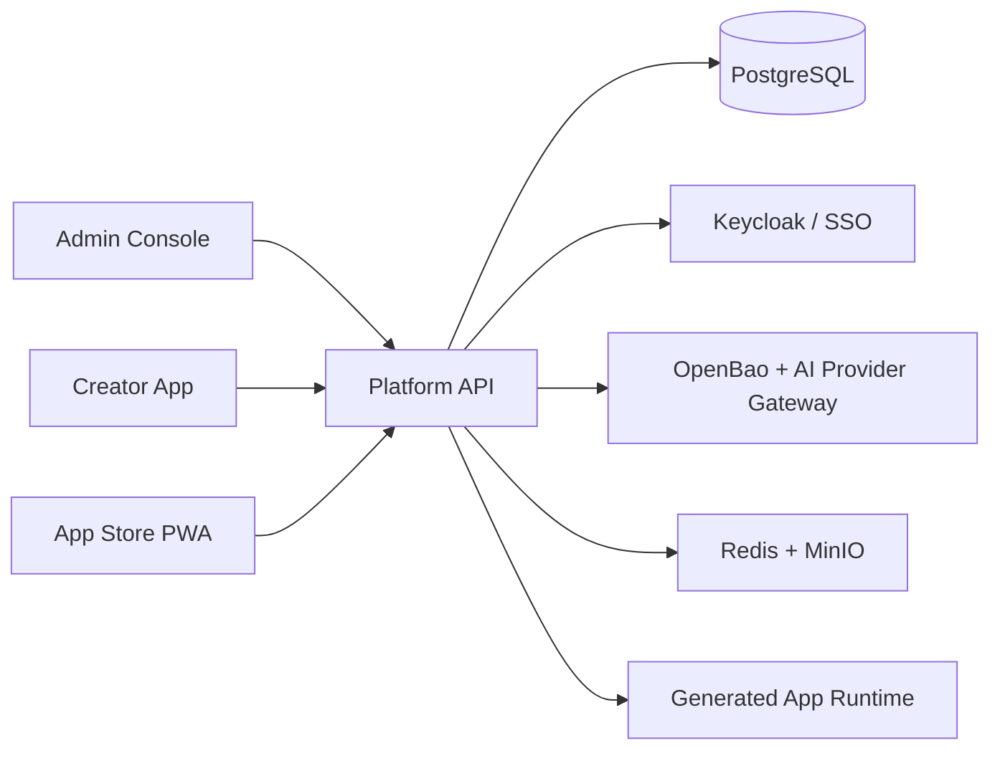

<p align="center">
  
</p>

<h1 align="center">Horizon</h1>

<p align="center">
  <strong>Enterprise AI application builder for secure, governed internal software.</strong>
</p>

<p align="center">
  Govern AI-assisted application delivery from idea and PRD to deployment, access management, and operations—in your private environment.
</p>

---

## Overview

Horizon is an enterprise vibe-coding platform for teams that need to create internal web applications with the speed of AI and the controls of a production platform. It combines governed AI workflows, application lifecycle management, identity, security, and operational evidence in one private-server-ready workspace.

The repository is a pnpm monorepo containing the platform services and three focused product surfaces:

| Surface           | Audience                                  | Purpose                                                                                                |
| ----------------- | ----------------------------------------- | ------------------------------------------------------------------------------------------------------ |
| **Admin Console** | IT, security, and platform administrators | Govern providers, access, policies, operations, licenses, and release readiness.                       |
| **Creator App**   | Business builders and development teams   | Turn a requirement into a PRD, AI workspace, preview, published application, and traceable deployment. |
| **App Store PWA** | Employees and approved end users          | Discover internal apps, request access, and submit support or product feedback.                        |
| **Platform API**  | All surfaces and integrations             | Provides the platform domain, persistence, identity boundary, governance, and lifecycle APIs.          |

## What Horizon Provides

- **Governed AI delivery** — provider configuration, API-key protection, quotas, guardrails, prompt controls, and usage evidence.
- **Creator workflow** — project setup, PRD baselines, AI-assisted workspace actions, preview checkpoints, and publishing readiness.
- **Enterprise access** — platform and app roles, invitations, access requests, simulated SSO foundation, and break-glass controls.
- **Application lifecycle** — app manifests, deployment traceability, generated-runtime evidence, health checks, and rollback/upgrade visibility.
- **Knowledge and skills governance** — versioned knowledge sources and skills, approval lifecycles, scoped retrieval, and controlled assignment.
- **Private operations** — installer preflight, setup wizard, backups, PITR evidence, observability, licenses, and security release checks.

## Architecture



## Quick Start

### Prerequisites

- Node.js 22 or newer
- pnpm 11.7 or newer
- Docker and Docker Compose (required for the private-server stack)

### Local development

The whole stack runs in containers from a single Compose file — Postgres, Redis, MinIO,
Keycloak, LiteLLM, OpenBao (dev-mode secret store), the Platform API, all three frontends,
and the Caddy reverse proxy. Start everything with one command:

```bash
pnpm dev:setup
```

On a fresh clone, this creates a local `.env` with generated development secrets, validates
the required tools and configuration, starts Compose, applies Prisma migrations, seeds the
database, bootstraps Keycloak, and waits for the API and browser surfaces. Image downloads
and the first dependency install can take several minutes. No extra commands are needed.
Once it is up:

| Surface       | URL                           |
| ------------- | ----------------------------- |
| Admin Console | http://localhost:9800/admin   |
| Creator App   | http://localhost:9800/creator |
| App Store PWA | http://localhost:9800/store   |
| Platform API  | http://localhost:9801         |
| Keycloak      | http://localhost:9805/auth    |
| MinIO console | http://localhost:9807         |

Open http://localhost:9800/admin — a fresh database lands on the first-run setup wizard to
create the organization and first administrator. Source is bind-mounted, so edits hot-reload
in the running containers. Stop the stack with:

```bash
docker compose --env-file .env -f docker/docker-compose.yml down
```

The generated `.env` is gitignored. If an existing `.env` still contains placeholders copied
from `.env.example`, `pnpm dev:setup` replaces only those placeholder secrets and aligns the
PostgreSQL, LiteLLM, and MinIO credentials; real secrets and custom settings are preserved.
Generated local credentials also receive a project-scoped Compose data namespace, so volumes
from an older credential set cannot break a new setup; legacy data volumes are retained.
To intentionally reset all local data and credentials, run the `down` command with `-v`,
remove `.env`, and run `pnpm dev:setup` again.

`pnpm install` is still needed on the host to run the quality gate (`pnpm check`), lint,
typecheck, and tests locally.

### Private-server installation

Create the local environment file and replace every example secret before continuing:

```bash
cp .env.example .env
pnpm install:preflight
pnpm install:plan
pnpm install:real
```

For the complete install flow, operational requirements, and current mock-to-real boundaries, see [the private-server installation guide](./docs/operations/real-mvp-install.md).

## Repository Structure

```text
apps/
  admin-web/       Admin Console
  creator-web/     Creator App
  app-store-pwa/   End User App Store PWA
  platform-api/    Platform domain and API
packages/
  api-client/      Shared API client
  auth-sdk/        Authentication SDK
  config/          Shared configuration
  mock-data/       Deterministic development fixtures
  types/           Shared domain types
  ui/              Shared design system
docker/            Private-server Compose definitions
docs/              Architecture, operations, delivery, and requirements evidence
```

## Quality and Verification

```bash
# Full local quality gate
pnpm check

# Type-check all applications and packages
pnpm typecheck

# Build all applications and packages
pnpm build

# Run unit, integration, and end-to-end tests
pnpm test

# Run the complete Sprint 14 regression suite
pnpm verify:sprint14
```

Run checks only for changes since the main branch in CI or before opening a pull request:

```bash
pnpm check:changed --base origin/main
```

## Documentation

- [Platform service design](./docs/architecture/platform-service-design.md)
- [Private-server installation](./docs/operations/real-mvp-install.md)
- [AI provider secret-store runbook](./docs/operations/ai-secret-store.md)
- [Production candidate readiness](./docs/delivery/production-candidate-readiness.md)

## MVP Progress

**Status legend:** ✅ complete foundation or implemented path · 🟡 in progress / requires pilot verification · ⛔ blocked by an environment or product decision.

Detailed, phase-by-phase release work is tracked in the authoritative [MVP pending-task checklist](./docs/MVP_PENDING_TASKS.md). The summary below is intentionally concise and does not replace its exit gates.

### Completed foundation

- ✅ pnpm monorepo with Admin Console, Creator App, App Store PWA, Platform API, shared packages, Prisma migrations, Compose, and automated verification.
- ✅ Private-stack components for PostgreSQL, Redis, MinIO, Keycloak, LiteLLM, Caddy, Platform API, and all three product surfaces.
- ✅ API-backed core product flows, including key Admin, Creator, publishing, App Store, audit, and ticket paths, with fail-closed behavior when live data is unavailable.
- ✅ Governed AI execution: provider routing and fallback, scoped quota accounting, guardrails, timeout/retry/circuit-breaker controls, and persisted sanitized evidence for usage, latency, tokens, and cost.
- ✅ PostgreSQL-backed platform session verification, refresh/logout/revocation APIs, frontend refresh lifecycle, and Admin session management UI.
- ✅ Restart-safe PostgreSQL AI job worker with encrypted payloads, lease recovery/heartbeat, request idempotency, and persisted execution evidence.
- ✅ Project file/attachment metadata in Prisma with object payloads in MinIO; Creator no longer treats legacy in-memory upload state as authoritative.
- ✅ Immutable generation checkpoints in PostgreSQL, migration-aware rollback protection, restart rehydration, and safe orphan-workspace cleanup.
- ✅ Real workspace generation now waits for preview readiness, FIFO-serializes turns per project while allowing different projects to progress concurrently, and enforces `prepare → actions → validate → commit → migrations → checkpoint`; all migrations from one turn share one transaction, and a failure restores last-known-good source without a checkpoint.
- ✅ Blue-green publish uses unique immutable revision tags/digests and persisted deployment revisions; publish, rollback, and promote compensate persistence failures, failed replacements preserve the healthy route, cross-app rollback stays isolated, and restart rehydration has real local runtime proof.
- ✅ Release ingress publishes only Caddy HTTP/HTTPS; generated apps remain internal and require Platform Auth plus active app/project membership.
- ✅ Local real-Keycloak browser proof for Admin, Creator, and App Store plus live Anthropic calls for all six governed scenarios, quota/guardrail blocking, and fallback recovery.

### In progress: pilot proof

- 🟡 Repeat the proven local Creator-first flows on the clean pilot hostname: live AI change, token-free preview session, publish, and end-user access.
- 🟡 Promote the successful final #149 CI and local workspace/publish restart, rollback, encrypted PostgreSQL/MinIO restore, and provider-outage drills to the operator-owned pilot environment; add registry-outage evidence. See [Phase 7–8 evidence](./docs/operations/phase-7-8-pilot-evidence.md).
- 🟡 Retire remaining legacy-only regression services after every consumer has moved to the Prisma/runtime path.

### Required before a production pilot

- ⛔ Confirm the Phase 0 cutline and environment ownership: DNS/TLS, container registry, backup destination and retention, target IdP, AI provider/model, and release evidence owner.
- ⛔ Initialize operator-owned OpenBao/KMS credentials and an external encrypted backup destination before accepting customer data; the local proof volume is not production ownership.
- 🟡 Close remaining persistence, isolation, security, backup/restore, and rollback gates in the checklist before declaring the MVP pilot-ready.

For installation steps and current operational boundaries, see [the private-server installation guide](./docs/operations/real-mvp-install.md).
