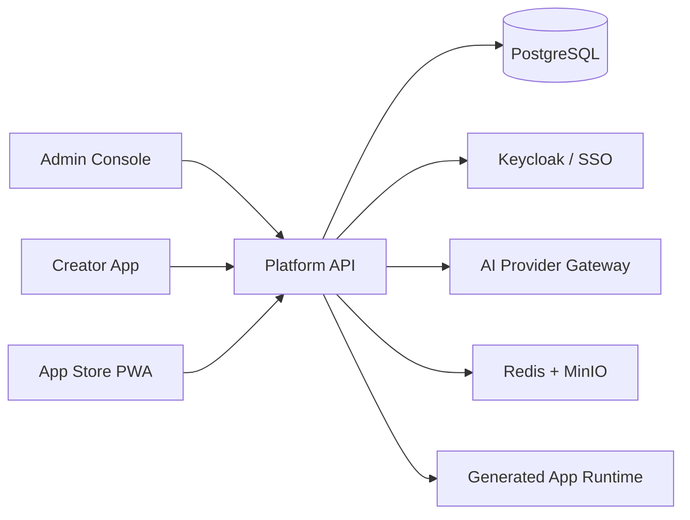

<p align="center">
  
</p>

<h1 align="center">Horizon</h1>

<p align="center">
  <strong>Enterprise AI application builder for secure, governed internal software.</strong>
</p>

<p align="center">
  Govern AI-assisted application delivery from idea and PRD to deployment, access management, and operations—in your private environment.
</p>

---

## Overview

Horizon is an enterprise vibe-coding platform for teams that need to create internal web applications with the speed of AI and the controls of a production platform. It combines governed AI workflows, application lifecycle management, identity, security, and operational evidence in one private-server-ready workspace.

The repository is a pnpm monorepo containing the platform services and three focused product surfaces:

| Surface           | Audience                                  | Purpose                                                                                                |
| ----------------- | ----------------------------------------- | ------------------------------------------------------------------------------------------------------ |
| **Admin Console** | IT, security, and platform administrators | Govern providers, access, policies, operations, licenses, and release readiness.                       |
| **Creator App**   | Business builders and development teams   | Turn a requirement into a PRD, AI workspace, preview, published application, and traceable deployment. |
| **App Store PWA** | Employees and approved end users          | Discover internal apps, request access, and submit support or product feedback.                        |
| **Platform API**  | All surfaces and integrations             | Provides the platform domain, persistence, identity boundary, governance, and lifecycle APIs.          |

## What Horizon Provides

- **Governed AI delivery** — provider configuration, API-key protection, quotas, guardrails, prompt controls, and usage evidence.
- **Creator workflow** — project setup, PRD baselines, AI-assisted workspace actions, preview checkpoints, and publishing readiness.
- **Enterprise access** — platform and app roles, invitations, access requests, simulated SSO foundation, and break-glass controls.
- **Application lifecycle** — app manifests, deployment traceability, generated-runtime evidence, health checks, and rollback/upgrade visibility.
- **Knowledge and skills governance** — versioned knowledge sources and skills, approval lifecycles, scoped retrieval, and controlled assignment.
- **Private operations** — installer preflight, setup wizard, backups, PITR evidence, observability, licenses, and security release checks.

## Architecture



## Quick Start

### Prerequisites

- Node.js 22 or newer
- pnpm 11.7 or newer
- Docker and Docker Compose (required for the private-server stack)

### Local development

```bash
pnpm install
pnpm dev
```

Run a single surface or the API when needed:

```bash
pnpm dev:admin
pnpm dev:creator
pnpm dev:store
pnpm dev:api
```

### Private-server installation

Create the local environment file and replace every example secret before continuing:

```bash
cp .env.example .env
pnpm install:preflight
pnpm install:plan
pnpm install:real
```

For the complete install flow, operational requirements, and current mock-to-real boundaries, see [the private-server installation guide](./docs/operations/real-mvp-install.md).

## Repository Structure

```text
apps/
  admin-web/       Admin Console
  creator-web/     Creator App
  app-store-pwa/   End User App Store PWA
  platform-api/    Platform domain and API
packages/
  api-client/      Shared API client
  auth-sdk/        Authentication SDK
  config/          Shared configuration
  mock-data/       Deterministic development fixtures
  types/           Shared domain types
  ui/              Shared design system
docker/            Private-server Compose definitions
docs/              Architecture, operations, delivery, and requirements evidence
```

## Quality and Verification

```bash
# Full local quality gate
pnpm check

# Type-check all applications and packages
pnpm typecheck

# Build all applications and packages
pnpm build

# Run unit, integration, and end-to-end tests
pnpm test

# Run the complete Sprint 14 regression suite
pnpm verify:sprint14
```

Run checks only for changes since the main branch in CI or before opening a pull request:

```bash
pnpm check:changed --base origin/main
```

## Documentation

- [Platform service design](./docs/architecture/platform-service-design.md)
- [Private-server installation](./docs/operations/real-mvp-install.md)
- [Production candidate readiness](./docs/delivery/production-candidate-readiness.md)

## Current Status

Horizon includes the Sprint 0–14 MVP and production-hardening foundation: governed AI workflows, creator-to-publish lifecycle, App Store feedback loop, identity and runtime controls, knowledge governance, install/backup operations, observability, licensing, and security release readiness.

The private-server install and core persistence work is in progress. Refer to the [installation guide](./docs/operations/real-mvp-install.md) for the supported path and remaining mock-to-real work.
