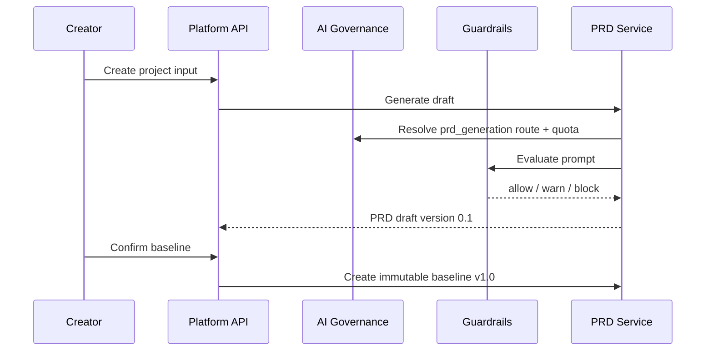

# ADR-006: PRD Version and Baseline Lifecycle

**Status:** Accepted  
**Date:** 2026-07-03  
**Deciders:** Product Owner, Software Architect, Creator, Security Admin

## Context

Sprint 3 makes PRD the source of truth before generated app work begins. Later sprints depend on a stable PRD baseline for app generation, version restore, publish traceability, ticket-to-PRD change requests and audit evidence.

Related scope: Sprint 3 project creation, PRD generation, PRD viewer, version history and baseline confirmation.

## Decision

Each project has one `PrdDocument`. A document has many `PrdVersion` records and each version has ordered `PrdSection` records.

Generated drafts are mutable only by creating a new draft version. Confirming a baseline creates a new immutable `PrdVersion` with `version = "1.0"`, `status = "baseline"` and `isBaseline = true`. The document stores `currentVersionId` and `baselineVersionId` as pointers; it does not mutate the original draft in place.

PRD draft generation must pass through Sprint 2 governance before a version is created:

## Options Considered

| Option | Pros | Cons | Verdict |
| --- | --- | --- | --- |
| Store one mutable PRD JSON blob on `Project` | Simple and fast | No audit-friendly history, weak traceability, baseline can drift | Rejected |
| Document + version + section tables | Traceable, section-level review, supports baseline and future change requests | More schema and service logic | Accepted |
| Store PRD as generated files only | Easy export story | Harder API queries, permissions and baseline state | Rejected for MVP |

## Consequences

- Sprint 4 workspace can require `baselineVersionId` before app generation.
- Sprint 5 restore and Sprint 8 ticket-to-PRD can append versions without overwriting v1.0.
- Every baseline confirmation emits an audit event.
- Future edits must create new versions rather than mutating the confirmed baseline.
