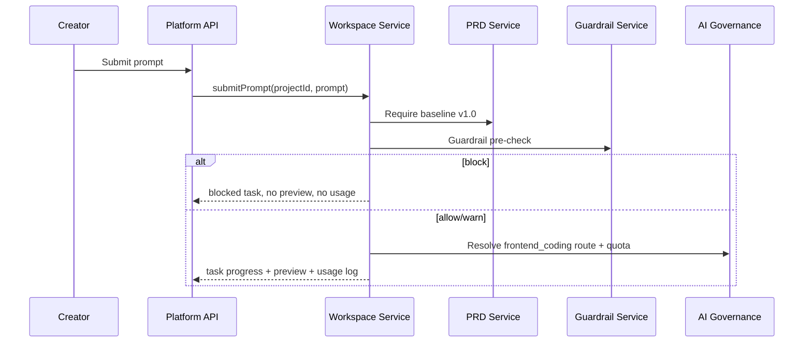

# ADR-007: Workspace Task, Preview and Usage Records

**Status:** Accepted  
**Date:** 2026-07-03  
**Deciders:** Product Owner, Software Architect, Creator, Security Admin

## Context

Sprint 4 introduces the Creator Workspace where a prompt creates an AI task, updates a live preview and consumes governed AI quota. Sprint 5 will use preview output for frontend version restore, and Sprint 8 will need traceability from ticket or prompt through PRD, preview and deployment.

## Decision

Workspace prompt execution is stored as separate records:

- `WorkspaceTask` stores prompt, status and guardrail decision.
- `WorkspaceTaskStep` stores deterministic progress steps.
- `PreviewVersion` stores the latest mock generated preview.
- `AiUsageLog` stores prompt, route/model and token usage.

The prompt pipeline requires a confirmed PRD baseline before any workspace task can be accepted.

## Alternatives Considered

| Option | Pros | Cons | Verdict |
| --- | --- | --- | --- |
| Keep workspace state only in frontend mock data | Fast UI build | No API contract, no usage/audit trail, Sprint 5 cannot consume output | Rejected |
| Store one JSON blob per workspace | Simple schema | Harder query and traceability, weak version boundary | Rejected |
| Store task, step, preview and usage records | Clear flow evidence, supports restore/traceability, testable deny paths | More tables and service code | Accepted |

## Consequences

- Prompt block path is explicit: guardrail event and blocked task exist, but preview/usage do not update.
- Accepted prompt path creates task progress, preview version and usage log.
- Sprint 5 can build frontend checkpoint/restore on top of `PreviewVersion`.
- Token usage and route/model metadata are available for audit and reporting.
