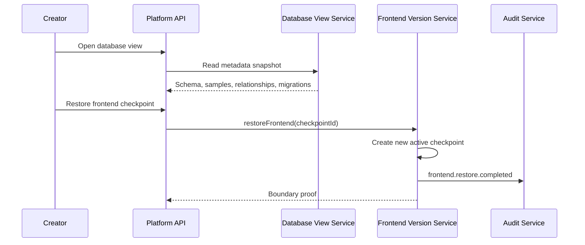

# ADR-008: Database View and Frontend Restore Boundary

**Status:** Accepted  
**Date:** 2026-07-03  
**Deciders:** Product Owner, Software Architect, Creator, Security Admin

## Context

Sprint 5 adds business-friendly database visibility and frontend version restore. The platform must let Creators inspect generated app structure without exposing raw SQL or mutation tools, and restore frontend versions without changing backend, database, auth, app roles, membership, domains or PRD baseline.

## Decision

Database visibility is served through platform-owned metadata records:

- `AppDatabaseTable`
- `AppDatabaseColumn`
- `AppDatabaseRelationship`
- `AppDatabaseSampleRecord`
- `AppDatabaseMigration`

Frontend restore is based on `FrontendCheckpoint`, not direct `PreviewVersion` mutation. `PreviewVersion` remains display output from Sprint 4, while `FrontendCheckpoint` is the restore unit and active frontend pointer.

## Alternatives Considered

| Option | Pros | Cons | Verdict |
| --- | --- | --- | --- |
| Query generated app database directly | Real-time data | Exposes production data/SQL risks too early for MVP | Rejected |
| Store database view as one JSON blob | Fast to build | Weak table/relationship/migration contracts | Rejected |
| Store structured metadata and sample records | Testable, safe, business-friendly, supports Sprint 6 publish traceability | More models and seed data | Accepted |
| Restore by mutating preview records | Simple | Blurs display output and restore source of truth | Rejected |
| Restore by creating frontend checkpoints | Clear audit, compare, active version and publish reference | More service logic | Accepted |

## Consequences

- Creator database view is read-only and does not expose raw SQL.
- Frontend restore creates a new checkpoint and audit event.
- Restore boundary is explicit and testable.
- Sprint 6 publish can reference the active frontend checkpoint.
