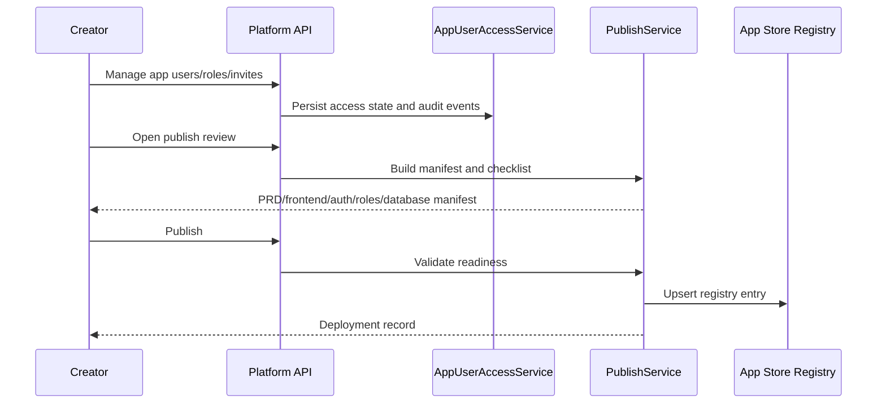

# ADR-009: App Access, Manifest and Publish Registry

**Status:** Accepted  
**Date:** 2026-07-03  
**Issue:** #5  
**Deciders:** Product Owner, Software Architect, Creator, Security Admin

## Context

Sprint 6 turns a generated app from a Creator workspace into a governed App Store entry. Publish must not be a visual-only state: it must reference the PRD baseline, active frontend checkpoint, auth mode, app roles, database schema and deployment record so Sprint 7 can consume registry/access state.

## Decision

The Platform API owns two focused services:

- `AppUserAccessService` for app roles, members, invitations and access requests.
- `PublishService` for app manifest generation, readiness checklist, publish request, deployment record and App Store registry entry.

The manifest is generated from platform-owned sources instead of free-form Creator input.

## Alternatives Considered

| Option | Pros | Cons | Verdict |
| --- | --- | --- | --- |
| Static Creator publish UI only | Fast demo | No registry/access contract for Sprint 7 | Rejected |
| Full separate production container deployment now | Closer to long-term production | Larger than Sprint 6 MVP scope | Rejected |
| Platform-owned manifest + registry publish | Testable, auditable, matches roadmap dependency | Requires new schema/API contracts | Accepted |

## Consequences

- External invites remain `approval_required` until a policy path clears them.
- Publish blocks with explicit checklist items when PRD baseline or active frontend checkpoint is missing.
- Published apps create deployment records and registry entries.
- Sprint 7 can query registry/access state instead of reconstructing it from Creator UI.
