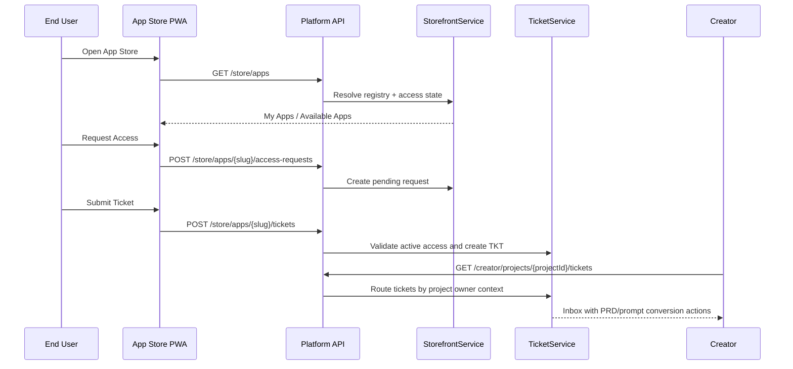

# ADR-010: Storefront PWA and Support Ticket Loop

**Status:** Accepted  
**Date:** 2026-07-03  
**Issue:** #7  
**Deciders:** Product Owner, Software Architect, Creator, End User, Security Admin

## Context

Sprint 7 turns the published registry from Sprint 6 into an End User App Store PWA. End Users need a mobile-first storefront that reflects app access state, allows access requests and sends bug/feedback/feature tickets back to the Creator. This must be a platform-owned workflow rather than a visual-only PWA because Sprint 8 depends on converting ticket feedback into PRD change requests.

## Decision

The Platform API owns two focused services:

- `StorefrontService` for My Apps, Available Apps, app detail, notification state and access requests.
- `TicketService` for submitted tickets, submitter-scoped status views and Creator ticket inbox routing.

The storefront consumes the App Store registry produced by `PublishService`, and ticket creation is allowed only when the End User has active access to the app.

## Alternatives Considered

| Option | Pros | Cons | Verdict |
| --- | --- | --- | --- |
| Static PWA mock only | Fast visual demo | No ticket/access contract, Sprint 8 blocked | Rejected |
| Reuse Creator access endpoints directly in PWA | Less API surface | Leaks creator-side management semantics to End User | Rejected |
| Dedicated storefront and ticket services | Clear boundaries, testable permissions, Sprint 8-ready | Adds schema/API contracts | Accepted |

## Consequences

- App Store visibility is derived from publish registry plus app access state.
- Duplicate pending access requests return the existing pending request.
- Ticket creation is denied for unknown or non-visible apps.
- End Users can see only their own ticket status, while Creators/Admins can see project inbox.
- Creator inbox actions explicitly include `convert_to_prd_change` and `convert_to_ai_prompt` for Sprint 8.
