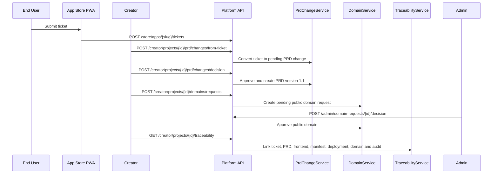

# ADR-011: Ticket-to-PRD Change, Domain Governance and MVP Traceability

**Status:** Accepted
**Date:** 2026-07-04
**Issue:** #9
**Deciders:** Product Owner, Software Architect, Creator, IT Admin, QA

## Context

Sprint 8 closes the MVP feedback loop. Sprint 7 created an End User App Store PWA and ticket inbox, but the MVP is not usable for a pilot unless feedback can become governed requirement work, approved PRD versions can be traced to deployment evidence, and public domain exposure is controlled by IT/Admin policy.

The platform must support this without turning the MVP into production observability or TLS automation. Those deeper production controls remain later sprint work. Sprint 8 needs a reliable pilot-grade loop that can be tested end to end.

## Decision

The Platform API owns four focused Sprint 8 services:

- `PrdChangeService` converts tickets into PRD change requests, prevents duplicate conversion, records approval decisions and links approved changes to new PRD versions.
- `DomainService` stores per-project domain settings and public domain requests, with Admin approval before public exposure.
- `TraceabilityService` produces a single linked evidence record across ticket, PRD change, PRD version, frontend checkpoint, manifest, deployment, domain and audit events.
- `MonitoringService` exposes MVP dashboard data for service health, app health, ticket counts, domain requests, provider calls, guardrails and recent audit events.

The Creator UI exposes Ticket-to-PRD, PRD Change Requests, Domain Settings, Deployment Traceability and MVP Demo Checklist panels. The Admin UI exposes MVP Monitoring, Service Health, Ticket Counts, Domain Requests and Audit Filters. These screens reuse `@evcp/ui` primitives and Sprint 8 CSS patterns rather than adopting a large visual component framework.

## Alternatives Considered

| Option | Pros | Cons | Verdict |
| --- | --- | --- | --- |
| Convert tickets directly into prompts | Fast path to app changes | Loses requirement governance and PRD history | Rejected |
| Put domain approval inside publish only | Fewer endpoints | Cannot track public exposure request lifecycle independently | Rejected |
| Full production observability stack in Sprint 8 | Stronger operations story | Too large for MVP closeout; belongs to production extension | Rejected |
| Dedicated PRD change, domain, traceability and monitoring services | Clear boundaries, testable lifecycle, pilot-ready evidence | Adds schema/API surface | Accepted |

## Consequences

- A ticket can produce at most one PRD change request.
- Approved PRD changes create a new linked PRD version instead of mutating the baseline.
- Public domain requests remain pending until an Admin decision is recorded.
- Traceability is queryable as one evidence object for the pilot demo.
- Audit filtering is available for security-sensitive events such as PRD approval and domain approval.
- `@evcp/ui` remains the visual foundation; future UI libraries should provide behavior/accessibility primitives rather than replace the product design language.
