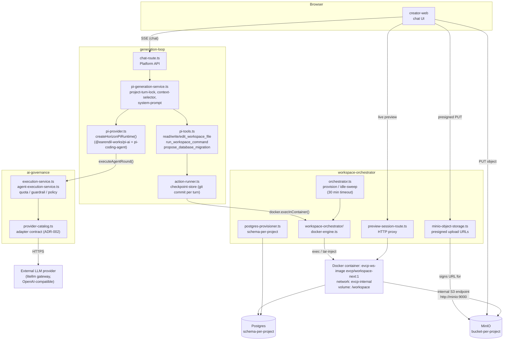

# Agent Runtime: Pi, Docker, and MinIO

## Purpose

This document explains how the generation-loop agent ("Pi") works together with the Docker workspace containers and MinIO object storage during a Creator chat turn. It is a companion to [`platform-service-design.md`](./platform-service-design.md) (system-wide context) and to [ADR-002](./ADR-002-ai-provider-adapter-architecture.md) (provider adapter contract) and [ADR-003](./ADR-003-generated-app-container-and-schema-isolation.md) (container/schema isolation), which record the decisions behind this shape.

## System Diagram

## Turn Flow

1. **Chat in** — `creator-web` opens an SSE connection to `chat-route.ts` in Platform API (`apps/platform-api/src/generation-loop/chat-route.ts`).
2. **Turn setup** — `pi-generation-service.ts` acquires a per-project turn lock, selects context files (`context-selector.ts`), and builds the system prompt (`system-prompt.ts`) for the current agent mode (`auto` / `plan` / `build`).
3. **Model round** — `pi-provider.ts` (`createHorizonPiRuntime`) drives a `ModelRuntime` from `@earendil-works/pi-ai` / `@earendil-works/pi-coding-agent`. It does not call an LLM directly: every round goes through `ai-governance/execution-service.ts` (`executeAgentRound`), which applies quota checks, guardrails, and provider fallback before dispatching to an external provider through the ADR-002 adapter contract (typically the `litellm` gateway service).
4. **Tool calls** — When the model wants to act, Pi calls one of the tools registered in `pi-tools.ts:44` (`read_workspace_file`, `write_workspace_file`, `edit_workspace_file`, `run_workspace_command`, `propose_database_migration`). These never touch the host filesystem; they go through `action-runner.ts`, which calls `docker.execInContainer()` (or `tar-inject.ts` for bulk writes) against the project's container.
5. **Container execution** — `workspace-orchestrator/docker-engine.ts` (`buildDevContainerSpec`) runs the command/file write inside `evcp-ws-<slug>`, the container provisioned for that project by `orchestrator.ts`. Each container is isolated: its own name, its own `/workspace` volume, and the shared `evcp-internal` Docker network (ADR-003: separate container + schema-per-app, not a shared runtime).
6. **Checkpointing** — After a successful file/edit/migration action, `checkpoint-store.ts` commits the workspace state to the project's git repo inside the container, so turns are restorable (`workspace-restore.ts`).
7. **Preview** — `preview-session-route.ts` proxies HTTP requests from Platform API to port `3000` inside the container, so `creator-web` can render a live preview without the container ever publishing a port to the host.

## Where MinIO Fits

MinIO is used two different ways, deliberately kept apart:

- **Container-side**: the workspace container talks to MinIO over the internal Docker network (`http://minio:9000`) for whatever the generated app itself needs from object storage.
- **Browser-side**: `minio-object-storage.ts` issues **presigned PUT URLs** so `creator-web` can upload project files (e.g. reference assets) directly to MinIO, bypassing Platform API for the actual bytes. The presigned URL is built from a public base URL (`EVCP_S3_PUBLIC_URL`) that is intentionally distinct from the internal `minio:9000` hostname, so the internal Docker hostname never leaks to the browser.

Each project gets its own bucket (`bucketNameFor` in `resource-ports.ts`), mirroring the schema-per-project pattern used for Postgres.

## Where Postgres Fits (for completeness)

Migrations proposed by Pi (`propose_database_migration`) are buffered per turn, materialized as files inside the container by `action-runner.ts` (`syncMigrationArtifacts`), and then run against the project's dedicated Postgres **schema** (not a dedicated database — see ADR-003 for why schema-per-app was chosen over container/database-per-app) via `pg-runner.ts` / `postgres-provisioner.ts`.

## Lifecycle

- Containers are provisioned on demand by `orchestrator.ts` and reaped after `IDLE_TIMEOUT_MS` (30 minutes) of inactivity by `idle-sweep.ts`.
- Orphaned Docker/Postgres/MinIO resources from crashed provisioning attempts are cleaned up by `cleanupOrphanWorkspaceResources` in `workspace-lifecycle.ts`.
- Workspace container state (id, ports, status) is persisted through `WorkspaceRuntimeRecordStore` (`persistence/workspace-runtime-repository.ts`, see [ADR-013](./ADR-013-workspace-runtime-record-persistence.md)) so it survives a Platform API restart.

## Key Files

| Concern | File |
| --- | --- |
| Chat entry point (SSE) | `apps/platform-api/src/generation-loop/chat-route.ts` |
| Turn orchestration | `apps/platform-api/src/generation-loop/pi-generation-service.ts` |
| Pi model runtime | `apps/platform-api/src/generation-loop/pi-provider.ts` |
| Pi tool definitions | `apps/platform-api/src/generation-loop/pi-tools.ts` |
| Action execution (→ Docker) | `apps/platform-api/src/generation-loop/action-runner.ts` |
| Governed LLM dispatch | `apps/platform-api/src/ai-governance/execution-service.ts` |
| Provider adapter contract | `apps/platform-api/src/ai-governance/provider-catalog.ts` |
| Container lifecycle | `apps/platform-api/src/workspace-orchestrator/orchestrator.ts` |
| Docker exec/spec | `apps/platform-api/src/workspace-orchestrator/docker-engine.ts` |
| MinIO presigned uploads | `apps/platform-api/src/workspace-orchestrator/minio-object-storage.ts` |
| Postgres schema-per-project | `apps/platform-api/src/workspace-orchestrator/postgres-provisioner.ts` |
| Live preview proxy | `apps/platform-api/src/workspace-orchestrator/preview-session-route.ts` |
