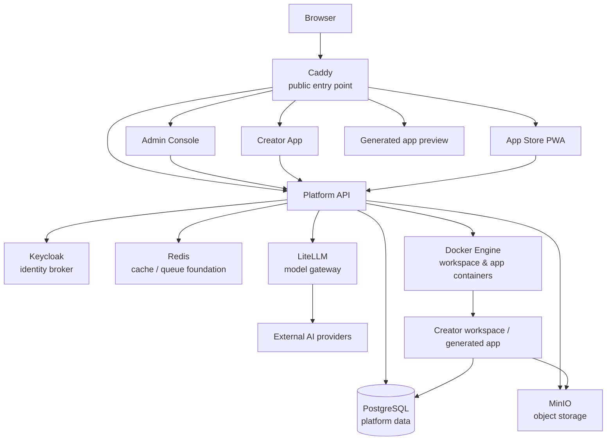
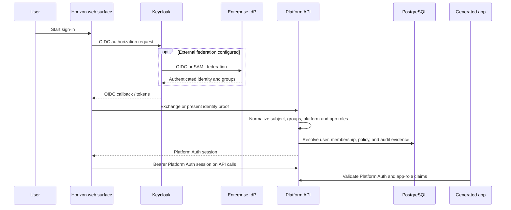
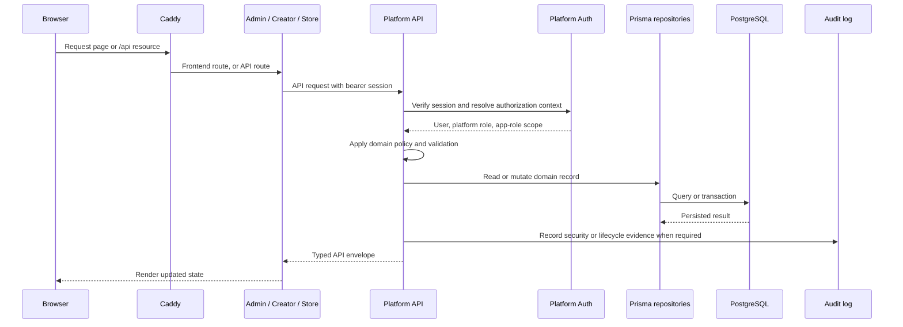
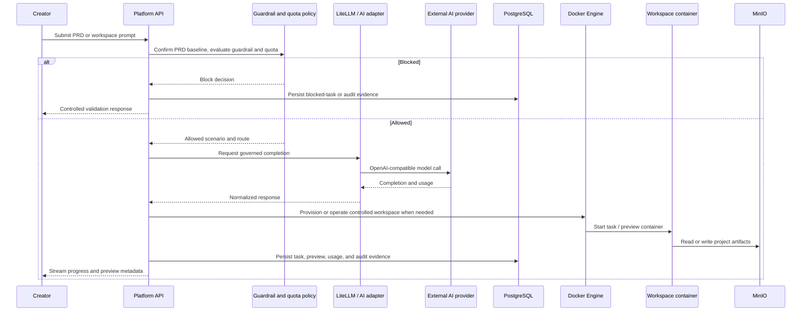

# Horizon Platform Service Design

## Purpose

This document explains how Horizon's private-server services work together. It is the operational architecture companion to the product requirements and installation guide: use it to understand request routing, identity, persistence, AI generation, Creator workspaces, and generated application delivery.

The authoritative deployment definitions are [`docker/docker-compose.yml`](../../docker/docker-compose.yml) for development/private-server integration and [`docker/docker-compose.release.yml`](../../docker/docker-compose.release.yml) for release images.

## Scope and Implementation Status

Horizon is designed for a single organization operating a private-server deployment. Caddy exposes the platform to browsers; internal services communicate on the `evcp-internal` Docker network.

The following distinction matters:

| Area                   | Target design                                                                                                                                | Current implementation                                                                                                                                                |
| ---------------------- | -------------------------------------------------------------------------------------------------------------------------------------------- | --------------------------------------------------------------------------------------------------------------------------------------------------------------------- |
| Browser authentication | Keycloak OIDC/SAML login normalizes into a Platform Auth session.                                                                            | Keycloak is deployed, while the browser callback is still being wired. A simulated login issues signed `evcp_session` bearer tokens for the current integration path. |
| Persistence            | Platform domain state is stored through Prisma in PostgreSQL.                                                                                | `EVCP_CORE_PERSISTENCE=prisma` enables the repository-backed routes; some sprint services are still migrating from deterministic in-memory state.                     |
| AI gateway             | All AI scenarios use a governed gateway with provider policy, quota, guardrails, audit, and a LiteLLM runtime path for workspace generation. | The OpenAI-compatible adapter and deterministic test path are available. More scenarios are still being migrated to the common gateway.                               |
| Generated app runtime  | Platform API provisions and manages isolated workspace/runtime containers.                                                                   | The real Docker, PostgreSQL, MinIO, and LiteLLM adapters are enabled when the required environment variables are configured.                                          |

See [Real MVP private-server installation](../operations/real-mvp-install.md) for the supported installation path and remaining mock-to-real work.

## System Context

## Service Responsibilities

| Service           | Responsibility                                                                                                                                       | Depends on                                                                   | Does not own                                                                  |
| ----------------- | ---------------------------------------------------------------------------------------------------------------------------------------------------- | ---------------------------------------------------------------------------- | ----------------------------------------------------------------------------- |
| **Caddy**         | Public HTTP(S) entry point, path routing, asset compression, and immediate SSE flushing for `/api/*`.                                                | Admin, Creator, App Store, Platform API.                                     | Identity, domain authorization, or application data.                          |
| **Admin Console** | Administrative UI for AI governance, identity/security readiness, installer, backup/restore, observability, and licensing.                           | Platform API through `/api`.                                                 | Direct database, Keycloak, or provider-key access.                            |
| **Creator App**   | Project, PRD, workspace, preview, user/access, and publish experience.                                                                               | Platform API through `/api`; generated preview through `/preview/*`.         | Infrastructure provisioning and raw provider credentials.                     |
| **App Store PWA** | App discovery, access requests, tickets, and end-user status.                                                                                        | Platform API through `/api`.                                                 | App authorization decisions and platform persistence.                         |
| **Platform API**  | The system of record for domain rules: Platform Auth, role mapping, PRD/workspace/publish flows, provider policy, audit evidence, and orchestration. | PostgreSQL, MinIO, LiteLLM, Docker Engine; Keycloak in the target auth flow. | Browser rendering or direct enterprise-IdP integration by generated apps.     |
| **Keycloak**      | Default bundled identity broker for local users and federated OIDC/SAML identity sources.                                                            | Its realm, clients, groups, and configured external IdPs.                    | Horizon business roles, app access decisions, or generated app business data. |
| **PostgreSQL**    | Durable platform records, Prisma migrations, seeded platform data, and the LiteLLM database.                                                         | Persistent volume and Platform API migrations.                               | Object artifacts and browser sessions.                                        |
| **Redis**         | Cache and queue foundation for platform services.                                                                                                    | Persistent/managed Redis deployment when production durability is required.  | Authoritative records or secrets.                                             |
| **MinIO**         | S3-compatible storage for artifacts, workspace buckets, backups, and upload-related objects.                                                         | Persistent volume, access credentials.                                       | Relational domain data and authorization decisions.                           |
| **LiteLLM**       | OpenAI-compatible gateway for coding/workspace model completion and per-workspace gateway keys.                                                      | PostgreSQL `litellm` database and configured external provider credentials.  | Horizon guardrail, quota, or audit policy decisions.                          |
| **Docker Engine** | Creates, starts, inspects, and removes controlled workspace and generated-app containers.                                                            | Docker socket mounted only into Platform API; approved workspace image.      | API authorization and user-provided infrastructure setup.                     |

## Public Routing and Trust Boundary

Caddy is the only browser-facing router in the Compose topology. It maps paths to a surface without giving frontend containers direct credentials to internal infrastructure.

| Public route | Destination   | Notes                                                                                                                                             |
| ------------ | ------------- | ------------------------------------------------------------------------------------------------------------------------------------------------- |
| `/`          | Admin Console | Default administrative surface.                                                                                                                   |
| `/creator/*` | Creator App   | Creator UI and assets.                                                                                                                            |
| `/store/*`   | App Store PWA | End-user app catalog and ticket UI.                                                                                                               |
| `/apps/*`    | App Store PWA | Rewritten to the store route namespace.                                                                                                           |
| `/api/*`     | Platform API  | `/api` is removed before forwarding. Response compression is disabled and `flush_interval -1` is used to preserve streaming generation responses. |
| `/preview/*` | Platform API  | Platform API applies the preview/runtime route and authorization boundary.                                                                        |

The web surfaces use the shared `@evcp/api-client`. In private-server mode they call `/api`; local development can opt into `VITE_PLATFORM_API_BASE_URL` for a direct API endpoint.

## Identity and Authorization Design

### Target login flow

Keycloak is Horizon's default identity broker. It can host local identities or broker enterprise OIDC/SAML providers. Horizon applications and generated apps do not consume raw Keycloak or external-IdP claims directly; they consume the stable Platform Auth contract.

### Platform Auth boundary

The Platform API owns normalization and authorization. A Platform Auth session carries a stable subject, email, name, groups, platform roles, and per-app roles. Generated apps validate only this contract; they do not receive IdP metadata, enterprise certificates, provider secrets, or Keycloak administration access.

The default Keycloak contract is documented in [ADR-005](./ADR-005-auth-broker-and-external-idp-strategy.md): realm `evcp`, distinct clients for Platform API/Admin/Creator/generated apps, and group-to-platform-role mapping.

### Current migration path

The compose stack includes Keycloak, but the browser OIDC callback/token exchange is not yet complete. Current web surfaces call a simulated SSO endpoint, store a signed `evcp_session`, and send it as `Authorization: Bearer ...`. An explicit mock-header fallback remains for development and regression migration only. Do not treat this fallback as a production authentication solution.

## Platform Request and Persistence Flow

`EVCP_CORE_PERSISTENCE` selects the Platform API repository mode:

| Mode     | Intended use                                                                    |
| -------- | ------------------------------------------------------------------------------- |
| `memory` | Deterministic local and automated tests without a database dependency.          |
| `prisma` | Private-server runtime using `DATABASE_URL` and the Prisma-backed repositories. |
| `legacy` | Temporary compatibility path while older services migrate.                      |

Prisma migrations and seeding occur before Platform API starts in the Compose development stack. The database stores platform data such as users/roles, projects, PRD baselines, workspace evidence, app access/publish records, tickets, audit evidence, policy configuration, and operations metadata.

## AI and Creator Workspace Flow

Horizon keeps governance decisions inside Platform API even when a model request is delegated to LiteLLM or an external provider. This prevents a workspace container or browser client from bypassing quota, guardrail, routing, or audit controls.

### Why LiteLLM is separate

LiteLLM acts as the model-runtime gateway for workspace flows and can issue/revoke scoped model keys. It holds provider connectivity; Platform API remains responsible for Horizon's own provider policy, secret redaction, guardrails, quotas, role checks, and audit trail. LiteLLM uses a separate `litellm` PostgreSQL database in the release Compose deployment.

### Workspace isolation

Platform API has access to the Docker socket and provisions containers from the approved workspace image. It supplies only the resolved project configuration required by a workspace: an app-scoped database/schema boundary, an app-scoped MinIO bucket, and a gateway credential. Workspace secrets are encrypted before persistence; plaintext is not stored in PostgreSQL. The browser talks to the workspace through Platform API/Caddy routes, not a public Docker socket.

## Publish and Generated Application Flow

1. The Creator confirms a PRD baseline and produces an approved workspace checkpoint.
2. Platform API evaluates publish readiness against the baseline, app roles, database metadata, and policy constraints.
3. Platform API writes a manifest, deployment record, and App Store registry entry with audit evidence.
4. The Docker-backed publish path commits or starts the generated-app runtime using the platform-provided configuration and network boundary.
5. Caddy directs preview traffic through `/preview/*`; app discovery and access requests go through `/store/*` and Platform API.
6. Health, readiness, logs, metrics, migrations, access, and release checks remain visible to the Admin Console through Platform API rather than being administered inside each generated app.

## Data, Artifact, and Secret Boundaries

| Asset                                      | System of record                                            | Access rule                                                                                       |
| ------------------------------------------ | ----------------------------------------------------------- | ------------------------------------------------------------------------------------------------- |
| Platform domain data and audit evidence    | PostgreSQL                                                  | Platform API and its Prisma repositories; web clients never connect directly.                     |
| File artifacts, workspace objects, backups | MinIO / S3-compatible storage                               | Platform-issued project scope and storage credentials; no shared browser credentials.             |
| AI provider credentials                    | Platform configuration / encrypted secret boundary          | Stored and exposed only as masked or fingerprinted values; never returned to a web client.        |
| Workspace provisioning secrets             | Encrypted persistence plus controlled container environment | Platform API decrypts only to provision the controlled runtime.                                   |
| Platform Auth session                      | Platform API contract                                       | Web surfaces and generated apps use validated bearer/session claims; IdP internals remain hidden. |
| LiteLLM master and scoped gateway keys     | LiteLLM plus Platform API orchestration                     | Master key stays server-side; workspace keys are scoped and revocable.                            |

## Operational Dependencies

| Startup dependency        | Why it is needed                                                                                 |
| ------------------------- | ------------------------------------------------------------------------------------------------ |
| PostgreSQL healthy        | Platform API migrations/seeds and LiteLLM database depend on it.                                 |
| LiteLLM healthy           | Platform API real workspace/generation adapters require it.                                      |
| Redis and MinIO healthy   | Platform API waits for the cache/queue foundation and object storage before starting in Compose. |
| Workspace image available | Release Compose confirms the approved workspace image before Platform API starts.                |
| Platform API available    | All frontend surfaces depend on it; Caddy starts after the surfaces and API are present.         |

Use the installer preflight before deployment. It checks the host, Docker/Compose, ports, DNS/TLS, environment values, and service contract; it also redacts saved setup evidence. See the [installation guide](../operations/real-mvp-install.md).

## Design Rules

- **One authority for business policy:** authorization, guardrails, quotas, app access, and lifecycle decisions live in Platform API.
- **No direct browser-to-infrastructure access:** browsers call Caddy and Platform API; they do not receive database, object-storage, LiteLLM master, or Docker credentials.
- **No direct generated-app-to-IdP coupling:** generated apps depend on Platform Auth, preserving an IdP-independent application contract.
- **Auditable lifecycle:** security-sensitive and lifecycle-changing operations produce traceable records rather than UI-only state.
- **Private-server portability:** Compose is the current deployment mechanism; services use configuration and network boundaries that can migrate to a later orchestrator.

## Related Documentation

- [Private-server installation](../operations/real-mvp-install.md)
- [Platform Auth session runtime](../operations/real-mvp-auth-session.md)
- [Frontend API bootstrap](../operations/real-mvp-frontend-api-bootstrap.md)
- [External AI provider adapter](../operations/real-mvp-ai-provider-adapter.md)
- [Auth broker and external IdP strategy](./ADR-005-auth-broker-and-external-idp-strategy.md)
- [Workspace task, preview, and usage records](./ADR-007-workspace-task-preview-usage-records.md)
