# Production Candidate Readiness

Issue: #23  
Current PR: #22  
Status: Implementation evidence verified on the stacked Sprint 0-14 branch chain; all open stacked PRs are ready for review with clean merge state; external maintainer approval and merge are still required.

## Summary

The planned roadmap ends at Sprint 14. The current implementation proves the MVP pilot and production-hardening criteria through the integrated `pnpm verify:sprint14` regression suite, Prisma migration/seed evidence, Admin UI screenshots and Product Owner acceptance notes.

This document does not introduce Sprint 15. It closes the release-readiness evidence gap by mapping the roadmap's final criteria to authoritative proof and by calling out the remaining external approval/merge work.

## Readiness Criteria

| Release Criterion | Authoritative Evidence | Status |
| --- | --- | --- |
| MVP pilot criteria still pass | `pnpm verify:sprint14` passes unit 65/65, integration 48/48 and E2E/API/UI 49/49, including Sprint 2-8 API/UI coverage | Verified |
| RTM P0 tests pass or have approved exceptions | `docs/requirements/requirements-traceability-matrix.md`, `docs/testing/mvp-sprint-test-plan.md`, Sprint 14 security RTM evidence | Verified |
| OIDC/SAML, break-glass, policy templates and app isolation are production-hardened | Sprint 9 and Sprint 10 delivery notes, PO acceptance docs, tests and screenshots | Verified |
| Installer, backup, restore, upgrade, rollback, observability and license controls pass acceptance tests | Sprint 12 and Sprint 13 delivery notes, DB count evidence and `pnpm verify:sprint13`/`pnpm verify:sprint14` regression | Verified |
| Security hardening covers TLS, secrets, upload validation, public/external app checklist and log redaction | Sprint 14 delivery note, PO acceptance doc, DB counts, screenshots and `pnpm verify:sprint14` | Verified |

## Integrated Flow Coverage

```mermaid
flowchart LR
  A[Admin AI Governance] --> B[Creator Project + PRD]
  B --> C[Creator Workspace + Preview]
  C --> D[Database View + Frontend Restore]
  D --> E[Users + Publish Registry]
  E --> F[App Store PWA + Ticket]
  F --> G[Ticket to PRD + Traceability]
  G --> H[Auth + Runtime Hardening]
  H --> I[Knowledge + Skill Governance]
  I --> J[Installer + Backup + Restore]
  J --> K[Observability + License]
  K --> L[Security Release Readiness]
```

| Integrated Area | Evidence |
| --- | --- |
| Admin governance through AI/guardrail | Sprint 2 unit/E2E tests, Admin UI screenshot/source checks |
| Creator project through PRD baseline and workspace preview | Sprint 3-4 unit/E2E tests and Creator UI evidence |
| Database view, frontend restore, app users and publish | Sprint 5-6 unit/integration/E2E tests |
| End User App Store, ticket loop and Creator PRD change | Sprint 7-8 tests and traceability evidence |
| Production auth/runtime/knowledge/operations/security | Sprint 9-14 tests, Prisma migrations/seeds, screenshots and delivery notes |

## Current Verification

| Gate | Result |
| --- | --- |
| Full regression | `pnpm verify:sprint14` passed: lint, typecheck, build, unit 65/65, integration 48/48, E2E/API/UI 49/49 |
| Sprint 14 database | `security_readiness_reports=1`, `security_readiness_checks=1`, `upload_scan_events=1`, `release_checklist_reports=1`, `sensitive_redaction_evidence=1` |
| Sprint 14 UI evidence | `docs/assets/screenshots/sprint14-security-release-readiness.png`, `docs/assets/screenshots/sprint14-security-release-readiness-mobile.png` |
| Browser console evidence | `docs/assets/screenshots/sprint14-console-warnings.txt` records 0 errors or warnings |

## Open External Actions

The implementation evidence is green, but the work is not merged. Merge requires external maintainer approval because GitHub rejects self-approval.

All open stacked PRs are marked ready for review and currently report clean merge state. Recommended merge order:

1. PR #1 Sprint 3
2. PR #2 Sprint 4
3. PR #4 Sprint 5
4. PR #6 Sprint 6
5. PR #8 Sprint 7
6. PR #10 Sprint 8
7. PR #12 Sprint 9
8. PR #14 Sprint 10
9. PR #16 Sprint 11
10. PR #18 Sprint 12
11. PR #20 Sprint 13
12. PR #22 Sprint 14 and production candidate readiness

## Product Owner Decision

Product Owner acceptance can mark the implementation evidence as ready for external maintainer review. The active implementation goal should remain open until the required external approval/merge state is handled or the user accepts the stacked PR-ready state as the stopping point.
