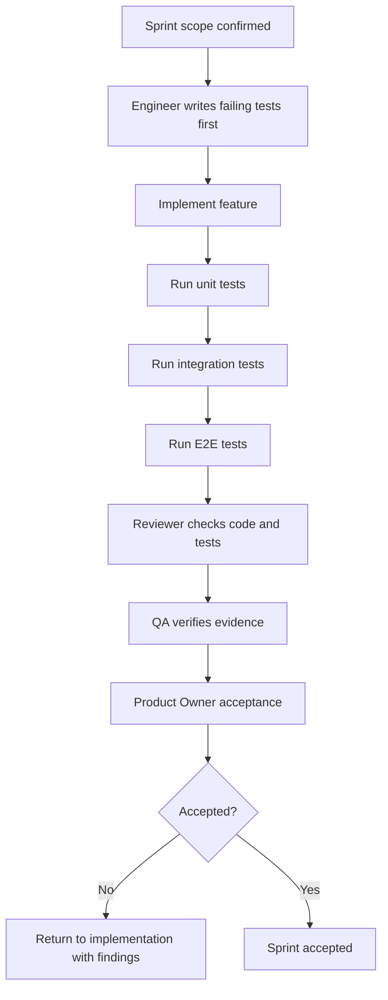

# Sprint Delivery Governance

Version: 0.1
Date: 2026-07-03
Status: Active for implementation

## 1. Purpose

ทุก sprint ต้องส่งมอบงานที่ทำงานร่วมกันได้จริง ไม่ใช่แค่ปิด checklist แยกส่วน เอกสารนี้กำหนด process ตรวจรับแบบ Product Owner, integration-first delivery และ mandatory unit/integration/e2e test gates

## 2. Required Roles

| Role | Responsibility |
| --- | --- |
| Product Owner | Owns sprint acceptance, rejects incomplete/integrated-failing work |
| Engineer | Implements code and unit tests |
| QA | Defines and runs integration/e2e tests and evidence |
| Reviewer | Reviews architecture, correctness, security and test sufficiency |
| Designer | Owns UI acceptance when sprint has user-facing changes |

## 3. Parallel Work Rule

Tasks may run in parallel only when they have a documented integration contract.

| Parallel Work Type | Required Contract |
| --- | --- |
| UI and API | Request/response shape, loading/error states, mock fixture |
| Backend and tests | API contract and seed data |
| Multiple surfaces | Shared component props, shared fixture source |
| Auth and app features | Permission matrix and deny-path tests |
| Publish/runtime and store | App manifest and registry contract |

No sprint is accepted until all parallel work is integrated in one runnable flow.

## 4. Mandatory Gates Per Sprint

| Gate | Required Evidence |
| --- | --- |
| Unit tests | `pnpm test:unit` or equivalent test output |
| Integration tests | `pnpm test:integration` or equivalent test output |
| E2E tests | `pnpm test:e2e` or equivalent test output |
| Build/typecheck | `pnpm build` and `pnpm typecheck` once dependencies are installed |
| Security deny path | At least one negative test for any protected/security-sensitive feature |
| UI evidence | Screenshot/manual evidence for primary user-facing screens |
| PO acceptance | Product Owner checklist signed off in sprint delivery note |

## 5. Product Owner Rejection Rules

Reject the sprint if:

- Any P0 acceptance criterion fails.
- Features work only in isolation but not in the integrated flow.
- Unit tests exist but integration/e2e tests are missing.
- E2E passes only against mocked data when the sprint required real API integration.
- Secrets, API keys or sensitive values are visible in UI/API/logs.
- Audit event is missing for security-sensitive actions.
- UI behavior contradicts the sprint UI spec.
- Regression from a previous sprint breaks without an approved exception.

## 6. Sprint Acceptance Flow

## 7. Delivery Note Requirement

Each sprint must produce a delivery note under `docs/delivery/` with:

- Scope delivered.
- Test commands run.
- Evidence links or command output summary.
- Regression status.
- Product Owner checklist result.
- Known exceptions, if any.

