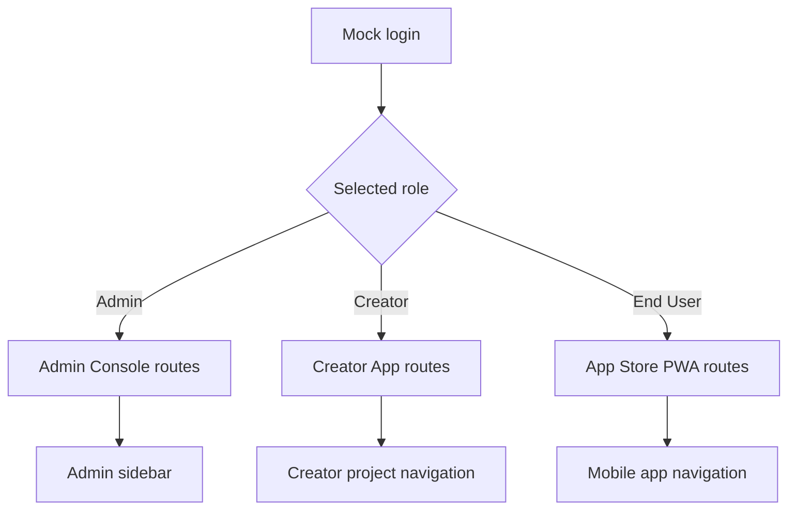

# Sprint 0 UI Spec - Foundation and Design System

Version: 0.1
Date: 2026-07-03
Status: Ready for Sprint 0 implementation
Related plan: `docs/planning/sprint-0-plan.md`

## 1. Design Objective

Sprint 0 must establish the reusable UX/UI foundation for all MVP surfaces. The output is not final branding; it is a stable design system baseline, routing shell, mock-auth behavior and realistic mock data that later sprints can extend without redesigning layout primitives.

## 2. Screens

| Surface | Route | Screen | Purpose |
| --- | --- | --- | --- |
| Admin Console | `/admin` | Dashboard Shell | Show admin navigation, topbar, service overview and placeholders |
| Admin Console | `/admin/ai-keys` | AI Keys Placeholder | Prove admin module routing and table/card patterns |
| Admin Console | `/admin/guardrails` | Guardrails Placeholder | Prove tabbed admin page pattern |
| Creator App | `/creator` | Project Picker Shell | Show Creator entry point and project card pattern |
| Creator App | `/creator/projects/leave-management` | Workspace Skeleton | Show topbar, prompt/preview/right-panel layout |
| App Store PWA | `/store` | Mobile Home Shell | Show PWA mobile-first app discovery layout |
| App Store PWA | `/store/apps/leave-management` | App Detail Placeholder | Show app metadata/action layout |

## 3. Navigation and Role Model

Role switching must immediately change visible routes, sidebar items and shell context. Unauthorized routes show a permission-denied state with a safe navigation action.

## 4. Layout Specifications

### 4.1 Admin Shell

- Desktop layout: fixed left sidebar, topbar, content area.
- Sidebar items: Dashboard, Services, AI Keys, Guardrails, Auth/SSO, Domains, Knowledge, Skills, Deployments, Audit Logs.
- Topbar content: environment badge, current user, critical status indicator.
- Dashboard content: 3 metric cards and service status list.

### 4.2 Creator Shell

- Project Picker: action row, filter tabs, responsive project card grid.
- Workspace Skeleton: topbar, left prompt panel, center preview panel, right context tabs.
- Topbar metadata: project name, PRD version, frontend version, token remaining, publish button.

### 4.3 Store PWA Shell

- Mobile-first single column.
- Header: title, profile action.
- Search input directly below header.
- Sections: My Apps, Available Apps.
- App cards include app name, role/access state and primary action.

## 5. Shared Components

Sprint 0 must create these shared components with stable props:

| Component | Required Behavior |
| --- | --- |
| `AppShell` | Sidebar/topbar/content layout with role-aware navigation |
| `MobileShell` | Mobile header, content and safe bottom spacing |
| `Button` | primary, secondary, ghost, danger; loading and disabled states |
| `Input`, `Textarea`, `Select` | label, helper text, error text, required indicator |
| `Card` | title, metadata, actions, status slot |
| `DataTable` | header, rows, empty state, loading state |
| `Tabs` | active state, disabled state, keyboard access |
| `Badge`, `StatusPill` | success, warning, error, neutral, info |
| `MetricCard` | label, value, trend/status |
| `Timeline` | ordered events with status icons |
| `Modal`, `Drawer` | title, body, sticky footer, cancel/confirm |
| `Toast` | success, warning, error, info |
| `EmptyState` | icon, title, description, action |

## 6. Design Tokens

| Token | Sprint 0 Requirement |
| --- | --- |
| Primary color | Enterprise blue for primary actions and active navigation |
| Neutral colors | Gray scale for chrome, borders, table backgrounds and disabled states |
| Status colors | Green success, amber warning, red error/destructive, blue info |
| Radius | 6-8px for cards and controls |
| Spacing | 4px-based spacing scale |
| Typography | Thai-readable sans-serif stack; fixed responsive scale, no viewport-based font sizing |
| Icons | Use `lucide-react` equivalents for common actions |

## 7. Mock Data Requirements

Use Leave Management as the default demo app across all shells:

- Users: Admin User, Creator User, End User.
- Project: Leave Management, PRD v1.0 draft/baseline, Frontend v1.
- AI providers: OpenAI-compatible primary and fallback mock.
- Guardrails: No Database Dump, Bypass Auth, Public Data.
- App roles: Employee, Manager, HR Admin.
- Tickets: one bug, one feedback, one feature request.

## 8. States

| State | Required UI |
| --- | --- |
| Loading | Skeleton rows/cards, not blank screens |
| Empty | EmptyState with one primary action |
| Permission denied | Clear message and safe route back |
| Error | Message, retry action, trace id placeholder |
| Mock mode | Visible environment badge so users know data is mocked |

## 9. Acceptance Criteria

- [ ] Admin, Creator and Store shells render from shared UI components.
- [ ] Role switch changes navigation and route access.
- [ ] PWA shell is usable at mobile width.
- [ ] Project cards and app cards render Leave Management mock data.
- [ ] Shared components expose loading, empty, disabled and error states.
- [ ] Screenshot evidence exists for Admin Dashboard, Creator Project Picker and Store PWA Home.

