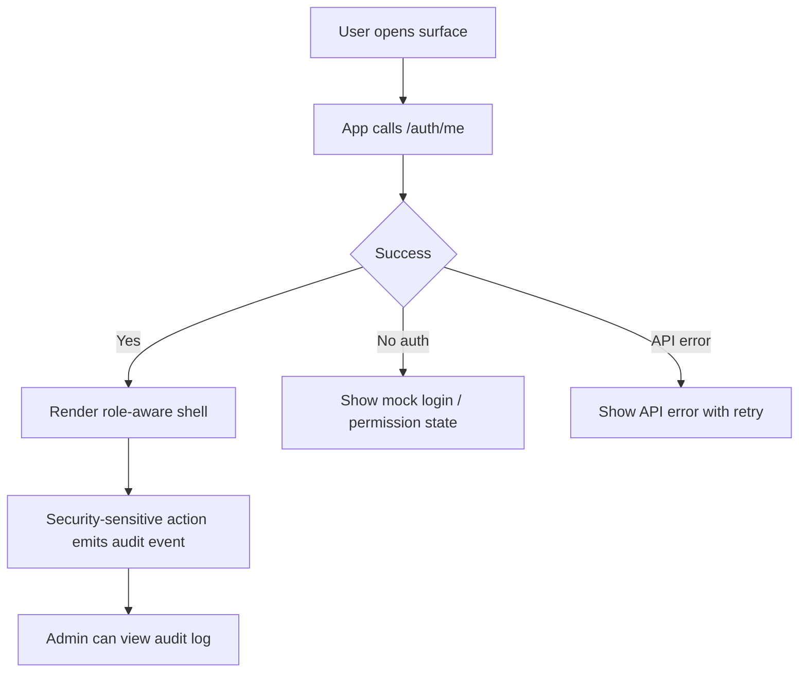

# Sprint 1 UI Spec - Platform API Foundation

Version: 0.1
Date: 2026-07-03
Status: Ready for Sprint 1 implementation
Related plan: `docs/planning/sprint-1-plan.md`

## 1. Design Objective

Sprint 1 is backend-heavy, but it still needs minimal UX patterns for platform identity, API health and audit visibility. The goal is to make API state observable in the shells created in Sprint 0.

## 2. Screens

| Surface | Route | Screen | Purpose |
| --- | --- | --- | --- |
| Admin Console | `/admin/system-health` | API Health Panel | Show Platform API and PostgreSQL connection status |
| Admin Console | `/admin/audit-logs` | Audit Log List | Show initial audit events from seed/auth/project actions |
| Shared/Auth | All surfaces | Current User Widget | Show `GET /auth/me` result and active role |
| Shared/Error | All surfaces | API Error State | Standardize API loading/error/permission states |

## 3. User Flow

## 4. Layout Specifications

### 4.1 Current User Widget

- Location: topbar right side.
- Content: user name, email, role badge.
- Interaction: role switch remains available in mock mode only.
- States: loading current user, failed current user, permission denied.

### 4.2 API Health Panel

- Use metric/status cards for Platform API, PostgreSQL and migration state.
- Show last checked timestamp.
- Include retry refresh action.
- Use status variants: healthy, warning, down.

### 4.3 Audit Log List

- Table columns: Time, Actor, Event, Resource, Severity, Result.
- Filters: actor, event type, severity.
- Detail drawer: request id, resource id, metadata JSON preview.
- Empty state: "ยังไม่มี audit event".

## 5. Components

| Component | Sprint 1 Usage |
| --- | --- |
| `CurrentUserMenu` | Render mock/current user from `/auth/me` |
| `HealthStatusCard` | Show service status |
| `AuditEventTable` | Show audit event rows |
| `AuditEventDrawer` | Inspect event details |
| `ApiStateBoundary` | Loading/error/permission wrapper |

## 6. States

| Scenario | UI Requirement |
| --- | --- |
| API unavailable | Show topbar warning and retry action |
| `/auth/me` fails | Show blocked shell with safe login action |
| Missing permission | Show permission denied page; do not render hidden data |
| Audit empty | Empty state with explanation |
| Audit row selected | Drawer opens without leaving list context |

## 7. Acceptance Criteria

- [ ] All surfaces display current user from API/mock auth state.
- [ ] Admin can see Platform API/PostgreSQL status.
- [ ] Admin can see audit events in a table.
- [ ] API errors use a consistent UI pattern.
- [ ] Permission denied state is distinguishable from network error.

