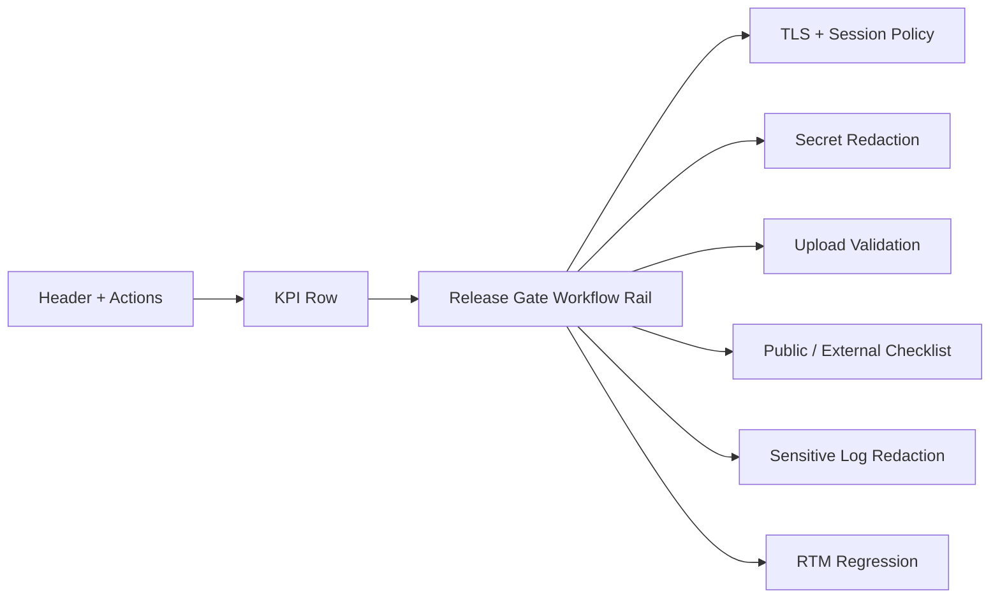

# Sprint 14 UI Spec - Security Release Readiness

## Purpose

The Sprint 14 Admin UI must help IT/Admin and Security Admin decide whether a generated app can be exposed externally or publicly. It is an operational dashboard, not a marketing page.

## Primary Screen

| Shell | Section | Visible Outcome |
| --- | --- | --- |
| Admin Console | Security Release Readiness | TLS/session/security gates, upload quarantine, release checklist, redaction evidence and RTM regression |

## Layout

## Components

- `MetricCard` for TLS Enforcement, Session Policy, Secret Redaction and RTM Regression status.
- `WorkflowRail` for release-gate sequence and blocked public release alert.
- `DataTable` for TLS/session rows, secret surfaces, upload decisions, checklist rows and RTM evidence.
- `DecisionPanel` for blocked public exposure rationale.
- `DefinitionGrid` for sensitive log redaction behavior.
- `ServiceStrip` for API, quarantine, public gate, redaction and RTM service state.

## Responsive Rules

- Desktop: two-column dashboard with workflow rail and evidence grid.
- Mobile: one-column layout, hidden long checklist table and replacement `security-release-mobile-list`.
- All long MIME types, rule names and blocker text must wrap within the card.

## Required Source/Text Contract

- `Security Release Readiness`
- `TLS Enforcement`
- `Session Policy`
- `Secret Redaction`
- `Upload Validation`
- `Public / External Checklist`
- `Sensitive Log Redaction`
- `RTM Regression`
- `security-release-shell`
- `security-release-mobile-list`

## Visual Direction

Use the EVCP design system: restrained enterprise surface, compact evidence tables, clear status badges and security-focused iconography from Lucide. Avoid generic admin template visuals; the screen should feel like a release control room for a private-server platform.
