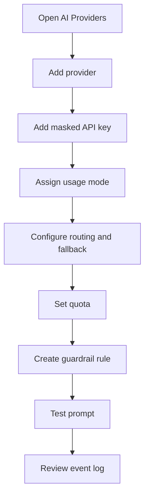

# Sprint 2 UI Spec - Admin Console: AI Keys and Guardrails

Version: 0.1
Date: 2026-07-03
Status: Ready for Sprint 2 implementation
Related plan: `docs/planning/sprint-2-plan.md`

## 1. Design Objective

Sprint 2 makes governance visible. Admin must configure external AI providers, masked API keys, routing, quota, fallback and guardrails without exposing secrets or requiring developer knowledge.

## 2. Screens

| Route | Screen | Primary User |
| --- | --- | --- |
| `/admin/ai-providers` | AI Providers Overview | AI Admin |
| `/admin/ai-providers/keys` | API Key Management | AI Admin |
| `/admin/ai-providers/routing` | Scenario Routing | AI Admin |
| `/admin/ai-providers/quota` | Token Quota | AI Admin |
| `/admin/guardrails` | Guardrail Rules and Policies | Security Admin |
| `/admin/guardrails/test` | Test Prompt | Security Admin |
| `/admin/guardrails/events` | Guardrail Events | Security/Admin |

## 3. Governance Flow

## 4. Layout Specifications

### 4.1 AI Providers Overview

- Header: "AI Providers & API Keys", primary action "เพิ่ม Provider".
- Summary cards: Active providers, active keys, monthly token usage, guardrail blocks.
- Tabs: Providers, Models, API Keys, Routing, Quota, Log.
- Provider table columns: Provider, Base URL, Status, Models, Last checked, Actions.

### 4.2 API Key Management

- Table columns: Name, Provider, Usage Mode, Quota, Fallback, Fingerprint, Last Used, Status.
- Add key modal fields: key name, provider, key secret, usage mode, quota, fallback priority, notes.
- After save, secret input clears and only fingerprint is shown.
- Rotate action requires confirmation.

### 4.3 Scenario Routing

- Matrix layout: Scenario x Provider/Model/Key.
- Scenarios: Requirement Analysis, Frontend Coding, Backend Coding, Review, Documentation.
- Each row has primary route and fallback route.
- Validation: fallback cannot point to disabled key.

### 4.4 Quota

- Quota cards: organization, creator, project, app.
- Form fields: daily limit, monthly limit, warning threshold, hard stop.
- Display estimated remaining token count and reset date.

### 4.5 Guardrails

- Tabs: Banned Keywords, AI Policies, Test Prompt, Events.
- Rule table columns: Rule, Severity, Action, Scope, Status, Updated.
- Rule actions: edit, disable, duplicate.
- Test prompt result panel: decision, matched rule, severity, event id.

## 5. Components

| Component | Purpose |
| --- | --- |
| `SecretField` | Accept secret once, never display after save |
| `ProviderStatusBadge` | active, disabled, warning, error |
| `RoutingMatrix` | Scenario-based provider selection |
| `QuotaEditor` | Limits and warning thresholds |
| `GuardrailRuleTable` | Rule list and actions |
| `PromptTestPanel` | Input prompt and display allow/warn/block result |
| `SecurityEventList` | Guardrail decision event log |

## 6. States and Validation

| Scenario | UI Requirement |
| --- | --- |
| No provider | Empty state with "เพิ่ม Provider แรก" |
| Secret saved | Show fingerprint and created metadata only |
| Quota exceeded | Show blocked state before external call |
| Guardrail block | Red status, matched rule and event id |
| Guardrail warn | Amber status and continue/acknowledge behavior |
| Non-admin access | Deny page and audit event trigger |

## 7. Acceptance Criteria

- [ ] Admin can add provider and API key without exposing secret after save.
- [ ] Admin can configure scenario routing and fallback.
- [ ] Admin can set quota and see remaining usage.
- [ ] Admin can create guardrail rule and test prompt.
- [ ] Test prompt clearly returns allow, warn or block.
- [ ] Guardrail event log is visible and filterable.

