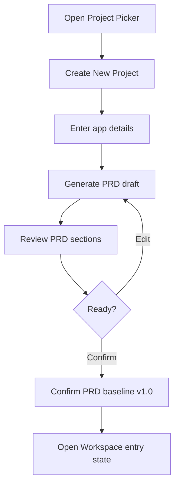

# Sprint 3 UI Spec - Creator Project Picker + PRD Generation

Version: 0.1
Date: 2026-07-03
Status: Ready for Sprint 3 implementation
Related plan: `docs/planning/sprint-3-plan.md`

## 1. Design Objective

Sprint 3 gives Creator the first productive workflow: find or create a project, generate a PRD draft, review it and confirm the baseline. The UX must make PRD the source of truth before app generation proceeds.

## 2. Screens

| Route | Screen | Purpose |
| --- | --- | --- |
| `/creator` | Project Picker | Browse owned/shared projects and start new work |
| `/creator/projects/new` | Create Project Wizard | Capture app intent and constraints |
| `/creator/projects/{projectId}/prd` | PRD Viewer | Review generated PRD sections |
| `/creator/projects/{projectId}/prd/history` | PRD Version History | Show draft/baseline timeline |
| Modal | Confirm Baseline | Lock PRD v1.0 baseline |

## 3. Creator Flow

## 4. Project Picker Layout

- Header: "Creator App", token remaining, create action.
- Actions: Create New Project, Remix Project, Templates.
- Filters: My Projects, Shared, Draft, Published, Archive.
- Project card fields: name, app type, status, owner, PRD version, frontend version, access mode, health, last edited.
- Card actions: Open, View PRD, Remix. Archive hidden behind overflow menu.

## 5. Create Project Wizard

Use a 3-step wizard:

| Step | Fields | Validation |
| --- | --- | --- |
| App Basics | App name, business problem, app type, target department | App name and problem required |
| Users and Access | intended users, internal/external, default app roles | At least one intended user group required |
| Data and Risk | data sensitivity, external access, public/domain intent | Confidential/Restricted shows warning |

Wizard footer:

- Back, Save Draft, Generate PRD.
- Generate PRD disabled until required fields pass.

## 6. PRD Viewer

Layout:

- Topbar: project name, PRD status, version, generated time.
- Left section navigation: Overview, Business Objective, Users, Roles, Flows, Screens, Data Model, Permissions, NFR, Acceptance Criteria, Open Questions.
- Main content: structured PRD sections.
- Right metadata panel: version, author, source prompt, change summary, baseline status.
- Primary actions: Confirm Baseline, Regenerate Draft, Export later disabled if not in MVP.

## 7. Version History

- Timeline entries: Draft created, Draft regenerated, Baseline confirmed.
- Each entry shows author, timestamp, summary and status badge.
- Selecting a version opens read-only preview.

## 8. States

| State | UI Requirement |
| --- | --- |
| No projects | Empty state with create project action |
| PRD generating | Progress steps: analyzing input, drafting PRD, checking sections, ready |
| PRD generation failed | Error state with retry and keep draft input |
| Draft incomplete | Highlight missing PRD sections |
| Baseline confirmed | Show immutable badge and next action to open workspace |
| Unauthorized project | Permission denied, do not show project metadata |

## 9. Components

| Component | Purpose |
| --- | --- |
| `ProjectCard` | Display project metadata and actions |
| `ProjectFilterTabs` | Segment project lists |
| `CreateProjectWizard` | Guided project creation |
| `PrdSectionNav` | Anchor navigation for PRD |
| `PrdViewer` | Structured PRD content |
| `PrdVersionTimeline` | Version history |
| `ConfirmBaselineModal` | Confirm immutability and next step |

## 10. Acceptance Criteria

- [ ] Creator can identify project status from project cards.
- [ ] Create Project Wizard captures all required MVP fields.
- [ ] PRD generation progress is visible.
- [ ] PRD Viewer supports structured review and section navigation.
- [ ] Confirm Baseline clearly explains baseline immutability.
- [ ] Confirmed project has visible PRD v1.0 baseline state.

