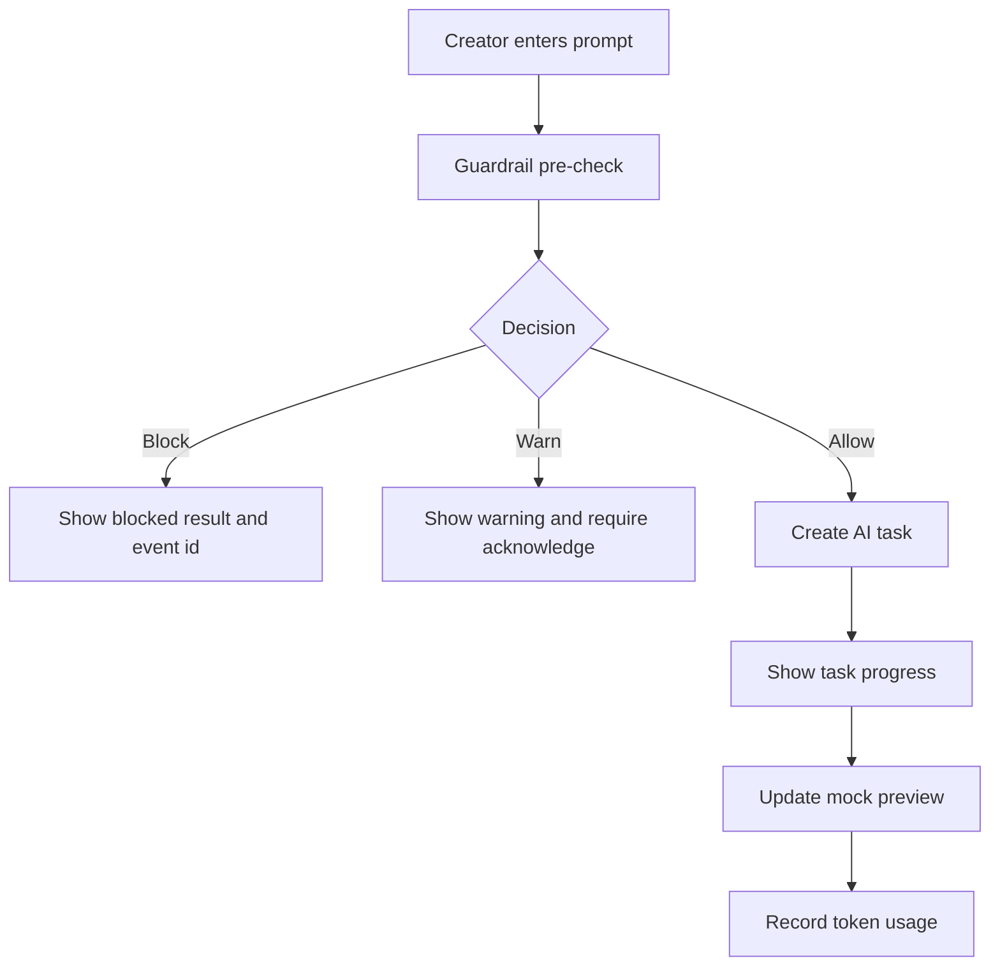

# Sprint 4 UI Spec - Creator Workspace: Prompt + Live Preview

Version: 0.1
Date: 2026-07-03
Status: Ready for Sprint 4 implementation
Related plan: `docs/planning/sprint-4-plan.md`

## 1. Design Objective

Sprint 4 delivers the core Lovable-like Creator Workspace. The UI must support prompt-driven changes while keeping PRD context, guardrail state, token usage and live preview visible.

## 2. Screens

| Route | Screen | Purpose |
| --- | --- | --- |
| `/creator/projects/{projectId}/workspace` | Workspace | Prompt, task progress, preview and project context |
| Workspace tab | PRD | Read PRD context without leaving workspace |
| Workspace tab | Database | Placeholder link/context for Sprint 5 |
| Workspace tab | Versions | Placeholder link/context for Sprint 5 |
| Workspace tab | Logs | Prompt/task/guardrail events |

## 3. Workspace Flow

## 4. Desktop Layout

Use a three-panel workspace:

| Region | Width Guidance | Content |
| --- | --- | --- |
| Topbar | Full width | Project name, PRD version, frontend version, tokens, publish status |
| Left panel | 280-360px | Chat history, AI plan, task progress |
| Center panel | Flexible | Live preview frame and device controls |
| Right panel | 280-360px | PRD, Database, Versions, Users, Tickets, Logs, API tabs |
| Bottom composer | Full width or left/center | Prompt input, send action, guardrail hint |

## 5. Prompt Panel

Required elements:

- Chat history grouped by user/AI/system.
- Current prompt composer.
- Example suggestions: Add field, modify UI, create workflow, fix preview error.
- Guardrail hint: "Prompt จะถูกตรวจตาม Guardrail ก่อนส่ง AI".
- Send button disabled if prompt empty or task running.

## 6. Task Progress

Task steps:

1. Understanding request
2. Loading PRD
3. Retrieving knowledge
4. Selecting skill
5. Updating PRD if needed
6. Generating frontend
7. Generating backend if needed
8. Applying auth/role rules
9. Building preview
10. Running checks
11. Ready

Each step needs status: pending, running, done, warning, failed.

## 7. Live Preview

- Device controls: Desktop, Tablet, Mobile.
- Actions: Refresh, Open Preview, Capture Screenshot.
- Preview frame shows mock Leave Management app.
- Preview error state includes retry and open logs.
- Current preview version visible near device controls.

## 8. Token Usage

Topbar token widget must show:

- Remaining today.
- Remaining month.
- Current request estimate if available.
- Reset date.
- Request quota action disabled or placeholder in MVP.

Creator must never see provider secret or system-wide model config.

## 9. States

| State | UI Requirement |
| --- | --- |
| No PRD baseline | Block workspace and link to PRD confirm |
| Prompt blocked | Red result with rule name and event id |
| Prompt warned | Amber result with acknowledge action |
| Task running | Disable send, show progress and cancel placeholder |
| Preview loading | Skeleton inside preview frame |
| Preview failed | Error panel with retry/log actions |
| Token exhausted | Block send and show quota explanation |

## 10. Components

| Component | Purpose |
| --- | --- |
| `WorkspaceTopbar` | Project/version/token/publish context |
| `PromptThread` | Chat-like prompt history |
| `PromptComposer` | Current prompt input |
| `TaskProgressList` | Multi-step AI progress |
| `PreviewFrame` | Device-aware preview |
| `DeviceSwitcher` | Desktop/tablet/mobile modes |
| `WorkspaceRightTabs` | PRD/database/version/user/log/API context |
| `GuardrailResultBanner` | Allow/warn/block feedback |

## 11. Acceptance Criteria

- [ ] Creator sees project, PRD version, frontend version and tokens while working.
- [ ] Prompt submission shows guardrail result before task progress.
- [ ] Task progress has deterministic visible steps.
- [ ] Live preview updates after accepted prompt.
- [ ] Desktop workspace supports prompt, preview and right context simultaneously.
- [ ] Guardrail block and token exhausted states are explicit and testable.

