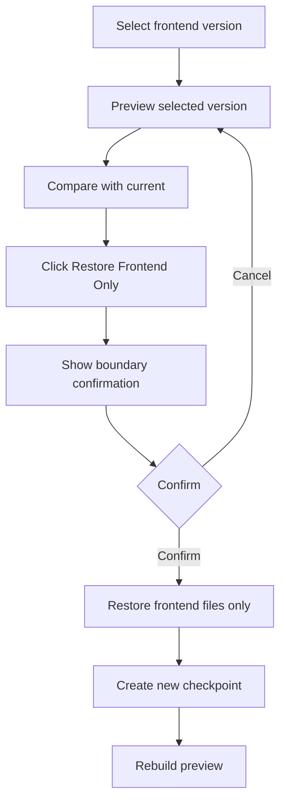

# Sprint 5 UI Spec - Database View + Frontend Version Restore

Version: 0.1
Date: 2026-07-03
Status: Ready for Sprint 5 implementation
Related plan: `docs/planning/sprint-5-plan.md`

## 1. Design Objective

Sprint 5 gives Creator controlled visibility into generated app structure and safe frontend-only restore. The UX must make boundaries explicit: database visibility is business-friendly and restore must not affect backend, data, auth, roles or PRD baseline.

## 2. Screens

| Route / Tab | Screen | Purpose |
| --- | --- | --- |
| Workspace right tab | Database Summary | Quick schema/table overview |
| `/creator/projects/{projectId}/database` | Database View | Schema, tables, relationships, sample records, migrations |
| Workspace right tab | Versions Summary | Recent frontend checkpoints |
| `/creator/projects/{projectId}/versions` | Frontend Versions | Timeline, compare, preview and restore |
| Modal | Restore Confirmation | Confirm frontend-only impact |

## 3. Database View Layout

Use a split layout:

- Header: "Database View: {App Name}", read-only badge.
- Tabs: Schema, Table View, Relationships, Migrations.
- Left rail: table list and search.
- Main panel: selected table/schema content.
- Bottom or side panel: sample records where applicable.

## 4. Database View Content

| Tab | Required Content |
| --- | --- |
| Schema | tables, columns, data types, required fields, defaults, generated/manual markers |
| Table View | sample records, search, filter, sort, relation links |
| Relationships | relationship diagram/list, source/target table, cardinality |
| Migrations | migration id, created by, timestamp, status, linked PRD/frontend version |

Restrictions must be visible:

- No raw SQL editor.
- No drop table action.
- No production data deletion.
- Schema changes must go through AI migration flow.

## 5. Frontend Versions Layout

- Timeline left side: current version, previous versions, published checkpoints.
- Preview panel: selected version preview.
- Change summary: generated by, prompt, changed files/components, notes.
- Actions: Compare, Restore Frontend Only, Create Note.
- Restore action disabled for unauthorized users.

## 6. Restore Flow

## 7. Restore Confirmation Copy

Confirmation must explicitly state:

- Will change: React pages, UI components, CSS/Tailwind styles, frontend routing.
- Will not change: backend APIs, database schema, production data, auth settings, app roles, app membership, domain settings, PRD baseline unless separately confirmed.
- Audit event will be recorded.

## 8. States

| State | UI Requirement |
| --- | --- |
| No schema | Empty state explaining app has no generated schema yet |
| Loading sample records | Skeleton table rows |
| Unauthorized table | Hide data and show permission state |
| Migration failed | Red status with linked logs |
| No checkpoints | Empty state with explanation that checkpoints start after frontend generation |
| Restore in progress | Disable actions and show progress |
| Restore complete | Success toast and new current checkpoint |

## 9. Components

| Component | Purpose |
| --- | --- |
| `DatabaseTableList` | Select app tables |
| `SchemaTable` | Columns/types/required fields |
| `SampleRecordsTable` | Read-only data preview |
| `RelationshipView` | Relationship list/diagram |
| `MigrationTimeline` | Migration history |
| `FrontendVersionTimeline` | Checkpoint list |
| `VersionPreviewPanel` | Preview selected frontend version |
| `VersionCompareSummary` | Show changed UI areas |
| `RestoreFrontendModal` | Boundary confirmation |

## 10. Acceptance Criteria

- [ ] Creator can inspect schema, table, relationship, sample records and migration history.
- [ ] Database view does not expose raw SQL actions.
- [ ] Frontend version timeline shows current and previous versions.
- [ ] Compare/preview old version is available.
- [ ] Restore confirmation clearly states frontend-only scope.
- [ ] Restore creates new checkpoint and audit-visible result.

