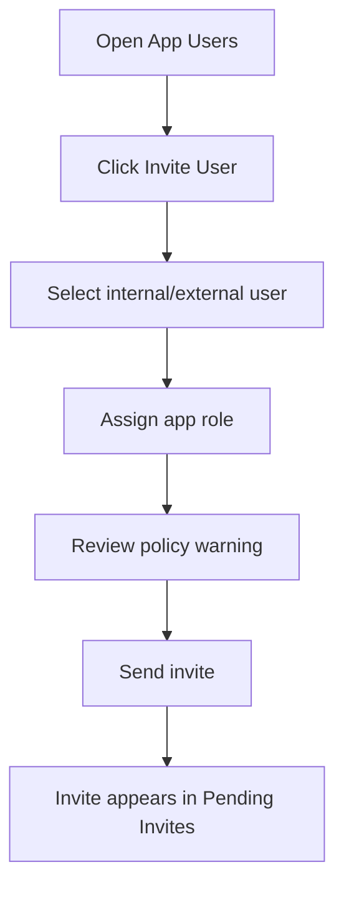

# Sprint 6 UI Spec - App User Management + Publish

Version: 0.1
Date: 2026-07-03
Status: Implemented for Sprint 6 acceptance
Related plan: `docs/planning/sprint-6-plan.md`

## 1. Design Objective

Sprint 6 turns a generated/previewed app into a governed app that can be assigned to users and published to the App Store registry. The UX must make app roles, members, invites, manifest and publish state understandable to non-IT Creators.

## 2. Screens

| Route / Tab | Screen | Purpose |
| --- | --- | --- |
| Workspace right tab | Users Summary | Quick member/access status |
| `/creator/projects/{projectId}/users` | App User Management | Members, pending invites, access requests |
| `/creator/projects/{projectId}/roles` | App Roles | Define app-level roles |
| Modal | Invite User | Invite internal/external user and assign role |
| `/creator/projects/{projectId}/publish` | Publish Review | Manifest, checklist, publish action |
| Drawer | Deployment Record | Show result after publish |

## 3. App User Management Layout

- Header: "App Users: {App Name}", primary action "เชิญผู้ใช้".
- Tabs: Members, Pending Invites, Access Requests, Roles.
- Members table columns: User, Type, App Role, Status, Last Access, Actions.
- Pending invites columns: Email/User, Role, Invited By, Expires, Status.
- Access requests columns: Requester, Requested Role, Reason, Submitted, Status, Actions.

## 4. App Roles Layout

- Role list cards or table: role name, description, permissions summary, members count.
- Create role modal fields: role name, description, permission presets.
- Default roles for Leave Management: Employee, Manager, HR Admin.
- Role deletion disabled if members are assigned.

## 5. Invite Flow

Invite modal required fields:

- User/email/group.
- User type: internal, external.
- App role.
- Expiration date for external user.
- Optional note.

External invites must show policy warning and approval state if required.

## 6. Publish Review

Publish page layout:

- App summary: name, owner, PRD version, frontend version, app roles.
- Manifest summary: app slug, route, auth mode, app roles, PRD link, frontend checkpoint.
- Readiness checklist: PRD baseline, active frontend version, app roles, at least one owner, no blocking guardrail event.
- Primary action: Publish to App Store.
- If blocked, show exact blocking items and links.

## 7. Deployment Record

After publish, show:

- Publish status.
- Deployment id.
- App Store visibility.
- PRD version.
- Frontend checkpoint.
- Manifest version.
- Published by and timestamp.

## 8. States

| State | UI Requirement |
| --- | --- |
| No members | Empty state with invite action |
| Pending invite | Amber badge and resend/revoke actions |
| External invite approval required | Policy warning and disabled send until approval path is clear |
| Role has members | Disable destructive delete |
| Publish blocked | Checklist with failing items |
| Publish running | Progress steps: manifest, registry, deployment record, app store update |
| Publish success | Success panel with Open in Store action |

## 9. Components

| Component | Purpose |
| --- | --- |
| `AppMembersTable` | Members and app roles |
| `AccessRequestsTable` | Approve/reject requests |
| `InviteUserModal` | User/group invite |
| `AppRoleEditor` | Create/edit app-level role |
| `PublishChecklist` | Readiness checks |
| `ManifestSummary` | Human-readable app manifest |
| `PublishProgress` | Publish process state |
| `DeploymentRecordDrawer` | Deployment output |

## 10. Acceptance Criteria

- [x] Creator can view app members, pending invites, access requests and roles.
- [x] Creator can invite internal End User and assign role.
- [x] External invite shows policy warning.
- [x] Publish Review shows manifest and readiness checklist.
- [x] Blocked publish explains missing requirements.
- [x] Successful publish creates visible deployment record and App Store registry state.
