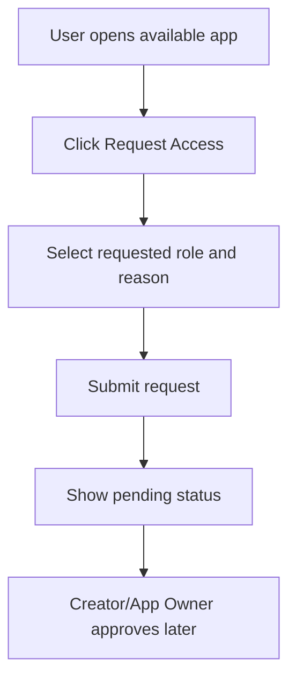

# Sprint 7 UI Spec - End User App Store PWA + Ticket

Version: 0.1
Date: 2026-07-03
Status: Implemented and accepted
Related plan: `docs/planning/sprint-7-plan.md`

## 1. Design Objective

Sprint 7 delivers the End User experience. The App Store must be mobile-first, simple and permission-aware. End Users should quickly see accessible apps, request access to available apps and submit tickets that route to the Creator.

## 2. Screens

| Route | Screen | Purpose |
| --- | --- | --- |
| `/store` | App Store Home | My Apps, Available Apps, search |
| `/store/apps/{appSlug}` | App Detail | Metadata, role, status, open/request/ticket actions |
| `/store/apps/{appSlug}/request-access` | Request Access | Submit access request |
| `/store/apps/{appSlug}/tickets/new` | Submit Ticket | Bug/feedback/feature request |
| `/store/tickets/{ticketId}` | Ticket Status | Timeline and current status |
| `/creator/projects/{projectId}/tickets` | Creator Ticket Inbox | Creator receives routed tickets |

## 3. PWA Home Layout

Mobile order:

1. Header: App Store, profile/action.
2. Search apps.
3. My Apps section.
4. Available Apps section.
5. Ticket/access shortcuts if needed.

App card fields:

- App icon.
- App name.
- Short description/category.
- Owner.
- My role or access status.
- Health status.
- Last updated.
- Primary action: Open, Request Access, View Status.
- Secondary action: Ticket/Favorite.

## 4. App Detail Layout

- Header: app name, status badge, owner.
- Metadata: creator, department, my role, access mode, version, health.
- Actions: Open App, Report Bug, Send Feedback, Request Role Change or Request Access.
- Release notes section.
- Support contact.
- Access status panel if pending/denied.

## 5. Request Access Flow

Fields:

- Requested role.
- Reason.
- Department/team optional.
- Acknowledgement if external/public policy applies.

## 6. Ticket Flow

Ticket form:

- Ticket type: Bug Report, Feedback, Feature Request, Access Issue, Data Issue, Performance Issue, Other.
- Priority: Low, Medium, High, Critical.
- Title.
- Description.
- Screenshot optional.
- Device/browser info auto-attached.

Ticket status page:

- Ticket id, title, app, status, submitted date.
- Timeline: submitted, in review, planned, resolved, closed.
- Creator replies/comments if available.

## 7. Creator Ticket Inbox Integration

Creator inbox must show:

- Ticket list with type, priority, status, submitted by, app.
- Detail panel with description, screenshot, device info.
- Actions: Reply, Convert to PRD Change, Convert to AI Prompt, Resolve.

## 8. Responsive and PWA Requirements

- Minimum touch target: 44px.
- Single-column mobile layout is primary.
- Desktop may use two-column/grid layout.
- Offline fallback page required.
- Installable metadata required.
- Basic in-app notification state required.

## 9. States

| State | UI Requirement |
| --- | --- |
| No apps | Empty state explaining no access yet |
| Pending access | Show request status instead of duplicate request button |
| Access denied | Show denied state and optional resubmit guidance |
| App unhealthy | Warning before opening app |
| Offline | Offline fallback with cached app shell |
| Ticket submitted | Success state with ticket id and View Status action |
| Ticket closed | Read-only status timeline |

## 10. Components

| Component | Purpose |
| --- | --- |
| `StoreHeader` | Mobile header/profile |
| `AppSearch` | Search apps |
| `AppCard` | App listing card |
| `AppDetailPanel` | App metadata and actions |
| `RequestAccessForm` | Access request |
| `TicketForm` | Submit ticket |
| `TicketStatusTimeline` | Ticket progress |
| `CreatorTicketInbox` | Routed ticket review |

## 11. Acceptance Criteria

- [x] App Store Home is usable on mobile width.
- [x] My Apps and Available Apps reflect permission/access state.
- [x] End User can request access and see pending status.
- [x] End User can submit ticket with required fields.
- [x] Ticket submitted state shows ticket id and status link.
- [x] Creator can see routed ticket in inbox.
