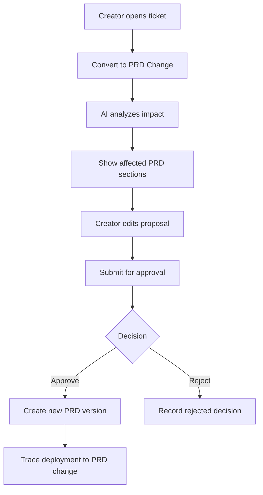

# Sprint 8 UI Spec - Ticket-to-PRD + Domain + Hardening

Version: 0.1
Date: 2026-07-04
Status: Implemented and Accepted
Related plan: `docs/planning/sprint-8-plan.md`

## 1. Design Objective

Sprint 8 closes the MVP loop. The UI must prove that End User feedback can become a PRD change request, domain requests can be governed, and deployment/audit/monitoring evidence is visible for a pilot demo.

## 2. Screens

| Route / Tab | Screen | Purpose |
| --- | --- | --- |
| Creator ticket detail | Convert to PRD Change | Convert ticket into PRD change proposal |
| `/creator/projects/{projectId}/prd/changes` | PRD Change Requests | Review and approve/reject changes |
| `/creator/projects/{projectId}/domains` | Domain Settings | Internal/custom/public domain settings |
| Modal | Public Domain Request | Request public exposure |
| `/creator/projects/{projectId}/deployments` | Deployment Traceability | Link PRD, frontend version, manifest, deployment |
| `/admin/monitoring` | MVP Monitoring Dashboard | Health, usage, tickets, guardrails |
| `/admin/audit-logs` | Audit Filters | Full audit filtering |
| Demo | MVP End-to-End Script View | Checklist for pilot demo |

## 3. Ticket-to-PRD Flow

## 4. Convert to PRD Change UI

Layout:

- Left: original ticket detail.
- Center: AI impact analysis and proposed PRD change.
- Right: affected PRD sections, risk, acceptance criteria.
- Actions: Save Draft, Submit for Approval, Cancel.

Required fields:

- Change title.
- Related ticket.
- Affected PRD sections.
- Proposed requirement text.
- Acceptance criteria.
- Risk/data classification if applicable.

## 5. PRD Change Approval

- List columns: Change, Source, Risk, Status, Requested by, Updated.
- Detail view: diff, affected sections, ticket link, approval history.
- Actions: Approve, Request Changes, Reject.
- Approved state creates/links new PRD version.

## 6. Domain Settings

Tabs:

- Internal Path: `/apps/{appSlug}`.
- Custom Domain: internal custom domain.
- Public Domain Request: controlled exposure.

Public request modal fields:

- Domain.
- Reason.
- Intended audience.
- Data classification.
- External user policy.
- Security checklist acknowledgement.

Public domain request must show approval requirement before submit.

## 7. Deployment Traceability

Traceability page must show one linked record:

- App version.
- PRD version.
- PRD change request.
- Ticket source if any.
- Frontend version.
- Manifest version.
- Deployment id.
- Domain/route.
- Published by.
- Approval snapshot.
- Audit event ids.

Use a timeline plus relationship summary table.

## 8. Monitoring and Audit

MVP Monitoring Dashboard:

- Service health: Platform API, PostgreSQL, Keycloak, MinIO, Redis, AI Gateway, Caddy.
- App health: Leave Management published status.
- AI usage: token usage and blocked prompts.
- Tickets: open/in review/resolved counts.
- Recent audit events.

Audit filter fields:

- Date range.
- Actor.
- Event type.
- App/project.
- Severity.
- Result.

## 9. Demo Script View

Create a read-only checklist screen or docs-linked checklist for pilot:

1. Admin configures AI provider/key and guardrail.
2. Creator creates Leave Management and confirms PRD.
3. Creator prompts WFH leave change and sees preview.
4. Creator checks database and restores frontend version.
5. Creator invites End User and publishes.
6. End User submits ticket.
7. Creator converts ticket to PRD change.
8. Show deployment traceability, domain request and audit/monitoring.

## 10. States

| State | UI Requirement |
| --- | --- |
| Ticket already linked | Show existing PRD change link and disable duplicate conversion |
| AI impact failed | Allow manual PRD change draft |
| Approval pending | Disable deployment action and show approver status |
| Domain request blocked | Show missing security/data policy requirements |
| Deployment trace missing link | Highlight incomplete traceability |
| Monitoring degraded | Amber/red service/app status |
| Audit filter empty | Empty state with filter reset action |

## 11. Components

| Component | Purpose |
| --- | --- |
| `TicketToPrdChangePanel` | Convert ticket to requirement change |
| `PrdChangeDiff` | Show proposed PRD edits |
| `ApprovalTimeline` | Approval decision history |
| `DomainSettingsTabs` | Internal/custom/public domain settings |
| `PublicDomainRequestModal` | Public exposure request |
| `DeploymentTraceGraph` | Linked PRD/frontend/manifest/deploy data |
| `MonitoringOverview` | Health and usage cards |
| `AuditFilterBar` | Full audit filtering |
| `MvpDemoChecklist` | End-to-end demo execution |

## 12. Acceptance Criteria

- [x] Creator can convert ticket to PRD change without leaving ticket context.
- [x] PRD change approval shows status, source ticket and decision evidence.
- [x] Domain request flow displays policy/approval requirement.
- [x] Deployment traceability links ticket, PRD, frontend, manifest, deployment and domain.
- [x] Monitoring dashboard shows core service/app status.
- [x] Audit filters return clear result state.
- [x] End-to-end demo checklist can be followed without missing UI screens.
