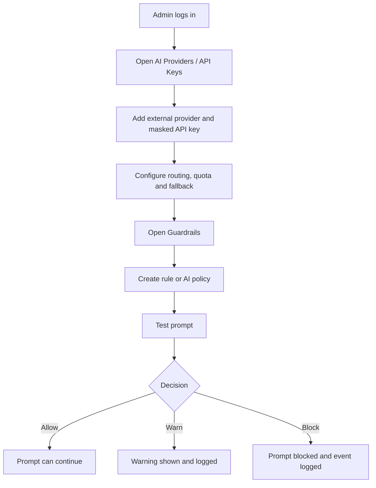
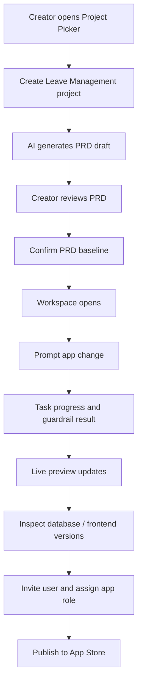
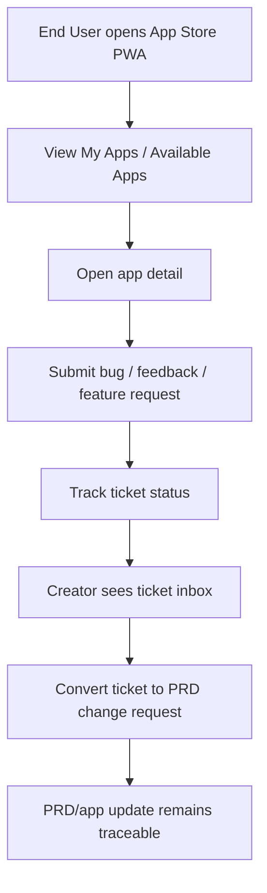

# Enterprise Vibe Coding Platform - UX/UI Requirements

Version: 0.1
Date: 2026-07-03
Status: MVP Design Requirements Draft
Source: PRD, MVP backlog/wireframe/API/schema document, requirements baseline, Sprint 0-8 plans

## 1. Purpose

เอกสารนี้ต่อยอดจาก wireframe และ requirement ตั้งต้นให้เป็น UX/UI requirements สำหรับเริ่มพัฒนา Sprint 0 ได้จริง โดยกำหนด user flow, information architecture, screen inventory, layout rules, component requirements, responsive behavior, states และ acceptance criteria สำหรับ 3 surfaces หลัก:

- Admin Console
- Creator App
- End User App Store PWA

เอกสารนี้ยังไม่ใช่ high-fidelity visual design หรือ pixel-perfect mockup แต่เป็น design handoff ระดับ MVP สำหรับ frontend implementation

## 2. Design Principles

| Principle | Requirement |
| --- | --- |
| Three-surface separation | Admin governs platform, Creator builds apps, End User uses apps. Navigation and permissions must make this separation obvious. |
| Dense but readable enterprise UI | Admin and Creator surfaces should be information-dense, table-friendly and efficient, not marketing-style. |
| Creator workspace first | Creator App must prioritize prompt, preview, PRD/database/context and publish actions in one coherent workspace. |
| Mobile-first App Store | End User App Store PWA must work well on mobile first and remain usable on desktop. |
| Governance visibility | AI key, quota, guardrail, approval, audit and access state must be visible where decisions are made. |
| Safety by default | Restricted actions need clear status, confirmation and audit visibility. Secrets must never be shown. |
| Thai primary UI | User-facing labels should be Thai primary with English technical terms where industry-standard. |

## 3. Information Architecture

### 3.1 Route Map

| Surface | Base Route | Primary Users | MVP Purpose |
| --- | --- | --- | --- |
| Admin Console | `/admin` | IT/System Admin, AI Admin, Security Admin | Configure platform governance and monitor system |
| Creator App | `/creator` | Creator, Developer, App Owner | Create, preview, manage and publish internal apps |
| App Store PWA | `/store` | End User, External User | Discover apps, request access, submit tickets |
| Generated Apps | `/apps/{appSlug}` | App users | Open published app runtime |

### 3.2 Navigation Model

| Surface | Navigation Pattern | MVP Rules |
| --- | --- | --- |
| Admin Console | Fixed left sidebar + topbar | Sidebar persists on desktop. Active module is visible. Admin user and environment status appear in topbar. |
| Creator App | Project-aware topbar + workspace panels | Project context is always visible: project name, PRD version, frontend version, token remaining, publish status. |
| App Store PWA | Mobile top navigation + bottom/action-friendly layout | Search, My Apps and Available Apps must be reachable within one screen on mobile. |

## 4. User Flows

### 4.1 Admin Governance Flow

### 4.2 Creator App Creation Flow

### 4.3 End User Feedback Flow

## 5. Screen Inventory

### 5.1 Sprint 0 MVP Shell Screens

| Surface | Required Shell Screens | Sprint 0 Acceptance |
| --- | --- | --- |
| Admin Console | Dashboard shell, AI Keys placeholder, Guardrails placeholder, System Health placeholder | Sidebar/topbar render, role guard works, mock metrics visible |
| Creator App | Project Picker shell, Workspace skeleton, Project detail placeholder | Project cards render from mock data, workspace layout skeleton exists |
| App Store PWA | Mobile home shell, App detail placeholder, Ticket placeholder | Mobile layout renders, PWA-ready shell exists, mock apps visible |

### 5.2 Full MVP Screen Inventory

| Surface | Screen | MVP Sprint | Primary Content |
| --- | --- | --- | --- |
| Admin | Dashboard / System Overview | Sprint 0 / 8 | Health cards, app count, AI usage, service status |
| Admin | AI Providers / API Keys | Sprint 2 | Providers, models, API keys, routing, quota, usage log |
| Admin | Guardrails | Sprint 2 | Rules, policies, test prompt, events |
| Admin | Auth / SSO | Sprint 9 extension | OIDC/SAML/Keycloak settings |
| Admin | Domains | Sprint 8 / 12 extension | Internal/custom/public domain settings and approval |
| Admin | Audit Logs | Sprint 1 / 8 | Security-sensitive event list and filters |
| Creator | Project Picker | Sprint 3 | Project cards, filters, create/remix/template actions |
| Creator | Create Project Wizard | Sprint 3 | App name, problem, app type, users, sensitivity |
| Creator | PRD Viewer | Sprint 3 | PRD sections, version history, confirm baseline |
| Creator | Workspace | Sprint 4 | Prompt/chat, task progress, live preview, right panel tabs |
| Creator | Database View | Sprint 5 | Schema/table/relationships/migrations/sample records |
| Creator | Frontend Versions | Sprint 5 | Timeline, compare, preview, restore frontend only |
| Creator | App Users / Roles | Sprint 6 | Members, invites, access requests, roles |
| Creator | Publish | Sprint 6 / 8 | Manifest, publish status, deployment traceability |
| Creator | Ticket Inbox | Sprint 7 / 8 | Ticket list, detail, reply, convert to PRD change |
| Store PWA | Home | Sprint 7 | Search, My Apps, Available Apps |
| Store PWA | App Detail | Sprint 7 | App metadata, status, role, release notes, actions |
| Store PWA | Request Access | Sprint 7 | Reason, requested role, status |
| Store PWA | Submit Ticket | Sprint 7 | Type, priority, title, description, screenshot |
| Store PWA | Ticket Status | Sprint 7 | Ticket timeline and status |

## 6. Layout Requirements

### 6.1 Admin Console

Admin Console must use a stable dashboard layout:

- Left sidebar width: fixed desktop width, collapsible later if needed.
- Topbar: current admin, environment/status, critical alert indicator.
- Main content: page title, primary action, tabs/filter bar, data table or status grid.
- Dashboard cards must show Health, Apps, AI Usage and Service Status.
- AI Keys page must use tabs: Providers, Models, API Keys, Routing, Quota, Log.
- Guardrails page must use tabs: Banned Keywords, AI Policies, Test Prompt, Events.

Required states:

- Empty provider list: prompt to add first provider.
- Masked key display: never show full key after save.
- Guardrail test result: allow, warn, block.
- Service status: healthy, warning, degraded, down.
- Permission denied for non-admin users.

### 6.2 Creator App

Creator App must use a project-centered layout:

- Project Picker: top actions, filter tabs, project cards.
- Workspace: three-panel layout on desktop.
- Workspace topbar must show project name, PRD version, frontend version, token remaining and publish action.
- Left panel: prompt/chat/task progress.
- Center panel: live preview with desktop/tablet/mobile controls.
- Right panel: PRD, Database, Versions, Users, Tickets, Logs, API.
- Prompt composer stays visible at the bottom of the workspace.

Required states:

- No projects: show create project action.
- Draft PRD: show confirm baseline action.
- Prompt running: show deterministic task steps.
- Guardrail block: show reason and event id.
- Preview failed: show retry and inspect logs action.
- Frontend restore confirmation: clearly state frontend-only scope.
- Publish blocked: show missing requirements or required approval.

### 6.3 End User App Store PWA

App Store PWA must be mobile-first:

- Home screen order: header/profile, search, My Apps, Available Apps.
- App cards must include app name, description/status, role/access state and primary action.
- App Detail must show owner, creator, role, health, version, release notes and support actions.
- Ticket form must be short enough for mobile and support optional screenshot upload.
- Desktop layout may widen cards into a grid but should preserve the same content hierarchy.

Required states:

- No accessible apps.
- Pending access request.
- Request denied.
- App unhealthy.
- Offline fallback page.
- Ticket submitted success.
- Ticket status timeline.

## 7. Shared Component Requirements

Sprint 0 shared UI package should provide these components first:

| Component | Required Props / Behavior | Used By |
| --- | --- | --- |
| `AppShell` | surface, sidebar items, user, active route | Admin, Creator |
| `Topbar` | title, context metadata, user actions | Admin, Creator |
| `Sidebar` | sections, active item, permission filtering | Admin, Creator |
| `MobileShell` | header, content, bottom-safe actions | Store PWA |
| `Button` | variant, size, loading, disabled, icon | All surfaces |
| `Input` / `Textarea` | label, helper, error, required | Forms |
| `Select` | label, options, disabled, error | Forms |
| `Card` | title, metadata, actions, status | Project/app cards |
| `DataTable` | columns, rows, loading, empty, pagination-ready | Admin/Creator tables |
| `Tabs` | active tab, disabled tabs | Admin/Creator detail pages |
| `Badge` / `StatusPill` | status variants | All surfaces |
| `MetricCard` | label, value, trend/status | Admin dashboard |
| `Timeline` | ordered status/events | PRD versions, tickets, frontend versions |
| `Modal` / `Drawer` | title, body, sticky footer, confirm/cancel | Create/invite/confirm flows |
| `Toast` | success, warning, error, info | All surfaces |
| `EmptyState` | title, description, action | All list pages |

## 8. Design Tokens

Initial tokens should be practical and restrained:

| Token Group | Requirement |
| --- | --- |
| Color | Primary blue for main actions, neutral gray for chrome, green success, amber warning, red destructive/error, purple only as secondary accent for AI/status where needed. |
| Typography | Thai-readable sans-serif stack, clear hierarchy for page title, section title, body, caption. No viewport-scaled font sizes. |
| Spacing | Use consistent 4px-based scale. Dense enterprise tables should remain readable. |
| Radius | Cards and controls should use 6-8px radius unless platform design later changes. |
| Elevation | Minimal shadows. Use borders/background bands for hierarchy in enterprise surfaces. |
| Icons | Use icon library such as lucide-react for common actions: search, plus, key, shield, database, users, ticket, upload, refresh, restore, publish. |

## 9. Responsive Rules

| Surface | Desktop | Tablet | Mobile |
| --- | --- | --- | --- |
| Admin Console | Sidebar + main content, tables prioritized | Sidebar may collapse, tables horizontally scroll | Admin mobile is secondary; critical status pages must remain readable |
| Creator App | Three-panel workspace | Two-panel or tabbed right panel | Mobile editing is not primary; project picker and ticket review should remain readable |
| App Store PWA | Grid/list hybrid | Two-column app cards | Primary layout; single column, large touch targets, app actions visible |

Minimum touch target for PWA actions: 44px height.

## 10. Accessibility Requirements

- All form fields must have labels.
- Keyboard navigation must work for menus, tabs, modals and primary actions.
- Focus state must be visible.
- Color must not be the only status indicator.
- Tables must have readable headers and empty/loading states.
- Modal confirmations must identify the action and affected resource.
- Error messages must state what happened and what the user can do next.

## 11. UX Copy Requirements

UI copy should be short, direct and action-oriented.

Examples:

| State | Copy Direction |
| --- | --- |
| Empty provider list | "ยังไม่มี AI Provider" + "เพิ่ม Provider แรก" |
| Masked API key | Show key name, provider, fingerprint, created date, last used; never show secret |
| Guardrail block | "Prompt ถูกบล็อกตาม Guardrail" + rule/policy name |
| PRD baseline confirmation | "ยืนยัน PRD baseline v1.0" + explain immutability |
| Frontend restore | "Restore เฉพาะ Frontend" + list what will not change |
| Access request pending | "รอการอนุมัติ" + owner/approver |
| Ticket submitted | "ส่ง Ticket แล้ว" + ticket id/status |

## 12. MVP UX Acceptance Criteria

### Sprint 0

- [ ] Admin, Creator and Store shells render from shared components.
- [ ] Mock role switching changes visible navigation and route access.
- [ ] Shared UI components cover buttons, inputs, cards, tables, tabs, badges, modal/drawer, toast, timeline and empty state.
- [ ] App Store shell renders correctly at mobile width.
- [ ] Project/App mock data matches Leave Management demo.

### Sprint 2

- [ ] Admin can scan AI provider/key status without seeing secrets.
- [ ] Routing/quota/guardrail tabs are discoverable.
- [ ] Guardrail test prompt clearly returns allow/warn/block.

### Sprint 3-5

- [ ] Creator can move from project creation to PRD baseline to workspace without losing project context.
- [ ] Workspace shows prompt, progress, preview and right-panel context together on desktop.
- [ ] Database view is business-friendly and does not expose raw SQL.
- [ ] Frontend restore flow clearly limits impact to frontend only.

### Sprint 6-8

- [ ] Creator can invite users, assign app roles and publish from project context.
- [ ] End User can find app, request access and submit ticket on mobile.
- [ ] Creator can convert ticket to PRD change and see traceability.
- [ ] Audit/monitoring/traceability views provide enough evidence for the MVP demo.

## 13. Implementation Notes for Sprint 0

- Use React + Vite + TypeScript for frontend apps as defined by requirements.
- Use a shared UI package in `packages/ui`.
- Use mock fixtures for Leave Management across all surfaces.
- Keep route guards in mock auth for Sprint 0; backend auth starts in Sprint 1.
- Do not implement final visual branding in Sprint 0. Implement stable layout, component API and interaction states first.
- Capture screenshots during Sprint 0 demo for Admin shell, Creator project picker and Store PWA mobile home.

## 14. Open Design Decisions

| Decision | Owner | Needed By |
| --- | --- | --- |
| Exact font stack and Thai font choice | Design / Frontend | Sprint 0 |
| Final color token names | Design / Frontend | Sprint 0 |
| Icon library confirmation | Frontend | Sprint 0 |
| Mobile behavior for Creator workspace | Design / Product | Sprint 4 |
| Public/external access warning copy | Product / Security | Sprint 7-8 |
| High-fidelity visual design direction | Design / Product | Before production pilot |
