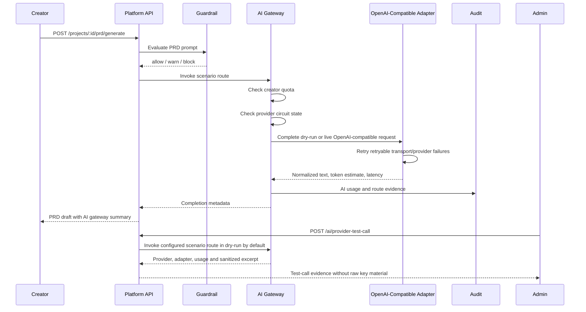

# Real MVP External AI Provider Adapter Foundation

Status: Phase 2 implementation in progress
Issues: #32, #77
Stacked after: #27 Real MVP private-server install foundation

## Purpose

The production blueprint chooses external AI providers only and requires a Provider Adapter architecture. This phase adds the first backend AI Gateway contract so PRD generation no longer depends on a direct deterministic-only path.

The adapter keeps deterministic dry-run mode for CI and private-server verification, and now supports a live OpenAI-compatible execution path when the Platform API runtime supplies a provider fetcher. Tests use an injected fetcher, so verification does not require real provider credentials or network access. The live runtime path includes bounded retry and circuit-breaker controls for online private-server operation.

## Gateway Flow

## Current Guarantees

- Provider routing uses a stable adapter contract.
- OpenAI-compatible and Azure OpenAI provider types map to the first adapter boundary.
- Live `dryRun: false` execution posts to the provider `/chat/completions` path through an injected runtime fetcher.
- Live runtime fetcher controls support `maxRetries`, `retryableStatusCodes` and per-provider circuit breaker threshold/cooldown settings.
- Retryable provider statuses default to 408, 409, 425, 429 and 5xx; thrown transport errors are retried until the configured attempt limit is exhausted.
- Repeated live failures open a provider/model circuit and fail fast during cooldown without calling the provider again.
- Circuit cooldown expiry allows a recovery attempt; a successful live call closes the circuit.
- Live responses normalize text, token usage and latency back into the shared AI Gateway response.
- Provider HTTP errors are mapped to controlled validation errors and sanitized before usage/audit evidence is recorded.
- Provider transport errors are mapped to controlled validation errors with sanitized attempt evidence.
- Admins can validate a configured provider route through `POST /ai/provider-test-call` before Creator traffic depends on it.
- Provider test-call defaults to deterministic dry-run and can opt into live `dryRun: false` when the runtime fetcher is configured.
- Provider test-call responses include provider id/name, adapter, model, status, fallback flag, tokens, latency, usage log id and a sanitized output excerpt.
- Guardrail `block` decisions stop before adapter invocation.
- Quota exhaustion stops before adapter invocation.
- API keys are stored as local envelopes and responses expose only masked/fingerprint values.
- PRD generation records AI usage with provider id, model, scenario, token estimate, latency, status, cost estimate and prompt fingerprint.
- Deterministic fallback is allowed only when a route fallback and explicit fallback text are provided.
- The install path does not require local LLM/Ollama/vLLM.

## Remaining Work

- Add provider-specific timeout defaults and async worker execution around the runtime fetcher when background job orchestration is introduced.
- Persist AI providers, encrypted keys, routes, quotas and usage logs through Prisma repositories.
- Route workspace/frontend/backend/review/documentation scenarios through the same gateway.
- Add per-provider cost tables and organization/project/app scoped quota consumption.
