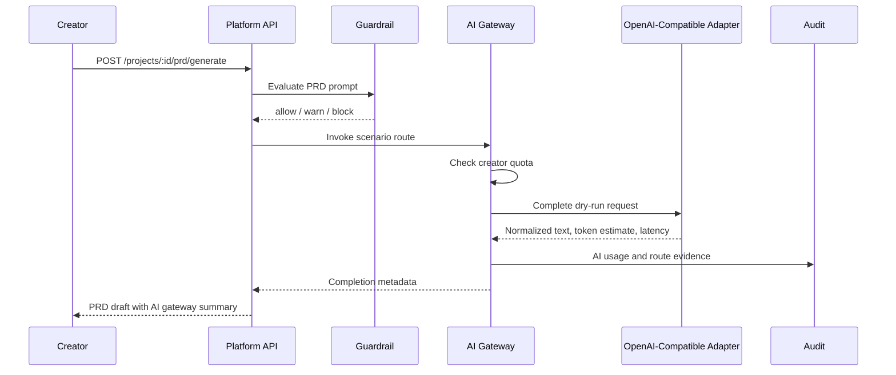

# Real MVP External AI Provider Adapter Foundation

Status: Phase 2 implementation started  
Issue: #32  
Stacked after: #27 Real MVP private-server install foundation

## Purpose

The production blueprint chooses external AI providers only and requires a Provider Adapter architecture. This phase adds the first backend AI Gateway contract so PRD generation no longer depends on a direct deterministic-only path.

The current adapter runs in deterministic dry-run mode for CI and private-server verification. Live network execution is intentionally deferred to the worker/runtime hardening step so tests do not require real provider credentials.

## Gateway Flow

## Current Guarantees

- Provider routing uses a stable adapter contract.
- OpenAI-compatible and Azure OpenAI provider types map to the first adapter boundary.
- Guardrail `block` decisions stop before adapter invocation.
- Quota exhaustion stops before adapter invocation.
- API keys are stored as local envelopes and responses expose only masked/fingerprint values.
- PRD generation records AI usage with provider id, model, scenario, token estimate, latency, status, cost estimate and prompt fingerprint.
- Deterministic fallback is allowed only when a route fallback and explicit fallback text are provided.
- The install path does not require local LLM/Ollama/vLLM.

## Remaining Work

- Move live external calls into a controlled worker/runtime with timeout, retry and provider-specific error mapping.
- Persist AI providers, encrypted keys, routes, quotas and usage logs through Prisma repositories.
- Add provider test-call API for Admin Console.
- Route workspace/frontend/backend/review/documentation scenarios through the same gateway.
- Add per-provider cost tables and organization/project/app scoped quota consumption.
