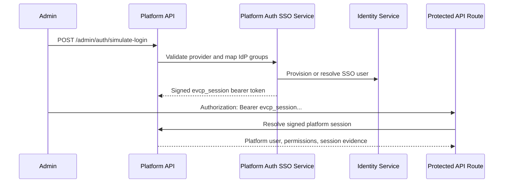

# Real MVP Platform Auth Session Foundation

Status: Phase 2 implementation started  
Issue: #28  
Stacked after: #27 Real MVP private-server install foundation

## Purpose

The Sprint 0-14 prototype used `x-mock-user-email` to identify the current user. That is not enough for a usable private-server MVP. This phase adds the first real backend-enforced session path: signed platform session bearer tokens.

This phase does not claim full production SSO callback support yet. Keycloak/OIDC/SAML provider setup is still represented by the existing Platform Auth configuration and simulated login flow. The important change is that normal API routes can now authenticate with an `Authorization: Bearer` platform session token instead of a mock user header.

## Auth Modes

| Mode | Intended use | Evidence |
| --- | --- | --- |
| `platform_session` | Real MVP transition path for authenticated API routes | Signed `evcp_session` bearer token, session id and expiry returned by `/auth/me` |
| `mock_header` | Temporary compatibility fallback for older Sprint 0-14 tests and screens | `/auth/me` returns `legacyMockFallback: true` |

## Session Flow

## Current Guarantees

- Session tokens are signed server-side with `SESSION_SECRET`.
- Tokens include session id, subject, email, issued-at and expiration claims.
- Expired, malformed and tampered bearer tokens return `401`.
- SSO claim emails can provision transient platform users with permissions derived from mapped platform roles.
- `/auth/me` reports the auth mode without returning raw secrets.
- Legacy mock headers still work only as an explicitly labeled fallback.

## Remaining Work

- Replace simulated login with a real Keycloak/OIDC callback.
- Persist sessions and SSO-provisioned users in PostgreSQL through Prisma repositories.
- Remove `mock_header` fallback after Admin, Creator and App Store frontends use real API clients and login.
- Add browser E2E that performs a real login against bundled Keycloak.
