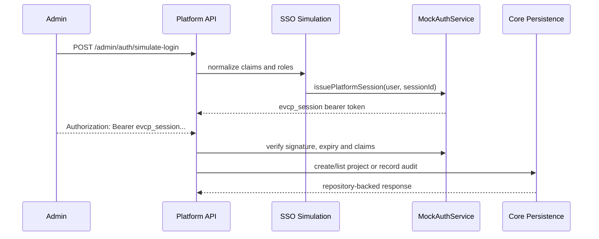

# Real MVP Platform Auth Session Runtime Integration

Status: Phase 2 implementation in progress  
Issue: #40  
Stacked after: #39 Runtime core persistence configuration

## Purpose

This phase moves the core Platform API away from mock-header-only authentication by issuing signed Platform Auth bearer sessions from the existing SSO simulation path and accepting those sessions on repository-backed core routes.

It does not claim that the real Keycloak/OIDC browser callback is complete. The current implementation creates the session contract that the real callback will use in the next auth slice.

## Auth Modes

| Mode | Current use | Behavior |
| --- | --- | --- |
| `platform_session` | Real MVP runtime path | Requests send `Authorization: Bearer evcp_session.<payload>.<signature>`. The API verifies the HMAC signature, expiry and session claims before resolving the platform user. |
| `mock_header` | Legacy sprint regression and migration fallback | Requests send `x-mock-user-email` or `x-evcp-user`. Core persistence routes map the resolved identity back to the repository user where required. |

`GET /auth/me` returns auth evidence so clients and tests can prove which mode was used:

```json
{
  "auth": {
    "mode": "platform_session",
    "sessionId": "psess_0001",
    "expiresAt": "2026-07-04T01:00:00.000Z",
    "legacyMockFallback": false
  }
}
```

## Runtime Flow



## Current Guarantees

- Platform sessions are signed with HMAC SHA-256 using `SESSION_SECRET`.
- Tokens carry a stable `typ`, `sid`, `sub`, `email`, `iat` and `exp` claim set.
- Tampered, malformed and expired bearer tokens return the existing unauthorized API envelope.
- Simulated SSO provisions an active platform user with permissions from mapped platform roles before issuing a session.
- Repository-backed `/auth/me`, `/projects`, `/audit-logs` and `/audit-logs/filter` accept bearer sessions when `EVCP_CORE_PERSISTENCE=memory` or `prisma`.
- Mock headers remain available as an explicit legacy fallback while sprint services are migrated.

## Verification

```bash
node --import tsx --test \
  tests/unit/platform-api-services.test.mjs \
  tests/integration/platform-auth-session-runtime-contract.test.mjs \
  tests/e2e/platform-api-http-smoke.test.mjs \
  tests/e2e/platform-auth-session-runtime-smoke.test.mjs
```

The full Phase 2 install regression remains:

```bash
pnpm verify:real-mvp-install
```

## Remaining Mock-to-Real Work

- Replace `/admin/auth/simulate-login` with the real Keycloak/OIDC callback and token exchange.
- Persist platform sessions in the database instead of the in-memory session registry.
- Replace the temporary frontend session bridge with the real Keycloak/OIDC callback; current Admin, Creator and App Store shells can store, send and clear `localStorage["evcp_session"]`.
- Remove the mock header fallback after Admin, Creator and App Store clients have migrated.
- Add PostgreSQL-backed auth session E2E coverage against a migrated private-server database.
