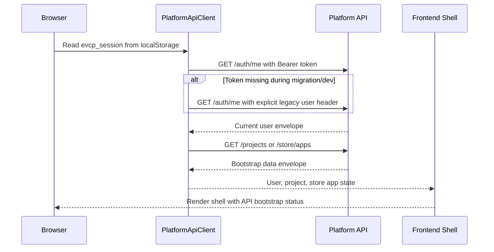

# Real MVP Frontend API Bootstrap

Status: Phase 2 implementation started
Issue: #45
Stacked after: #44 AI Provider Adapter runtime integration

## Purpose

The Admin Web, Creator Web and App Store PWA shells now start their primary user/project/store identity through the Platform API instead of importing mock fixtures directly. This is the first frontend mock-to-real migration step after the install, persistence, auth session and AI provider adapter foundations.

The goal is not to finish every interactive workflow in this slice. The goal is to make the frontend bootstrap path use the same API/auth boundary that the private-server install path exposes.

## Bootstrap Flow



## Current Coverage

- `@evcp/api-client` provides a browser-safe `PlatformApiClient`.
- The client supports:
  - `Authorization: Bearer <evcp_session>` for Platform Auth sessions.
  - explicit `x-mock-user-email` only as a migration/dev fallback.
  - typed success/failure envelope parsing through `PlatformApiError`.
  - `/auth/me`, `/projects` and `/store/apps` bootstrap routes.
  - Creator workspace operations for `/projects/:projectId/workspace`, `/projects/:projectId/workspace/prompts` and `/projects/:projectId/workspace/preview/refresh`.
  - Creator app management and publish operations for `/projects/:projectId/app/users`, `/projects/:projectId/app/invitations`, `/projects/:projectId/app/access-requests/decision`, `/projects/:projectId/publish/review`, `/projects/:projectId/publish` and `/app-store/registry`.
  - App Store operations for `/store/apps/:slug`, `/store/apps/:slug/access-requests`, `/store/apps/:slug/tickets` and `/store/tickets/:ticketId`.
  - installer operations for `/admin/installer/preflight`, `/admin/installer/setup` and `/admin/installer/reports`.
  - Admin AI provider test-call operation for `/ai/provider-test-call`.
  - Admin AI governance operations for `/ai/providers`, `/ai/api-keys`, `/ai/routes`, `/ai/quotas`, `/guardrails/rules` and `/guardrails/events`.
- Admin Web loads current user from `/auth/me`.
- Admin Web uses the shared client for the first-run install wizard preflight, setup save and installer report retrieval.
- Admin Web uses the shared client for the Provider Test Call panel, including pending/success/error state and sanitized output evidence.
- Admin Web uses the shared client for Create Provider, Save Masked Key, Configure Route, Configure Quota and Add Guardrail Rule actions, while retaining deterministic local fallback rows for Vite development without an API base URL.
- Creator Web loads current user and project list from `/auth/me` and `/projects`.
- Creator Web uses the shared client to load workspace state, submit prompts and refresh the live preview while preserving deterministic local fallback state.
- Creator Web uses the shared client to load app users/roles/invitations/access requests, create invitations, approve access requests, load publish review, publish to the App Store registry and surface deployment evidence.
- App Store PWA loads current user/store profile and apps from `/auth/me` and `/store/apps`.
- App Store PWA uses the shared client to request access, submit support tickets and retrieve ticket status timelines.
- Local Vite development falls back to deterministic local state when `VITE_PLATFORM_API_BASE_URL` is not configured.

## Configuration

For private-server compose/Caddy, frontend shells use `/api` by default.

For local integration against a direct Platform API port:

```bash
VITE_PLATFORM_API_BASE_URL=http://127.0.0.1:3100 pnpm dev
```

The current session token lookup is:

```text
localStorage["evcp_session"]
```

The frontend shells expose a temporary `Sign in` bridge that calls the existing simulated SSO endpoint, stores the returned `evcp_session` and reloads bootstrap data with Bearer auth. `Logout` clears both `evcp_session` and `evcp_session_expires_at`.

This is not the final Keycloak/OIDC browser callback. It exists so the Admin, Creator and App Store shells can exercise the Platform Auth bearer contract before the real callback/token exchange is wired.

Until the real browser login flow fully replaces the bridge, the frontend client keeps the explicit legacy header fallback per surface:

- Admin: `admin@company.com`
- Creator: `creator@company.com`
- App Store: `user@company.com`

## Remaining Work

### Admin AI governance pilot behavior

Admin AI governance is fail-closed in pilot mode. When its Platform API reads fail, the console clears the current provider, API-key, route, quota, and guardrail-event view, displays an unavailable state, and disables configuration writes until a successful refresh. It does not render fallback provider, key, route, quota, or guardrail data, and it never generates a replacement provider secret.

- Replace simulated login with the real Keycloak/OIDC browser callback and token storage.
- Continue moving remaining page tables/forms/actions from static demo arrays to API calls; Admin AI governance core actions are now API-backed.
- Remove legacy mock header fallback after all surfaces use Platform Auth bearer sessions.
- Add browser-level E2E with running API and real login once Keycloak callback is wired.
- Continue moving service state behind Prisma repositories so API bootstrap data is database-backed in private-server mode.
