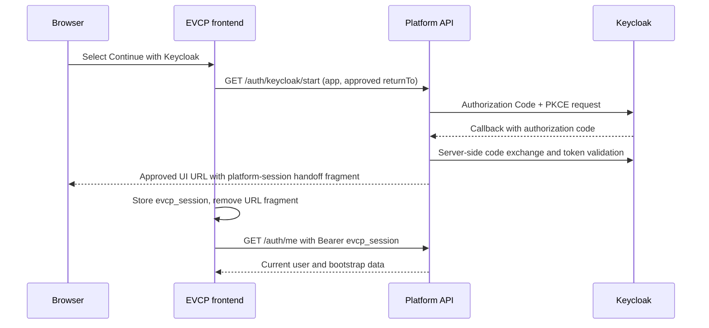

# Production Frontend API and Keycloak Bootstrap

## Browser bootstrap

Admin Web, Creator Web, and App Store PWA use Platform API as their application
boundary. Authentication is a server-brokered OpenID Connect **Authorization Code
with PKCE** flow, not a browser-managed Keycloak client flow.



The session handoff contains only the EVCP short-lived `evcp_session` and its expiry.
No Keycloak administrative credential, client secret, access token, or refresh token
is stored in the browser.

## Configuration

In Compose behind Caddy, browser shells use `/api`. For a direct local API:

```bash
VITE_PLATFORM_API_BASE_URL=http://127.0.0.1:3100 pnpm dev
```

The browser return origins must exactly match the API configuration:

| Shell | Configuration |
| --- | --- |
| Admin Web | `EVCP_ADMIN_WEB_URL` |
| Creator Web | `EVCP_CREATOR_WEB_URL` |
| App Store PWA | `EVCP_STORE_WEB_URL` |

`EVCP_PUBLIC_API_URL` defines Keycloak's only callback URL:
`${EVCP_PUBLIC_API_URL}/auth/keycloak/callback`. Configure the same URL as the
`evcp-platform-api` client redirect URI. Use externally visible HTTPS origins in a
production deployment; do not substitute a container-only hostname for a browser
return origin.

## API bootstrap behavior

After consuming a valid handoff, each shell reads `localStorage["evcp_session"]`
and calls `/auth/me` with its Bearer token before requesting its surface data:

- Admin: current user and operations routes.
- Creator: current user, projects, workspace, and publish routes.
- Store: current user and store-app routes.

Local UI fallback data remains available only when no Platform API base URL is
configured for standalone development. It is not an authentication path. A deployed
API rejects mock identity headers, native password login, password changes, and
simulated login; sign-in must start at `/auth/keycloak/start`.

## Troubleshooting

- A rejected `returnTo` means the UI origin does not exactly match its
  `EVCP_*_WEB_URL` value.
- A Keycloak redirect error means `EVCP_PUBLIC_API_URL` and the Keycloak client
  redirect URI differ.
- A callback error with no session means Platform API rejected state, PKCE, nonce,
  issuer, audience, signature, expiry, or group mapping. Start a new login rather
  than retrying an old callback URL.
- A successful sign-in without application access usually means the Keycloak user
  lacks the needed `evcp-admins`, `evcp-creators`, or `evcp-users` group.
