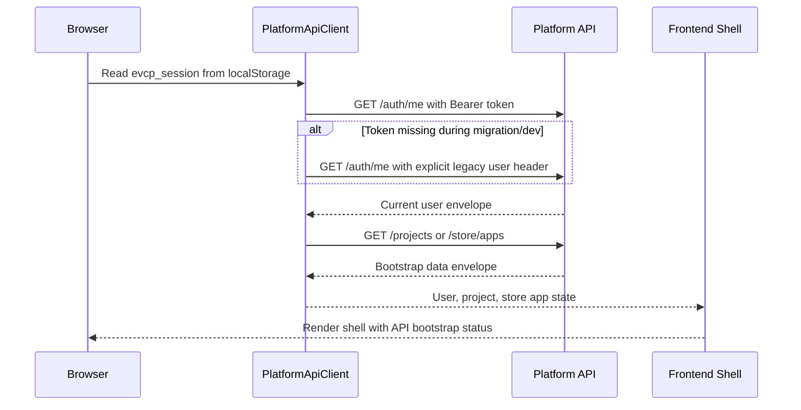

# Real MVP Frontend API Bootstrap

Status: Phase 2 implementation started
Issue: #45
Stacked after: #44 AI Provider Adapter runtime integration

## Purpose

The Admin Web, Creator Web and App Store PWA shells now start their primary user/project/store identity through the Platform API instead of importing mock fixtures directly. This is the first frontend mock-to-real migration step after the install, persistence, auth session and AI provider adapter foundations.

The goal is not to finish every interactive workflow in this slice. The goal is to make the frontend bootstrap path use the same API/auth boundary that the private-server install path exposes.

## Bootstrap Flow



## Current Coverage

- `@evcp/api-client` provides a browser-safe `PlatformApiClient`.
- The client supports:
  - `Authorization: Bearer <evcp_session>` for Platform Auth sessions.
  - explicit `x-mock-user-email` only as a migration/dev fallback.
  - typed success/failure envelope parsing through `PlatformApiError`.
  - `/auth/me`, `/projects` and `/store/apps` bootstrap routes.
- Admin Web loads current user from `/auth/me`.
- Creator Web loads current user and project list from `/auth/me` and `/projects`.
- App Store PWA loads current user/store profile and apps from `/auth/me` and `/store/apps`.
- Local Vite development falls back to deterministic local state when `VITE_PLATFORM_API_BASE_URL` is not configured.

## Configuration

For private-server compose/Caddy, frontend shells use `/api` by default.

For local integration against a direct Platform API port:

```bash
VITE_PLATFORM_API_BASE_URL=http://127.0.0.1:3100 pnpm dev
```

The current session token lookup is:

```text
localStorage["evcp_session"]
```

Until the real browser login/logout flow lands, the frontend client keeps the explicit legacy header fallback per surface:

- Admin: `admin@company.com`
- Creator: `creator@company.com`
- App Store: `user@company.com`

## Remaining Work

- Replace simulated login with the real Keycloak/OIDC browser callback and token storage.
- Move all page tables/forms/actions from static demo arrays to API calls.
- Remove legacy mock header fallback after all surfaces use Platform Auth bearer sessions.
- Add browser-level E2E with running API and real login once Keycloak callback is wired.
- Continue moving service state behind Prisma repositories so API bootstrap data is database-backed in private-server mode.
