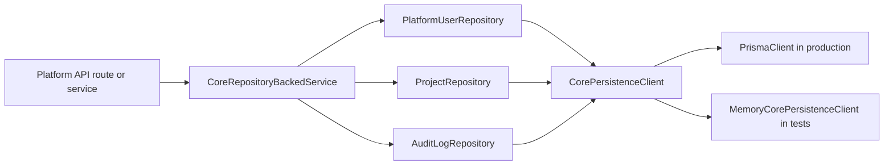

# Real MVP Core Persistence Foundation

Status: Phase 2 implementation in progress  
Issue: #34

## Purpose

This phase starts replacing mock-only Platform API state with a Prisma-backed persistence contract. It focuses on the core records every real MVP flow depends on:

- platform users, roles and permissions
- creator projects
- audit logs

The implementation is intentionally additive. It creates a repository layer and a repository-backed service harness without claiming every existing API route has already been migrated away from in-memory services.

## Current Data Flow



## Repository Coverage

| Repository | Prisma model | Real MVP behavior covered |
| --- | --- | --- |
| `PlatformUserRepository` | `PlatformUser`, `PlatformUserRole`, `PlatformRole` | Resolve user by email with status, role and permissions |
| `ProjectRepository` | `Project` | Create/upsert project, list all projects for admin, list owned projects for creator |
| `AuditLogRepository` | `AuditLog` | Record audit events, filter by actor, action, severity, project/app resource and date range |

## Test Coverage

```bash
node --import tsx --test \
  tests/unit/platform-core-persistence.test.mjs \
  tests/integration/platform-core-persistence-contract.test.mjs \
  tests/e2e/platform-core-persistence-flow.test.mjs
```

The tests prove:

- Prisma-shaped user records hydrate platform roles and permissions.
- Creator project creation uses the repository contract and can be upserted.
- Creator project listing is actor-scoped and admin listing is unrestricted.
- End users cannot create projects.
- Audit events are written and filtered through the repository layer.
- The repository-backed core flow can be returned through the shared API success envelope.
- The repository source remains aligned with the Prisma schema and seed records.

## Remaining Mock-to-Real Work

- Wire existing Platform API routes to repository-backed services.
- Add PostgreSQL-backed integration tests that run `prisma migrate deploy`, seed and route-level API calls against a real database.
- Move auth session lookup from mock headers to Platform Auth/Keycloak-backed identities.
- Move AI provider, PRD generation, workspace and publish/runtime services onto repository-backed state.
- Add data migration/rollback notes when replacing each in-memory service.
