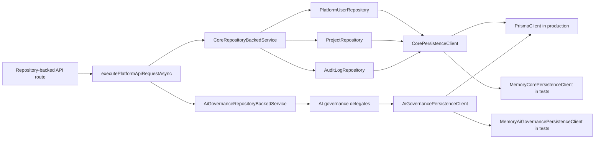

# Real MVP Core Persistence Foundation

Status: Phase 2 implementation in progress  
Issues: #34, #36, #38, #65

## Purpose

This phase starts replacing mock-only Platform API state with a Prisma-backed persistence contract. It focuses first on the core records every real MVP flow depends on:

- platform users, roles and permissions
- creator projects
- audit logs
- AI governance providers, masked API keys, route policy, quota policy and guardrail evidence

The implementation is intentionally additive. It creates a repository layer, a repository-backed service harness and an async core API execution path without claiming every existing sprint service has already been migrated away from in-memory state.

## Current Data Flow



## Route-Level Coverage

| Route | Persistence-backed behavior |
| --- | --- |
| `GET /auth/me` | Resolves current user from the repository by header email and writes `auth.me` audit evidence |
| `GET /projects` | Lists admin-visible or creator-owned projects through the repository |
| `POST /projects` | Creates/upserts project through the repository and writes `project.created` audit evidence |
| `GET /audit-logs` | Lists repository-backed audit events for admins |
| `POST /audit-logs/filter` | Filters repository-backed audit events by actor, action, severity, project/app and date range |

## AI Governance Route-Level Coverage

| Route | Persistence-backed behavior |
| --- | --- |
| `GET /ai/providers` | Lists admin-visible AI providers through the AI governance repository |
| `POST /ai/providers` | Creates/upserts an AI provider with adapter, base URL, model list and active status |
| `GET /ai/api-keys` | Lists API key metadata with fingerprint and masked value only |
| `POST /ai/api-keys` | Stores API key metadata with fingerprint, masked value and local envelope ciphertext without returning the raw secret |
| `POST /ai/routes` | Upserts scenario routing policy for primary and optional fallback provider/model |
| `POST /ai/quotas` | Upserts AI usage quota policy by scope |
| `POST /guardrails/rules` | Creates/upserts active guardrail rule metadata |
| `POST /guardrails/test` | Evaluates active guardrail rules and writes guardrail event evidence |
| `GET /guardrails/events` | Lists persisted guardrail evaluation events |

The legacy synchronous executor remains available for existing sprint regression tests and for services that have not yet moved to repositories.

## Runtime Mode

Platform API startup reads `EVCP_CORE_PERSISTENCE` through `createRuntimePlatformApiServices`.

| Mode | Use case | Behavior |
| --- | --- | --- |
| `legacy` | Existing sprint regression runs | Starts the mock-first in-memory services and does not create a core persistence service |
| `memory` | Deterministic local/API tests | Starts repository-backed core and AI governance routes with memory persistence clients and no database requirement |
| `prisma` | Online private server | Starts repository-backed core and AI governance routes with Prisma through `DATABASE_URL` |

Private-server `.env` should set:

```bash
EVCP_CORE_PERSISTENCE=prisma
DATABASE_URL=postgresql://...
```

`prisma` mode creates the Prisma-backed core and AI governance repository services lazily during Platform API startup. Existing sprint-specific services outside this route set still keep their legacy in-memory state until they are migrated in later slices.

## Repository Coverage

| Repository | Prisma model | Real MVP behavior covered |
| --- | --- | --- |
| `PlatformUserRepository` | `PlatformUser`, `PlatformUserRole`, `PlatformRole` | Resolve user by email with status, role and permissions |
| `ProjectRepository` | `Project` | Create/upsert project, list all projects for admin, list owned projects for creator |
| `AuditLogRepository` | `AuditLog` | Record audit events, filter by actor, action, severity, project/app resource and date range |
| `AiGovernanceRepositoryBackedService` | `AiProvider`, `AiApiKey`, `AiScenarioRoute`, `AiQuota`, `GuardrailRule`, `GuardrailEvent` | Persist AI governance setup, keep API secrets masked in responses and preserve guardrail event evidence |

## Test Coverage

```bash
node --import tsx --test \
  tests/unit/platform-core-persistence.test.mjs \
  tests/unit/platform-core-api-persistence.test.mjs \
  tests/integration/platform-core-persistence-contract.test.mjs \
  tests/integration/platform-core-api-persistence-contract.test.mjs \
  tests/integration/platform-ai-governance-persistence-contract.test.mjs \
  tests/e2e/platform-core-persistence-flow.test.mjs \
  tests/e2e/platform-core-api-persistence-smoke.test.mjs \
  tests/e2e/platform-ai-governance-persistence-flow.test.mjs
```

The tests prove:

- Prisma-shaped user records hydrate platform roles and permissions.
- Creator project creation uses the repository contract and can be upserted.
- Creator project listing is actor-scoped and admin listing is unrestricted.
- End users cannot create projects.
- Audit events are written and filtered through the repository layer.
- The repository-backed core flow can be returned through the shared API success envelope.
- The core API async executor can run `/auth/me`, `/projects`, `/audit-logs` and `/audit-logs/filter` against repository-backed state.
- The AI governance persistence service can create/list providers, masked API keys, routes, quotas, guardrail rules and guardrail events.
- Runtime memory persistence keeps AI governance state across service object recreation with the same persistence client.
- The repository source remains aligned with the Prisma schema and seed records.

## Remaining Mock-to-Real Work

- Add PostgreSQL-backed integration tests that run `prisma migrate deploy`, seed and route-level API calls against a real database.
- Replace simulated SSO login with the real Keycloak/OIDC callback and database-backed Platform Auth session lookup.
- Move PRD generation, workspace and publish/runtime services onto repository-backed state.
- Replace local envelope placeholder encryption with production KMS/secret-store integration before handling real customer provider secrets.
- Add data migration/rollback notes when replacing each in-memory service.
