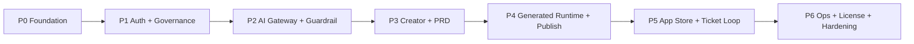

# Horizon - Production Implementation Backlog

Version: 0.1  
Date: 2026-07-03  
Status: Draft for Backlog Review  
Source requirements:

- `docs/requirements/production-blueprint-requirements.md`
- `docs/requirements/requirements-traceability-matrix.md`
- `docs/architecture/ADR-001-single-enterprise-private-server-deployment.md`
- `docs/architecture/ADR-002-ai-provider-adapter-architecture.md`
- `docs/architecture/ADR-003-generated-app-container-and-schema-isolation.md`
- `docs/architecture/ADR-004-policy-based-publish-governance.md`
- `docs/architecture/ADR-005-auth-broker-and-external-idp-strategy.md`

## 1. Purpose

เอกสารนี้แตก Production Blueprint, RTM และ ADR ชุดแรกออกเป็น implementation backlog ที่ทีม engineering สามารถนำไปวาง sprint, estimate, assign owner และสร้าง tickets ได้ โดยยังไม่ลงรายละเอียด code-level plan

## 2. Delivery Strategy

แนวทางการพัฒนาควรเป็น **foundation-first + vertical-slice validation**:

1. สร้าง platform foundation และ contracts ก่อน
2. ทำ governance/auth/audit/security boundary ให้แน่น
3. ทำ AI Gateway และ PRD/Creator workflow แบบใช้งานได้
4. ทำ generated app runtime และ publish governance
5. ทำ App Store, ticket, notification และ feedback loop
6. ปิด production operation: backup, restore, upgrade, license, observability

## 3. Backlog Conventions

| Field         | Meaning                                      |
| ------------- | -------------------------------------------- |
| ID            | Stable backlog item id                       |
| Priority      | P0 must ship, P1 fast follow, P2 future      |
| Type          | Epic, Story, Spike, Hardening                |
| Source        | Requirement, RTM test case, or ADR reference |
| Exit Criteria | Observable condition before item is complete |

## 4. Phase Plan

| Phase   | Goal                                                   | Exit Criteria                                                                                              |
| ------- | ------------------------------------------------------ | ---------------------------------------------------------------------------------------------------------- |
| Phase 0 | Repository and engineering foundation                  | Monorepo builds, shared packages exist, CI/test/lint conventions defined                                   |
| Phase 1 | Platform core, auth, audit, policy skeleton            | Users can authenticate, roles enforce API access, audit events record sensitive actions                    |
| Phase 2 | AI Gateway, guardrail, quota, knowledge/skill skeleton | Prompt can route through provider adapter with guardrail and usage logging                                 |
| Phase 3 | Creator project, PRD lifecycle, workspace preview      | Creator can create project, baseline PRD, prompt AI, preview, inspect database metadata                    |
| Phase 4 | Generated app runtime and publish governance           | App builds/deploys as separate container with schema per app and policy approval                           |
| Phase 5 | App Store PWA, access, ticket feedback loop            | End User can discover app, request access, submit ticket, Creator converts ticket to PRD change            |
| Phase 6 | Production operations and hardening                    | Installer, backup/PITR, restore drill, upgrade/rollback, observability, license enforcement pass RTM tests |

## 5. Phase 0 - Repository and Engineering Foundation

| ID         | Type  | Priority | Item                                                                     | Source               | Exit Criteria                                                                     |
| ---------- | ----- | -------- | ------------------------------------------------------------------------ | -------------------- | --------------------------------------------------------------------------------- |
| P0-FND-001 | Story | P0       | Create monorepo structure for platform apps and packages                 | FR-INST-003, ADR-001 | `apps/*`, `packages/*`, `generated-apps/*`, `docker/*`, `docs/*` structure exists |
| P0-FND-002 | Story | P0       | Configure TypeScript, package manager, lint, test, build scripts         | RTM TC-INST-003      | Root commands for build/test/lint run successfully                                |
| P0-FND-003 | Story | P0       | Create shared `types`, `config`, `api-client`, `auth-sdk`, `ui` packages | FR-CRE-007, ADR-003  | Frontends and API can import shared packages                                      |
| P0-FND-004 | Story | P0       | Create initial Docker Compose skeleton                                   | FR-INST-003, ADR-001 | Compose starts minimal platform services and infrastructure services              |
| P0-FND-005 | Story | P0       | Define API response envelope and platform error codes                    | API Contract, RTM    | Shared API contract package includes success/error envelopes                      |
| P0-FND-006 | Story | P0       | Add CI-ready quality gates                                               | RTM sign-off         | Build, test, lint, typecheck can run in automation                                |
| P0-FND-007 | Story | P1       | Add docs index and contribution guide                                    | Documentation        | New engineers can find requirements, ADRs, backlog, setup commands                |

## 6. Phase 1 - Platform Core, Auth, Audit, Policy Skeleton

| ID          | Type  | Priority | Item                                                                           | Source                     | Exit Criteria                                                      |
| ----------- | ----- | -------- | ------------------------------------------------------------------------------ | -------------------------- | ------------------------------------------------------------------ |
| P1-CORE-001 | Story | P0       | Scaffold `platform-api` service                                                | FR-INST-003                | API starts and exposes health endpoint                             |
| P1-CORE-002 | Story | P0       | Define core domain schema for users, groups, roles, projects, apps, audit logs | Domain Model               | Database schema covers core entities and relationships             |
| P1-AUTH-001 | Story | P0       | Implement Platform Auth session and claims contract                            | ADR-005, FR-AUTH-006       | API can resolve current user and role claims                       |
| P1-AUTH-002 | Story | P0       | Integrate bundled Keycloak default broker                                      | FR-AUTH-004, TC-AUTH-004   | Login through bundled Keycloak succeeds                            |
| P1-AUTH-003 | Story | P0       | Add OIDC provider configuration flow                                           | FR-AUTH-001, TC-AUTH-001   | Admin can configure OIDC and user can login                        |
| P1-AUTH-004 | Story | P0       | Add SAML provider configuration flow                                           | FR-AUTH-002, TC-AUTH-002   | Admin can configure SAML and user can login                        |
| P1-AUTH-005 | Story | P0       | Implement local break-glass admin                                              | FR-AUTH-003, SEC-007       | Break-glass login requires reason and emits critical audit         |
| P1-RBAC-001 | Story | P0       | Implement backend permission guard                                             | FR-ACCESS, SEC-002         | Protected APIs enforce role/scope checks                           |
| P1-AUD-001  | Story | P0       | Implement audit event service and event taxonomy                               | FR-AUD-001, Event Taxonomy | Sensitive events persist with actor/resource/request metadata      |
| P1-POL-001  | Story | P0       | Implement policy engine skeleton                                               | ADR-004                    | Policy engine accepts inputs and returns required reviewers/checks |

## 7. Phase 2 - AI Gateway, Guardrail, Knowledge, Skills

| ID         | Type  | Priority | Item                                                           | Source                        | Exit Criteria                                                        |
| ---------- | ----- | -------- | -------------------------------------------------------------- | ----------------------------- | -------------------------------------------------------------------- |
| P2-AI-001  | Story | P0       | Define `AIProviderAdapter` interface                           | ADR-002, AIGW-001             | Contract covers model list, completion, usage parsing, error mapping |
| P2-AI-002  | Story | P0       | Implement first OpenAI-compatible adapter                      | FR-AI-002                     | Admin can configure provider/base URL/model/key and make test call   |
| P2-AI-003  | Story | P0       | Implement scenario routing and fallback policy                 | FR-AI-003, AIGW-002, AIGW-003 | Route decision is deterministic and logged                           |
| P2-AI-004  | Story | P0       | Implement quota and license pre-check before provider call     | AIGW-004, FR-LIC              | Exhausted quota blocks before external request                       |
| P2-AI-005  | Story | P0       | Implement AI usage logging                                     | FR-AI-005, AIGW-005           | Usage stores tokens, cost estimate, latency, status                  |
| P2-GRD-001 | Story | P0       | Implement rule-based guardrail                                 | FR-GRD-001                    | Keyword/regex/PII/secret rules can warn/block                        |
| P2-GRD-002 | Story | P0       | Implement AI policy guardrail interface                        | FR-GRD-002                    | Policy rules can produce allow/warn/block/approval decision          |
| P2-GRD-003 | Story | P0       | Run guardrail before and after AI provider call                | AIGW-008                      | Unsafe prompt/response is blocked and audited                        |
| P2-KNW-001 | Story | P0       | Implement knowledge library metadata and upload                | FR-KNW-001                    | Supported sources can be uploaded and scoped                         |
| P2-KNW-002 | Story | P0       | Implement knowledge versioning, approval and indexing skeleton | FR-KNW-003 to FR-KNW-005      | Approved knowledge version can be retrieved by scoped AI task        |
| P2-SKL-001 | Story | P0       | Implement skill library, versioning, approval, assignment      | FR-SKL-001 to FR-SKL-005      | AI task can resolve approved skill by role/scenario/scope            |

## 8. Phase 3 - Creator App, PRD Lifecycle, Workspace

| ID         | Type  | Priority | Item                                                     | Source              | Exit Criteria                                              |
| ---------- | ----- | -------- | -------------------------------------------------------- | ------------------- | ---------------------------------------------------------- |
| P3-CRE-001 | Story | P0       | Scaffold Creator App shell and project picker            | FR-CRE-001          | Creator can view projects and create project               |
| P3-PRD-001 | Story | P0       | Implement PRD draft generation template flow             | FR-PRD-001          | New project receives PRD draft                             |
| P3-PRD-002 | Story | P0       | Implement PRD baseline confirmation and versioning       | FR-PRD-002          | PRD v1.0 baseline is immutable and audited                 |
| P3-PRD-003 | Story | P0       | Implement PRD change request from prompt/manual source   | FR-PRD-003          | Change request stores source, affected sections, risk      |
| P3-WS-001  | Story | P0       | Build prompt builder and AI task progress UI             | FR-CRE-002          | Creator sees task state and steps                          |
| P3-WS-002  | Story | P0       | Build live preview surface and refresh flow              | FR-CRE-003          | Preview supports desktop/tablet/mobile mode                |
| P3-DB-001  | Story | P0       | Build database schema/table/relationship/migration views | FR-CRE-004          | Creator sees app DB metadata without raw SQL               |
| P3-FE-001  | Story | P0       | Implement frontend checkpoint and restore model          | FR-CRE-005          | Restore affects frontend only and creates audit/checkpoint |
| P3-DEV-001 | Spike | P0       | Decide developer code editor workflow details            | RTM gap, FR-CRE-006 | Final ADR/backlog item chooses branch/review mechanics     |

## 9. Phase 4 - Generated App Runtime and Publish Governance

| ID         | Type  | Priority | Item                                                                     | Source                 | Exit Criteria                                              |
| ---------- | ----- | -------- | ------------------------------------------------------------------------ | ---------------------- | ---------------------------------------------------------- |
| P4-GEN-001 | Story | P0       | Define generated app folder template and manifest JSON schema            | ADR-003                | Generated app has required files and manifest fields       |
| P4-GEN-002 | Story | P0       | Generate standard React/Vite frontend and NestJS/Prisma backend skeleton | FR-CRE-007             | Generated app builds and tests with standard stack         |
| P4-GEN-003 | Story | P0       | Implement Platform Auth SDK integration for generated apps               | FR-AUTH-006            | Generated app protected APIs deny unauthenticated requests |
| P4-GEN-004 | Story | P0       | Implement app permission guard and role/permission matrix                | FR-ACCESS-003          | App APIs enforce app-level permissions                     |
| P4-DB-001  | Story | P0       | Implement schema-per-app provisioning and least-privilege DB user        | FR-DATA-004            | App cannot access another app schema                       |
| P4-DEP-001 | Story | P0       | Implement app container build/deploy contract                            | FR-RUN-001             | Published app runs as separate container                   |
| P4-DEP-002 | Story | P0       | Implement app health/readiness/log/metrics contract                      | Generated App Contract | Admin can see per-app health and logs                      |
| P4-DOM-001 | Story | P0       | Implement route registration through Caddy                               | FR-RUN-002, FR-RUN-003 | `/apps/{slug}` routes to app container with TLS            |
| P4-PUB-001 | Story | P0       | Implement publish request and policy evaluation                          | FR-RUN-006, ADR-004    | Required reviewers/checks are resolved from policy         |
| P4-PUB-002 | Story | P0       | Implement approval lifecycle and audit snapshots                         | Approval Lifecycle     | Approval states and decision snapshots persist             |
| P4-MIG-001 | Story | P0       | Implement migration dry-run and destructive migration checks             | ADR-003, ADR-004       | Destructive migration requires required approvals          |

## 10. Phase 5 - App Store, Access, Ticket, Feedback Loop

| ID            | Type  | Priority | Item                                                  | Source                   | Exit Criteria                                                     |
| ------------- | ----- | -------- | ----------------------------------------------------- | ------------------------ | ----------------------------------------------------------------- |
| P5-STORE-001  | Story | P0       | Scaffold App Store PWA shell                          | FR-STORE-001             | PWA manifest, responsive shell, offline fallback exist            |
| P5-STORE-002  | Story | P0       | Implement app visibility query                        | FR-STORE-002             | My Apps/Available Apps reflect permission policy                  |
| P5-ACCESS-001 | Story | P0       | Implement access request flow                         | FR-STORE-003             | User submits request and App Owner can approve/reject             |
| P5-ACCESS-002 | Story | P0       | Implement external user invite/access policy          | FR-STORE-005             | External access requires policy approval and audit                |
| P5-OPEN-001   | Story | P0       | Implement app open tracking and audit                 | FR-STORE-004             | Authorized launch succeeds, unauthorized launch denies            |
| P5-TKT-001    | Story | P0       | Implement support ticket submission                   | FR-TKT-001               | User submits ticket with type, priority, description, device info |
| P5-TKT-002    | Story | P0       | Implement ticket routing, assignment, status timeline | FR-TKT-002 to FR-TKT-004 | Creator/App Owner sees routed ticket and user tracks status       |
| P5-TKT-003    | Story | P0       | Implement ticket-to-PRD change conversion             | FR-TKT-005, FR-PRD-005   | Ticket links to PRD change request and audit                      |
| P5-NOTI-001   | Story | P0       | Implement in-app notifications                        | FR-NOTI-002              | Invite/access/publish/ticket notifications appear                 |
| P5-NOTI-002   | Story | P0       | Implement email notification channel                  | FR-NOTI-003              | Email sends or delivery failure is logged                         |

## 11. Phase 6 - Production Operations, License, Hardening

| ID          | Type      | Priority | Item                                                        | Source                 | Exit Criteria                                                          |
| ----------- | --------- | -------- | ----------------------------------------------------------- | ---------------------- | ---------------------------------------------------------------------- |
| P6-INST-001 | Story     | P0       | Build production CLI installer                              | FR-INST-001            | Installer runs preflight and creates install report                    |
| P6-INST-002 | Story     | P0       | Build Local Web Setup Wizard                                | FR-INST-002            | Admin completes setup through browser                                  |
| P6-BCK-001  | Story     | P0       | Implement configurable backup schedule                      | FR-BCK-001             | Encrypted backups stored in configured storage                         |
| P6-BCK-002  | Story     | P0       | Implement PostgreSQL PITR                                   | FR-BCK-002, OPS-002    | Restore to point-in-time works within retention                        |
| P6-BCK-003  | Story     | P0       | Implement restore drill and verification report             | FR-BCK-003             | Restore validation creates pass/fail report                            |
| P6-UPG-001  | Story     | P0       | Implement upgrade compatibility checks                      | OPS-005                | Upgrade blocks on missing backup/health/disk/license                   |
| P6-UPG-002  | Story     | P0       | Implement rollback command and report                       | FR-INST-005            | Failed upgrade can rollback with audit                                 |
| P6-OBS-001  | Story     | P0       | Build Admin health/log/audit dashboard                      | FR-OBS-001             | Admin sees core service and generated app health                       |
| P6-OBS-002  | Story     | P1       | Export metrics/logs/traces to external observability stack  | FR-OBS-002             | Telemetry export works with configured endpoint                        |
| P6-LIC-001  | Story     | P0       | Implement license module and signed license validation      | FR-LIC-001, FR-LIC-002 | Admin sees license status and offline cache works                      |
| P6-LIC-002  | Story     | P0       | Implement license enforcement policies                      | FR-LIC-003             | Expired/over-limit license blocks configured actions without data loss |
| P6-SEC-001  | Hardening | P0       | Implement TLS, secret encryption, redaction, session policy | SEC-001 to SEC-006     | Security controls pass RTM tests                                       |
| P6-SEC-002  | Hardening | P0       | Implement file upload validation and security checklist     | SEC-009, SEC-010       | Unsafe uploads and public/external publishes are blocked               |

## 12. MVP-Aligned Sprint Recommendation

Assumption from source MVP plan: 1-week sprint, 1-3 developers + AI coding assistant. The first delivery plan must preserve the source sprint order.

### Sprint 0 - Foundation and Design System

**Goal:** Prepare monorepo, design system, mock data and auth skeleton.

| Source Scope                                                                          | Backlog Items                                                                      |
| ------------------------------------------------------------------------------------- | ---------------------------------------------------------------------------------- |
| Monorepo, shared UI, app shells, mock auth, shared API client, fixtures, base layouts | P0-FND-001, P0-FND-002, P0-FND-003, P0-FND-005, P0-FND-007, early P1-AUTH-001 mock |

### Sprint 1 - Platform API Foundation

**Goal:** Create backend core, initial database schema, mock auth guard and seed data.

| Source Scope                                                                                  | Backlog Items                                     |
| --------------------------------------------------------------------------------------------- | ------------------------------------------------- |
| NestJS API, Prisma base, users/groups/roles, projects/apps, audit, seed users, `GET /auth/me` | P1-CORE-001, P1-CORE-002, P1-RBAC-001, P1-AUD-001 |

### Sprint 2 - Admin Console: AI Keys and Guardrails

**Goal:** Admin can configure AI providers/API keys and guardrails.

| Source Scope                                                                                               | Backlog Items                                                                             |
| ---------------------------------------------------------------------------------------------------------- | ----------------------------------------------------------------------------------------- |
| AI provider UI/API, API key UI/API, routing, quota, guardrail UI/API, mock AI policy classifier, event log | P2-AI-001, P2-AI-002, P2-AI-003, P2-AI-004, P2-AI-005, P2-GRD-001, P2-GRD-002, P2-GRD-003 |

### Sprint 3 - Creator Project Picker + PRD Generation

**Goal:** Creator can create project and confirm PRD baseline.

| Source Scope                                                                                                                   | Backlog Items                                  |
| ------------------------------------------------------------------------------------------------------------------------------ | ---------------------------------------------- |
| Project picker, project wizard, project APIs, PRD model, mock PRD generator, PRD viewer/version history, baseline confirmation | P3-CRE-001, P3-PRD-001, P3-PRD-002, P3-PRD-003 |

### Sprint 4 - Creator Workspace: Prompt + Live Preview

**Goal:** Lovable-like workspace with mock AI task and live preview.

| Source Scope                                                                                                               | Backlog Items                                                 |
| -------------------------------------------------------------------------------------------------------------------------- | ------------------------------------------------------------- |
| Workspace layout, chat/prompt, progress, token UI, preview, mock app generator, preview refresh, guarded prompt, usage log | P3-WS-001, P3-WS-002, P2-GRD-003, P2-AI-005, early P4-GEN-002 |

### Sprint 5 - Database View + Frontend Version Restore

**Goal:** Creator can inspect database and restore frontend only.

| Source Scope                                                                                                                     | Backlog Items                    |
| -------------------------------------------------------------------------------------------------------------------------------- | -------------------------------- |
| Schema/table/sample records/migration views, frontend checkpoints, version timeline, compare/preview, restore API, restore audit | P3-DB-001, P3-FE-001, P1-AUD-001 |

### Sprint 6 - App User Management + Publish

**Goal:** Creator can invite user, assign app role and publish app to App Store.

| Source Scope                                                                                                | Backlog Items                                                               |
| ----------------------------------------------------------------------------------------------------------- | --------------------------------------------------------------------------- |
| App roles, members, invites, access requests, manifest, publish API, deployment record, app registry update | P4-GEN-001, P4-GEN-004, P4-PUB-001, P4-PUB-002, P5-ACCESS-001, P5-STORE-002 |

### Sprint 7 - End User App Store PWA + Ticket

**Goal:** End User can use PWA App Store and submit ticket.

| Source Scope                                                                                                  | Backlog Items                                                     |
| ------------------------------------------------------------------------------------------------------------- | ----------------------------------------------------------------- |
| PWA manifest, mobile home, My/Available Apps, app detail, request access, ticket UI/API/status, Creator inbox | P5-STORE-001, P5-STORE-002, P5-ACCESS-001, P5-TKT-001, P5-TKT-002 |

### Sprint 8 - Ticket-to-PRD + Domain + Hardening

**Goal:** Close feedback loop and prepare pilot demo.

| Source Scope                                                                                                                                          | Backlog Items                                                          |
| ----------------------------------------------------------------------------------------------------------------------------------------------------- | ---------------------------------------------------------------------- |
| Convert ticket to PRD change, PRD approval, domain settings/request/approval, deployment traceability, monitoring, audit filters, demo cleanup/script | P5-TKT-003, P3-PRD-003, P4-DOM-001, P4-PUB-002, P6-OBS-001, P1-AUD-001 |

## 13. Cross-Cutting Definition of Done

Every implementation item is done only when:

- [ ] Linked requirement IDs are referenced in the ticket or PR.
- [ ] Tests cover happy path and at least one negative/security path when applicable.
- [ ] Backend permission guard is applied for protected APIs.
- [ ] Audit events are emitted for security-sensitive actions.
- [ ] No API key/secret is exposed in API responses, logs, or UI.
- [ ] Docs or ADRs are updated if behavior or decision changes.
- [ ] RTM test cases are updated when scope changes.

## 14. Blocking Decisions Before Coding Specific Areas

| Area        | Blocking Decision                                                    | Recommended Owner                |
| ----------- | -------------------------------------------------------------------- | -------------------------------- |
| Installer   | Minimum supported hardware and OS profile                            | Engineering / Ops                |
| Auth        | Default direct IdP support constraints beyond Keycloak broker        | Architecture / Security          |
| Policy      | Default policy templates for Public/Internal/Confidential/Restricted | Product / Security               |
| License     | Grace period, warning window, exact enforcement thresholds           | Product / Legal                  |
| Code Editor | Branch/review mechanics for Developer role                           | Product / Engineering / Security |
| Email       | SMTP-only vs email provider adapter v1                               | Engineering / IT                 |

## 15. Sprint Planning Artifacts

MVP sprint planning is tracked in these implementation-ready artifacts:

- `docs/planning/production-sprint-roadmap.md`
- `docs/planning/sprint-0-plan.md`
- `docs/planning/sprint-1-plan.md`
- `docs/planning/sprint-2-plan.md`
- `docs/planning/sprint-3-plan.md`
- `docs/planning/sprint-4-plan.md`
- `docs/planning/sprint-5-plan.md`
- `docs/planning/sprint-6-plan.md`
- `docs/planning/sprint-7-plan.md`
- `docs/planning/sprint-8-plan.md`

Production extension sprints 9-14 remain summarized in `docs/planning/production-sprint-roadmap.md` until the MVP baseline is reviewed and accepted.
