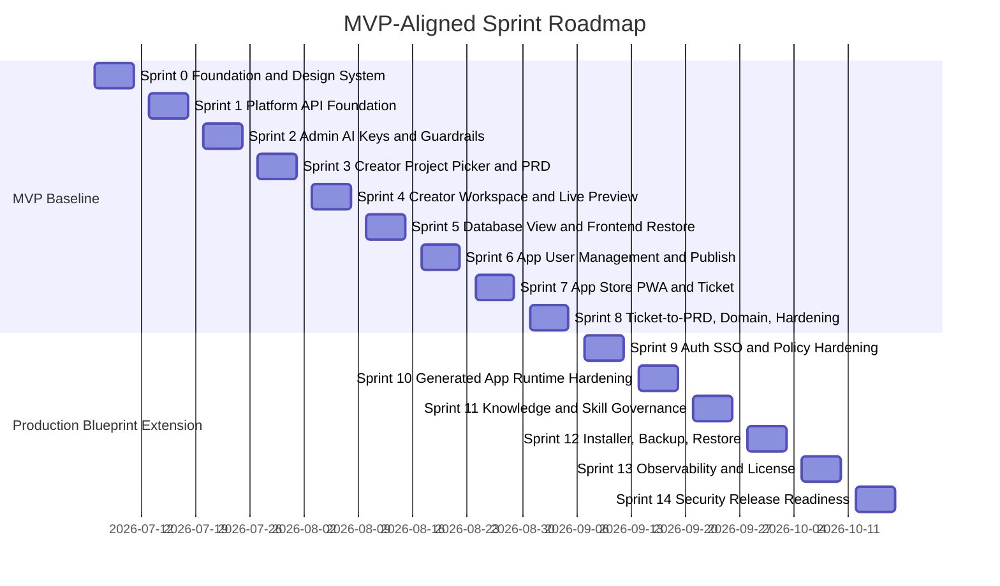

# Enterprise Vibe Coding Platform - MVP-Aligned Production Sprint Roadmap

Version: 0.2
Date: 2026-07-03
Status: Draft for Roadmap Review
Planning horizon: MVP Sprint 0 to Sprint 8, then Production Hardening Sprint 9 to Sprint 14
Sprint cadence: MVP baseline uses 1-week sprints as defined in the source backlog
Source backlog: `docs/planning/production-implementation-backlog.md` and attached MVP sprint plan

## 1. Purpose

เอกสารนี้ปรับ sprint roadmap ให้สอดคล้องกับ MVP sprint plan ในเอกสารตั้งต้น โดยรักษา Sprint 0-8 ตามลำดับเดิม แล้วต่อด้วย production hardening sprints สำหรับ capability ที่เกิน MVP แต่จำเป็นต่อ Production Blueprint

## 2. Source MVP Sprint Structure

เอกสารตั้งต้นกำหนด sprint assumptions ดังนี้:

| Item | Source Baseline |
| --- | --- |
| Sprint length | 1 week |
| Team size | 1-3 developers + AI coding assistant |
| Working style | AI-assisted pair development |
| MVP target | Usable MVP in 8 sprints after Sprint 0 foundation |
| Development style | Spec-first, template-first, small-task-first, testable-output-first, human-review-gated |

## 3. Roadmap Overview

## 4. Sprint Summary

| Sprint | Theme | Must Match Source MVP? | Primary Outcome |
| --- | --- | --- | --- |
| Sprint 0 | Foundation and Design System | Yes | Monorepo, shared UI, app shells, mock auth, API client, fixtures |
| Sprint 1 | Platform API Foundation | Yes | NestJS API, Prisma base schema, users/groups/roles, projects/apps, audit, seed data |
| Sprint 2 | Admin Console - AI Keys and Guardrails | Yes | Admin can manage providers/API keys/scenario routing/quota/guardrails |
| Sprint 3 | Creator Project Picker + PRD Generation | Yes | Creator creates project, PRD draft, PRD baseline |
| Sprint 4 | Creator Workspace - Prompt + Live Preview | Yes | Prompt, AI task progress, token UI, live preview, guardrail check |
| Sprint 5 | Database View + Frontend Version Restore | Yes | Schema/table/migration views and frontend-only restore |
| Sprint 6 | App User Management + Publish | Yes | App roles, members, invites, access requests, manifest, publish |
| Sprint 7 | End User App Store PWA + Ticket | Yes | PWA app store, app detail, request access, ticket, creator inbox |
| Sprint 8 | Ticket-to-PRD + Domain + Hardening | Yes | Ticket converts to PRD change, domain flow, traceability, full MVP demo |
| Sprint 9 | Auth SSO and Policy Hardening | Production extension | OIDC/SAML, Keycloak/direct IdP strategy, break-glass, policy templates |
| Sprint 10 | Generated App Runtime Hardening | Production extension | Separate app container, schema isolation, app health/log/OpenAPI/migrations |
| Sprint 11 | Knowledge and Skill Governance | Production extension | Versioning, approval, permission-filtered retrieval, assignment |
| Sprint 12 | Installer, Backup, Restore | Production extension | CLI installer, setup wizard, backup schedule, PITR, restore drill |
| Sprint 13 | Observability and License | Production extension | Health dashboard, telemetry export, signed license, enforcement |
| Sprint 14 | Security Release Readiness | Production extension | TLS, secrets, upload validation, release checklist, RTM regression |

## 5. MVP Sprint Details

Individual sprint plan files:

| Sprint | Plan |
| --- | --- |
| Sprint 0 | `docs/planning/sprint-0-plan.md` |
| Sprint 1 | `docs/planning/sprint-1-plan.md` |
| Sprint 2 | `docs/planning/sprint-2-plan.md` |
| Sprint 3 | `docs/planning/sprint-3-plan.md` |
| Sprint 4 | `docs/planning/sprint-4-plan.md` |
| Sprint 5 | `docs/planning/sprint-5-plan.md` |
| Sprint 6 | `docs/planning/sprint-6-plan.md` |
| Sprint 7 | `docs/planning/sprint-7-plan.md` |
| Sprint 8 | `docs/planning/sprint-8-plan.md` |
| Sprint 9 | `docs/planning/sprint-9-plan.md` |
| Sprint 10 | `docs/planning/sprint-10-plan.md` |

### Sprint 0 - Foundation and Design System

**Goal:** เตรียม monorepo, design system, mock data, auth skeleton

| Source Task | Backlog Mapping | Deliverable |
| --- | --- | --- |
| S0.1 Generate monorepo structure | P0-FND-001 | Workspace folders for apps/packages/generated-apps/docker/docs |
| S0.2 Create shared UI package | P0-FND-003 | Shared UI package and base components |
| S0.3 Create app shell for Admin / Creator / Store | P0-FND-003 | Admin, Creator and PWA shells |
| S0.4 Create mock auth provider | P1-AUTH-001 early mock | Mock login and role context |
| S0.5 Create shared API client | P0-FND-003, P0-FND-005 | API client with response envelope |
| S0.6 Create mock data fixtures | P0-FND-003 | Seed fixtures for admin, creator, end user |
| S0.7 Create base layout components | P0-FND-003 | Sidebar, topbar, cards, tables, tabs basics |

**Exit Criteria:**
- Admin app shell, Creator app shell and App Store PWA shell run.
- Shared UI package is imported by all three frontend shells.
- Mock login supports admin, creator and end_user roles.
- Role-based routing works at shell level.

**Demo:** Switch mock roles and show Admin, Creator and App Store shell access.

### Sprint 1 - Platform API Foundation

**Goal:** สร้าง backend core, database schema เริ่มต้น, auth mock/guard, seed data

| Source Task | Backlog Mapping | Deliverable |
| --- | --- | --- |
| S1.1 Create NestJS platform-api | P1-CORE-001 | Platform API service running |
| S1.2 Setup Prisma schema base | P1-CORE-002 | Prisma schema and first migration |
| S1.3 Add users/groups/roles tables | P1-CORE-002 | Identity core data model |
| S1.4 Add projects/apps basic tables | P1-CORE-002 | Project/app data model |
| S1.5 Add audit log service | P1-AUD-001 | Audit event persistence |
| S1.6 Add seed users: admin, creator, end user | P1-CORE-002 | Seed data |
| S1.7 Add auth guard mock | P1-RBAC-001 | Mock auth guard and `GET /auth/me` |

**Exit Criteria:**
- Platform API runs and connects to PostgreSQL.
- Prisma migration applies cleanly.
- Seed users exist for admin, creator and end user.
- `GET /auth/me` returns current user and permissions.
- Basic audit log records key events.

**Demo:** Start API, run migrations/seed, call `/auth/me`, show audit log record.

### Sprint 2 - Admin Console: AI Keys and Guardrails

**Goal:** Admin ตั้งค่า AI provider/API key และ guardrail ได้

| Source Task | Backlog Mapping | Deliverable |
| --- | --- | --- |
| S2.1 Build AI provider UI | P2-AI-002 | Provider list/create UI |
| S2.2 Build API key UI | P2-AI-002 | Masked API key management UI |
| S2.3 Build scenario routing UI | P2-AI-003 | Scenario route UI |
| S2.4 Build quota UI | P2-AI-004 | Quota config UI |
| S2.5 Implement AI provider APIs | P2-AI-002 | Provider/model APIs |
| S2.6 Implement API key APIs with encryption-ready storage | P2-AI-002, SEC-002 | Encrypted key persistence |
| S2.7 Build guardrail UI | P2-GRD-001 | Guardrail rule UI |
| S2.8 Implement rule-based guardrail APIs | P2-GRD-001 | Keyword/regex guardrail APIs |
| S2.9 Implement AI policy guardrail mock classifier | P2-GRD-002 | Mock policy classifier |
| S2.10 Add guardrail event log | P2-GRD-003, P1-AUD-001 | Guardrail event log |

**Exit Criteria:**
- Admin can add AI provider/API key without exposing secret after save.
- Admin can configure usage mode/scenario/fallback/quota.
- Admin can create banned keyword and AI policy rules.
- Test prompt returns allow/warn/block.

**Demo:** Add provider/key, configure route/quota, test blocked prompt, show event log.

### Sprint 3 - Creator Project Picker + PRD Generation

**Goal:** Creator สร้าง project และ PRD baseline ได้

| Source Task | Backlog Mapping | Deliverable |
| --- | --- | --- |
| S3.1 Creator project picker UI | P3-CRE-001 | Project picker |
| S3.2 Create project wizard | P3-CRE-001 | Project creation form |
| S3.3 Project APIs | P3-CRE-001, P1-CORE-002 | Project CRUD APIs |
| S3.4 PRD data model | P3-PRD-001, P3-PRD-002 | PRD schema |
| S3.5 PRD generation mock service | P3-PRD-001 | Deterministic PRD generator |
| S3.6 PRD viewer UI | P3-PRD-002 | PRD viewer |
| S3.7 PRD version history | P3-PRD-002 | Version history |
| S3.8 Confirm PRD baseline | P3-PRD-002 | Baseline confirmation |

**Exit Criteria:**
- Creator sees own projects.
- Creator creates Leave Management project.
- System generates PRD draft.
- Creator confirms PRD v1.0 baseline.

**Demo:** Create Leave Management project and confirm PRD baseline.

### Sprint 4 - Creator Workspace: Prompt + Live Preview

**Goal:** สร้าง Lovable-like workspace พร้อม mock AI task และ live preview

| Source Task | Backlog Mapping | Deliverable |
| --- | --- | --- |
| S4.1 Workspace layout | P3-WS-001 | Three-panel workspace |
| S4.2 Chat/prompt panel | P3-WS-001 | Prompt UI |
| S4.3 AI task progress component | P3-WS-001 | Task progress |
| S4.4 Token remaining UI | P2-AI-005, P3-WS-001 | Token usage display |
| S4.5 Live preview panel | P3-WS-002 | Preview panel |
| S4.6 Mock app generator | P4-GEN-002 early mock | Mock Leave app preview |
| S4.7 Preview refresh API | P3-WS-002 | Preview refresh |
| S4.8 Prompt API with guardrail check | P2-GRD-003, P3-WS-001 | Guarded prompt API |
| S4.9 AI usage log | P2-AI-005 | Usage log |

**Exit Criteria:**
- Creator sends prompt.
- Guardrail checks prompt.
- Token remaining decreases.
- AI task progress displays.
- Preview updates.

**Demo:** Prompt “Add WFH leave type”, show progress and updated preview.

### Sprint 5 - Database View + Frontend Version Restore

**Goal:** Creator ดู database และ restore frontend เฉพาะ UI ได้

| Source Task | Backlog Mapping | Deliverable |
| --- | --- | --- |
| S5.1 Database schema view UI | P3-DB-001 | Schema view |
| S5.2 Table view UI | P3-DB-001 | Table view |
| S5.3 Sample records API | P3-DB-001 | Sample records API |
| S5.4 Migration history UI | P3-DB-001 | Migration timeline |
| S5.5 Frontend checkpoint data model | P3-FE-001 | Checkpoint model |
| S5.6 Frontend version timeline UI | P3-FE-001 | Version timeline |
| S5.7 Compare/preview old version mock | P3-FE-001 | Version preview/compare |
| S5.8 Restore frontend API | P3-FE-001 | Frontend restore API |
| S5.9 Restore audit log | P1-AUD-001, P3-FE-001 | Restore audit event |

**Exit Criteria:**
- Creator sees schema/table/sample data/migration history.
- Creator sees frontend versions.
- Creator restores frontend version.
- Backend/database/auth/app roles are not affected.

**Demo:** Open DB view, preview old version, restore frontend-only checkpoint, show audit log.

### Sprint 6 - App User Management + Publish

**Goal:** Creator invite user, assign app role และ publish app ไป App Store ได้

| Source Task | Backlog Mapping | Deliverable |
| --- | --- | --- |
| S6.1 App roles UI | P4-GEN-004 | App roles UI |
| S6.2 App members UI | P5-ACCESS-001 | Members UI |
| S6.3 Invite user modal | P5-ACCESS-001 | Invite modal |
| S6.4 Invitations APIs | P5-ACCESS-001 | Invitation APIs |
| S6.5 Access requests APIs | P5-ACCESS-001 | Access request APIs |
| S6.6 App manifest generation | P4-GEN-001 | App manifest |
| S6.7 Publish API | P4-PUB-001 | Publish API |
| S6.8 Deployment record | P4-PUB-002, P4-DEP-001 | Deployment record |
| S6.9 App registry update | P5-STORE-002 | App appears in store registry |

**Exit Criteria:**
- Creator invites user.
- Creator assigns app role.
- Creator publishes app.
- Published app appears in App Store registry.

**Demo:** Invite End User as Employee and publish Leave Management to App Store.

### Sprint 7 - End User App Store PWA + Ticket

**Goal:** End User ใช้ App Store แบบ PWA และส่ง ticket ได้

| Source Task | Backlog Mapping | Deliverable |
| --- | --- | --- |
| S7.1 PWA manifest | P5-STORE-001 | PWA manifest |
| S7.2 Mobile-first App Store home | P5-STORE-001 | Mobile home |
| S7.3 My Apps / Available Apps | P5-STORE-002 | App visibility |
| S7.4 App detail page | P5-STORE-002 | App detail |
| S7.5 Request access flow | P5-ACCESS-001 | Access request |
| S7.6 Submit ticket UI | P5-TKT-001 | Ticket form |
| S7.7 Ticket APIs | P5-TKT-001 | Ticket APIs |
| S7.8 Ticket status page | P5-TKT-002 | Ticket status |
| S7.9 Creator ticket inbox | P5-TKT-002 | Creator inbox |

**Exit Criteria:**
- End User sees accessible apps.
- End User requests access.
- End User submits ticket.
- Creator sees ticket.

**Demo:** End User opens App Store, views Leave Management, submits bug ticket, Creator sees it.

### Sprint 8 - Ticket-to-PRD + Domain + Hardening

**Goal:** ปิด loop feedback -> PRD change และเตรียม demo pilot

| Source Task | Backlog Mapping | Deliverable |
| --- | --- | --- |
| S8.1 Convert ticket to PRD change request | P5-TKT-003 | Ticket-to-PRD conversion |
| S8.2 PRD change request approval flow | P3-PRD-003, P4-PUB-002 | PRD approval |
| S8.3 Domain settings UI | P4-DOM-001 | Domain settings |
| S8.4 Public domain request UI | P4-DOM-001 | Public domain request UI |
| S8.5 Domain approval API | P4-DOM-001, P4-PUB-001 | Domain approval API |
| S8.6 Deployment traceability view | P4-PUB-002 | Traceability view |
| S8.7 Monitoring dashboard | P6-OBS-001 early MVP | Monitoring dashboard |
| S8.8 Full audit log filter | P1-AUD-001 | Audit filters |
| S8.9 Demo data cleanup | Demo readiness | Clean demo fixtures |
| S8.10 End-to-end demo script | Demo readiness | Full MVP script |

**Exit Criteria:**
- Ticket converts to PRD change.
- Domain request flow works.
- Deployment links PRD/frontend version.
- Full MVP demo is ready.

**Demo:** Full flow: Admin setup, Creator create/publish, End User ticket, Creator converts ticket to PRD change.

## 6. Production Blueprint Extension Sprints

### Sprint 9 - Auth SSO and Policy Hardening

**Goal:** Harden MVP auth and policy into Production Blueprint readiness.

| Focus | Backlog Mapping | Exit Criteria |
| --- | --- | --- |
| OIDC provider config | P1-AUTH-003 | OIDC login works |
| SAML provider config | P1-AUTH-004 | SAML login works |
| Break-glass admin hardening | P1-AUTH-005 | Reason + critical audit |
| Policy templates | P1-POL-001, ADR-004 | Public/Internal/Confidential/Restricted policies defined |
| Direct IdP constraints | ADR-005 | Architecture decision updated |

Detailed plan: `docs/planning/sprint-9-plan.md`

### Sprint 10 - Generated App Runtime Hardening

**Goal:** Move from MVP mock/runtime to production-grade generated app contract.

| Focus | Backlog Mapping | Exit Criteria |
| --- | --- | --- |
| Separate app container | P4-DEP-001 | App runs in its own container |
| Schema-per-app DB user | P4-DB-001 | Cross-schema access denied |
| Health/readiness/log/metrics | P4-DEP-002 | Runtime contract visible |
| OpenAPI and migration contract | P4-GEN-001, P4-MIG-001 | Spec and migration linked to deployment |

Detailed plan: `docs/planning/sprint-10-plan.md`

### Sprint 11 - Knowledge and Skill Governance

**Goal:** Make knowledge and skill management governed, versioned and permission-aware.

| Focus | Backlog Mapping | Exit Criteria |
| --- | --- | --- |
| Knowledge library | P2-KNW-001 | Sources uploaded and scoped |
| Knowledge indexing/versioning/approval | P2-KNW-002 | Approved version retrieved by AI |
| Skill library/versioning/assignment | P2-SKL-001 | Skill selected by role/scenario/scope |

Detailed plan: `docs/planning/sprint-11-plan.md`

### Sprint 12 - Installer, Backup, Restore

**Goal:** Make private-server deployment installable and recoverable.

| Focus | Backlog Mapping | Exit Criteria |
| --- | --- | --- |
| CLI installer | P6-INST-001 | Preflight and install report |
| Local Web Setup Wizard | P6-INST-002 | Browser setup completes |
| Backup schedule | P6-BCK-001 | Encrypted backups stored |
| PostgreSQL PITR | P6-BCK-002 | Restore to point in time |
| Restore drill | P6-BCK-003 | Pass/fail report |

### Sprint 13 - Observability and License

**Goal:** Add production monitoring and commercial control.

| Focus | Backlog Mapping | Exit Criteria |
| --- | --- | --- |
| Upgrade checks | P6-UPG-001 | Upgrade blocks unsafe state |
| Rollback command | P6-UPG-002 | Rollback audited |
| Health/log/audit dashboard | P6-OBS-001 | Core/app health visible |
| License validation | P6-LIC-001 | Signed license and offline cache |
| License enforcement | P6-LIC-002 | Limits block without data loss |

### Sprint 14 - Security Release Readiness

**Goal:** Close security hardening and validate release candidate.

| Focus | Backlog Mapping | Exit Criteria |
| --- | --- | --- |
| TLS/secrets/session/redaction | P6-SEC-001 | Security tests pass |
| Upload validation | P6-SEC-002 | Unsafe uploads blocked/quarantined |
| Public/external security checklist | P6-SEC-002 | Publish blocks until checklist passes |
| RTM regression | RTM | P0 tests pass or exceptions approved |

## 7. MVP to Production Milestones

| Milestone | Target Sprint | Evidence |
| --- | --- | --- |
| M0 Foundation shells ready | Sprint 0 | Admin, Creator, Store shells with mock auth |
| M1 API foundation ready | Sprint 1 | API, Prisma, seed data, `/auth/me`, audit |
| M2 Admin governance MVP ready | Sprint 2 | AI provider/key and guardrail setup |
| M3 Creator PRD baseline ready | Sprint 3 | Project + PRD v1.0 |
| M4 Creator workspace ready | Sprint 4 | Prompt + task progress + preview |
| M5 Creator restore/data view ready | Sprint 5 | DB view + frontend restore |
| M6 Publish to App Store ready | Sprint 6 | Invite, app role, publish, app registry |
| M7 End User feedback ready | Sprint 7 | PWA + ticket |
| M8 Full MVP demo ready | Sprint 8 | Ticket-to-PRD + domain + traceability |
| M9 Production hardening ready | Sprint 14 | RTM P0 validation and release readiness |

## 8. Sequencing Rules

- Do not move Sprint 2 before Sprint 1 API foundation, because Admin AI APIs need auth, seed users and audit.
- Do not move Sprint 4 before Sprint 3 PRD baseline, because prompt/live preview must load PRD context.
- Do not move Sprint 6 before Sprint 4/5, because publish depends on generated app preview, manifest and version context.
- Do not move Sprint 7 before Sprint 6, because App Store needs published app registry.
- Do not move Sprint 8 before Sprint 7, because ticket-to-PRD requires submitted tickets.
- Production extension sprints can be pulled earlier only if they do not break MVP sequence.

## 9. Release Readiness Criteria

MVP pilot is ready after Sprint 8 when:

- [ ] Admin can configure AI provider/API key and guardrail.
- [ ] Creator can create Leave Management project and confirm PRD baseline.
- [ ] Creator can prompt, preview, inspect database and restore frontend.
- [ ] Creator can invite user, assign app role and publish.
- [ ] End User can open App Store PWA, see app and submit ticket.
- [ ] Creator can convert ticket to PRD change.
- [ ] Deployment traceability and audit are visible.

Production candidate is ready after Sprint 14 when:

- [ ] MVP pilot criteria still pass.
- [ ] RTM P0 tests pass or have approved exceptions.
- [ ] OIDC/SAML, break-glass, policy templates and app isolation are production-hardened.
- [ ] Installer, backup, restore, upgrade, rollback, observability and license controls pass acceptance tests.
- [ ] Security hardening covers TLS, secrets, upload validation, public/external app checklist and log redaction.
