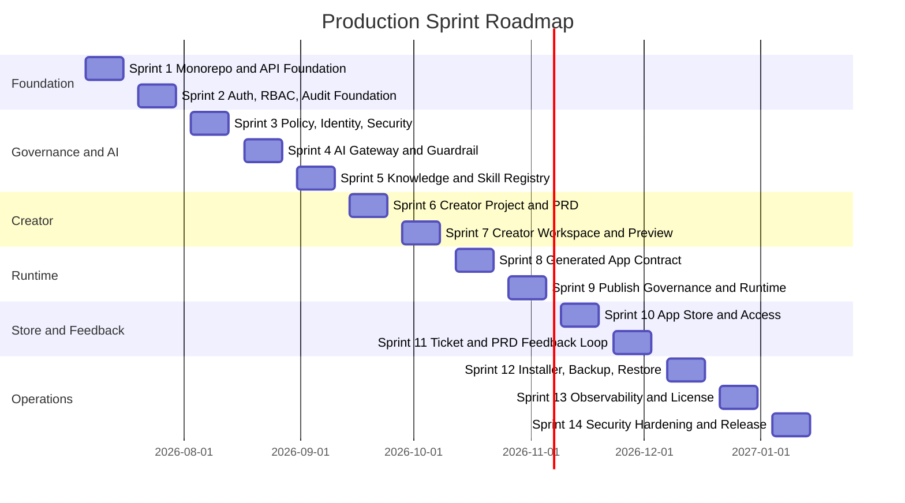

# Enterprise Vibe Coding Platform - Full Production Sprint Roadmap

Version: 0.1  
Date: 2026-07-03  
Status: Draft for Roadmap Review  
Planning horizon: Sprint 1 to Sprint 14  
Sprint cadence: 2 weeks  
Source backlog: `docs/planning/production-implementation-backlog.md`

## 1. Purpose

เอกสารนี้เขียนแผน sprint ให้ครบตลอด production delivery path จาก foundation ไปจนถึง production hardening เพื่อให้ทีมเห็นลำดับการทำงาน, dependencies, exit criteria และ demo outcome ของแต่ละ sprint ก่อนเริ่ม implementation

## 2. Planning Assumptions

| Assumption | Value |
| --- | --- |
| Sprint length | 2 weeks |
| First sprint | 2026-07-06 to 2026-07-17 |
| Team model | Small AI-assisted engineering team |
| Capacity model | Story points, recalibrate after Sprint 1 |
| Delivery model | Foundation-first with vertical-slice validation |
| Release style | Internal demo at end of every sprint |
| Scope policy | P0 items are committed; P1 items are stretch or fast follow |

## 3. Roadmap Overview

## 4. Sprint Summary

| Sprint | Dates | Theme | Primary Outcome |
| --- | --- | --- | --- |
| Sprint 1 | 2026-07-06 to 2026-07-17 | Monorepo and API Foundation | Repo builds/tests and minimal Platform API health endpoint works |
| Sprint 2 | 2026-07-20 to 2026-07-31 | Auth, RBAC, Audit Foundation | Platform Auth contract, Keycloak login, break-glass admin, audit skeleton |
| Sprint 3 | 2026-08-03 to 2026-08-14 | Policy, Identity, Security | OIDC/SAML config, permission guard, policy engine skeleton |
| Sprint 4 | 2026-08-17 to 2026-08-28 | AI Gateway and Guardrail | External AI provider adapter, routing, quota, usage log, guardrail |
| Sprint 5 | 2026-08-31 to 2026-09-11 | Knowledge and Skill Registry | Knowledge/skill library with versioning, approval and scoped retrieval |
| Sprint 6 | 2026-09-14 to 2026-09-25 | Creator Project and PRD | Creator can create project, generate PRD draft and confirm baseline |
| Sprint 7 | 2026-09-28 to 2026-10-09 | Creator Workspace and Preview | Prompt workspace, task progress, live preview, DB view, frontend restore |
| Sprint 8 | 2026-10-12 to 2026-10-23 | Generated App Contract | Generated app template, manifest, auth SDK integration and schema provisioning |
| Sprint 9 | 2026-10-26 to 2026-11-06 | Publish Governance and Runtime | Separate app container deploys through policy approval and Caddy route |
| Sprint 10 | 2026-11-09 to 2026-11-20 | App Store and Access | PWA App Store, visibility, access requests, external access policy |
| Sprint 11 | 2026-11-23 to 2026-12-04 | Ticket and PRD Feedback Loop | Ticket routing, status timeline, notifications, ticket-to-PRD change |
| Sprint 12 | 2026-12-07 to 2026-12-18 | Installer, Backup, Restore | CLI installer, setup wizard, backup schedule, PITR, restore drill |
| Sprint 13 | 2026-12-21 to 2027-01-01 | Observability and License | Health dashboard, telemetry export, signed license and enforcement |
| Sprint 14 | 2027-01-04 to 2027-01-15 | Security Hardening and Release | TLS, secrets, upload validation, public checklist, release readiness |

## 5. Detailed Sprint Plans

### Sprint 1 - Monorepo and API Foundation

**Dates:** 2026-07-06 to 2026-07-17  
**Goal:** Establish runnable repository foundation and platform API skeleton.

| Priority | Backlog Items | Owner Role |
| --- | --- | --- |
| P0 | P0-FND-001, P0-FND-002, P0-FND-003, P0-FND-005, P1-CORE-001 | Platform + Frontend |
| P1 | P0-FND-004, P0-FND-006, P0-FND-007 | Platform + QA/Product |

**Exit Criteria:**
- Root install/build/test/lint/typecheck commands run.
- Minimal `platform-api` starts and `/health` returns standard success envelope.
- Shared packages expose response/error contracts.
- Workspace layout matches ADR-003 boundaries.

**Demo:** Show repo structure, run quality commands, start API, call `/health`, walk docs index if stretch completes.

### Sprint 2 - Auth, RBAC, Audit Foundation

**Dates:** 2026-07-20 to 2026-07-31  
**Goal:** Create the security boundary before feature work.

| Priority | Backlog Items | Owner Role |
| --- | --- | --- |
| P0 | P1-CORE-002, P1-AUTH-001, P1-AUTH-002, P1-AUTH-005, P1-RBAC-001, P1-AUD-001 | Platform + Security |
| P1 | P1-POL-001 | Platform |

**Exit Criteria:**
- Core schema covers users, groups, roles, projects, apps and audit logs.
- Platform Auth can resolve current user and role claims.
- Bundled Keycloak login works.
- Break-glass admin requires reason and emits critical audit event.
- Backend permission guard denies unauthorized protected API access.

**Demo:** Login through Keycloak, call current-user endpoint, trigger denied API access, show audit events including break-glass test.

### Sprint 3 - Policy, Identity, Security

**Dates:** 2026-08-03 to 2026-08-14  
**Goal:** Complete identity provider configuration and first policy evaluation flow.

| Priority | Backlog Items | Owner Role |
| --- | --- | --- |
| P0 | P1-AUTH-003, P1-AUTH-004, P1-POL-001 | Platform + Security |
| P0 | Policy template draft for Public/Internal/Confidential/Restricted | Product + Security |
| P1 | Direct external IdP constraints decision | Architecture |

**Exit Criteria:**
- Admin can configure OIDC provider.
- Admin can configure SAML provider.
- Policy engine accepts publish/access inputs and returns required reviewer roles.
- First default data classification policy template exists.

**Demo:** Configure OIDC/SAML in admin flow, run policy evaluation examples for Internal, Confidential and Restricted apps.

### Sprint 4 - AI Gateway and Guardrail

**Dates:** 2026-08-17 to 2026-08-28  
**Goal:** Route AI prompts through governed external provider flow.

| Priority | Backlog Items | Owner Role |
| --- | --- | --- |
| P0 | P2-AI-001, P2-AI-002, P2-AI-003, P2-AI-004, P2-AI-005, P2-GRD-001 | Platform + AI |
| P1 | P2-GRD-002, P2-GRD-003 | AI + Security |

**Exit Criteria:**
- `AIProviderAdapter` contract exists and has tests.
- First OpenAI-compatible adapter works with configured provider/key.
- Scenario routing and fallback decisions are deterministic and logged.
- Quota check blocks before external provider call.
- Rule-based guardrail can block unsafe prompt before provider call.
- AI usage log records tokens/cost/latency/status when available.

**Demo:** Add provider/key, send safe prompt, show usage log, trigger quota block, trigger guardrail block.

### Sprint 5 - Knowledge and Skill Registry

**Dates:** 2026-08-31 to 2026-09-11  
**Goal:** Build the enterprise brain foundation for AI context and approved workflows.

| Priority | Backlog Items | Owner Role |
| --- | --- | --- |
| P0 | P2-KNW-001, P2-KNW-002, P2-SKL-001 | Platform + AI |
| P1 | P2-GRD-002, P2-GRD-003 carryover if needed | AI + Security |

**Exit Criteria:**
- Authorized user can upload supported knowledge source metadata.
- Knowledge item has scope and version.
- Approved knowledge version is retrievable by scoped AI task.
- Skill library supports versioning, approval and assignment by role/scenario/scope.
- AI task metadata references selected knowledge and skill versions.

**Demo:** Upload knowledge, approve version, create skill, assign skill to scenario, run AI task showing selected context metadata.

### Sprint 6 - Creator Project and PRD

**Dates:** 2026-09-14 to 2026-09-25  
**Goal:** Let Creator create a governed project with PRD source of truth.

| Priority | Backlog Items | Owner Role |
| --- | --- | --- |
| P0 | P3-CRE-001, P3-PRD-001, P3-PRD-002, P3-PRD-003 | Frontend + Platform |
| P1 | P3-DEV-001 spike | Product + Engineering + Security |

**Exit Criteria:**
- Creator App shell and project picker exist.
- Creator can create project with app name, business problem, app type, users and sensitivity.
- PRD draft generation template flow creates PRD.
- Creator can confirm immutable PRD baseline.
- Prompt/manual change can create PRD change request.

**Demo:** Create Leave Management project, generate PRD draft, confirm v1.0 baseline, create change request.

### Sprint 7 - Creator Workspace and Preview

**Dates:** 2026-09-28 to 2026-10-09  
**Goal:** Give Creator the first Lovable-like workspace for prompt, preview and app metadata inspection.

| Priority | Backlog Items | Owner Role |
| --- | --- | --- |
| P0 | P3-WS-001, P3-WS-002, P3-DB-001, P3-FE-001 | Frontend + Platform |
| P1 | Developer code editor workflow ADR/backlog from P3-DEV-001 | Architecture |

**Exit Criteria:**
- Creator sees prompt builder and AI task progress.
- Live preview supports desktop/tablet/mobile modes.
- Database view shows schema/table/relationships/migrations without raw SQL.
- Frontend checkpoint and restore model exists and preserves backend/database/auth/roles.

**Demo:** Prompt a change, show task progress, refresh preview, inspect database view, restore prior frontend checkpoint.

### Sprint 8 - Generated App Contract

**Dates:** 2026-10-12 to 2026-10-23  
**Goal:** Define and generate the standard production app boundary.

| Priority | Backlog Items | Owner Role |
| --- | --- | --- |
| P0 | P4-GEN-001, P4-GEN-002, P4-GEN-003, P4-GEN-004, P4-DB-001 | Platform + Full-stack |
| P1 | Generated app tests for first workflow template | QA + Full-stack |

**Exit Criteria:**
- Generated app template has required folder layout and manifest JSON schema.
- Generated app builds with React/Vite/TypeScript and NestJS/Prisma.
- Generated app protected API denies unauthenticated requests through Platform Auth SDK.
- App permission guard enforces app-level roles.
- Schema-per-app provisioning and least-privilege DB user prevent cross-schema access.

**Demo:** Generate app skeleton, inspect manifest, run tests, call protected endpoint unauthenticated, verify schema isolation.

### Sprint 9 - Publish Governance and Runtime

**Dates:** 2026-10-26 to 2026-11-06  
**Goal:** Publish a generated app through policy and run it as a separate container.

| Priority | Backlog Items | Owner Role |
| --- | --- | --- |
| P0 | P4-DEP-001, P4-DEP-002, P4-DOM-001, P4-PUB-001, P4-PUB-002, P4-MIG-001 | Platform + DevOps |
| P1 | Internal/custom domain admin UI polish | Frontend |

**Exit Criteria:**
- Publish request evaluates policy and creates required approval workflow.
- Approval lifecycle persists states and immutable decision snapshots.
- App builds and deploys as separate container.
- App exposes health/readiness/log/metrics contract.
- Caddy route `/apps/{slug}` reaches app container with TLS-ready route configuration.
- Migration dry-run and destructive migration approval checks exist.

**Demo:** Submit publish request for Leave Management app, approve by policy, deploy container, open app route, show app health and deployment record.

### Sprint 10 - App Store and Access

**Dates:** 2026-11-09 to 2026-11-20  
**Goal:** Let End Users discover and request access to apps through PWA.

| Priority | Backlog Items | Owner Role |
| --- | --- | --- |
| P0 | P5-STORE-001, P5-STORE-002, P5-ACCESS-001, P5-ACCESS-002, P5-OPEN-001 | Frontend + Platform |
| P1 | Favorite/recently-used app shortcuts | Frontend |

**Exit Criteria:**
- App Store PWA has manifest, responsive shell and offline fallback.
- My Apps and Available Apps reflect app visibility policy.
- End User can submit access request with reason and requested role.
- App Owner can approve/reject access request.
- External user invite/access policy is enforced and audited.
- Authorized launch succeeds and unauthorized launch is denied.

**Demo:** Open App Store on mobile viewport, show visible apps, request access, approve access, open app, show audit event.

### Sprint 11 - Ticket and PRD Feedback Loop

**Dates:** 2026-11-23 to 2026-12-04  
**Goal:** Complete the user feedback loop from App Store ticket to PRD change.

| Priority | Backlog Items | Owner Role |
| --- | --- | --- |
| P0 | P5-TKT-001, P5-TKT-002, P5-TKT-003, P5-NOTI-001, P5-NOTI-002 | Frontend + Platform |
| P1 | Ticket attachment storage hardening | Platform + Security |

**Exit Criteria:**
- End User submits ticket with type, priority, description and device info.
- Ticket routes to Creator/App Owner or Security Admin by type.
- Ticket status timeline and comments persist.
- End User can track ticket status.
- Creator converts ticket to PRD change request.
- In-app and email notifications are sent or delivery failure is logged.

**Demo:** End User submits bug ticket, Creator sees routed ticket, updates status, converts to PRD change request, notification appears.

### Sprint 12 - Installer, Backup, Restore

**Dates:** 2026-12-07 to 2026-12-18  
**Goal:** Make the private-server deployment operable with install and recovery workflows.

| Priority | Backlog Items | Owner Role |
| --- | --- | --- |
| P0 | P6-INST-001, P6-INST-002, P6-BCK-001, P6-BCK-002, P6-BCK-003 | DevOps + Platform |
| P1 | Hardware profile tuning from early install tests | DevOps |

**Exit Criteria:**
- CLI installer runs preflight and creates install report.
- Local Web Setup Wizard completes setup.
- Configurable encrypted backup schedule stores artifacts in configured storage.
- PostgreSQL PITR restores to point in time within retention.
- Restore drill creates pass/fail verification report.

**Demo:** Run installer flow in test environment, configure backup, execute restore drill, show report.

### Sprint 13 - Observability and License

**Dates:** 2026-12-21 to 2027-01-01  
**Goal:** Add production monitoring and commercial control without data loss risk.

| Priority | Backlog Items | Owner Role |
| --- | --- | --- |
| P0 | P6-UPG-001, P6-UPG-002, P6-OBS-001, P6-LIC-001, P6-LIC-002 | Platform + DevOps |
| P1 | P6-OBS-002 | DevOps |

**Exit Criteria:**
- Upgrade checks block on missing backup, unhealthy services, disk issue or invalid license.
- Rollback command restores previous version and audits result.
- Admin health/log/audit dashboard shows core services and generated app health.
- Signed license validation and offline cache work.
- Expired/over-limit license blocks configured create/publish/AI actions without deleting data.
- Telemetry export works if P1 completes.

**Demo:** Show health dashboard, run upgrade check, simulate rollback, install warning/expired license and show enforcement behavior.

### Sprint 14 - Security Hardening and Release Readiness

**Dates:** 2027-01-04 to 2027-01-15  
**Goal:** Close production security controls and validate release readiness against RTM.

| Priority | Backlog Items | Owner Role |
| --- | --- | --- |
| P0 | P6-SEC-001, P6-SEC-002 | Security + Platform |
| P0 | Full RTM regression and release candidate validation | QA + Product |
| P1 | Security review fixes and documentation polish | Security + Docs |

**Exit Criteria:**
- TLS, secret encryption, redaction and session policy pass security tests.
- File upload validation blocks unsafe uploads or quarantines according to policy.
- Public/external publish security checklist blocks incomplete release.
- RTM P0 tests pass or have approved release exceptions.
- Release notes and operation docs are complete enough for pilot handoff.

**Demo:** Run security checklist, show secret redaction, test unsafe upload rejection, run RTM regression summary, present release readiness report.

## 6. Cross-Sprint Milestones

| Milestone | Target Sprint | Evidence |
| --- | --- | --- |
| M1 Foundation Ready | Sprint 1 | Repo builds/tests and Platform API health works |
| M2 Security Boundary Ready | Sprint 3 | Auth, RBAC, audit and policy skeleton are usable |
| M3 Governed AI Ready | Sprint 5 | AI provider, guardrail, knowledge and skills can drive Creator workflows |
| M4 Creator Vertical Slice Ready | Sprint 7 | Creator creates PRD, prompts AI, previews and restores frontend |
| M5 Generated Runtime Ready | Sprint 9 | App deploys as separate container with policy approval |
| M6 App Store Feedback Ready | Sprint 11 | End User can open app, submit ticket and trigger PRD change |
| M7 Operable Private Server Ready | Sprint 13 | Install, backup, restore, upgrade, rollback, health and license work |
| M8 Production Release Candidate | Sprint 14 | RTM validation and hardening pass |

## 7. Dependencies and Sequencing Rules

- Phase 1 Auth/RBAC work must not start until response envelope and Platform API health endpoint are stable.
- AI Gateway must not call external providers before guardrail pre-check and quota pre-check are implemented.
- Creator publish flow must not ship before policy engine and approval snapshots exist.
- Generated app runtime must not ship before Platform Auth SDK and app permission guard exist.
- App Store visibility must not ship before app membership and access policy enforcement exist.
- Ticket-to-PRD conversion must not ship before PRD change request model exists.
- Production installer must not be treated as complete until backup, restore drill and upgrade checks work.

## 8. Roadmap-Level Risks

| Risk | Likely Sprint | Impact | Mitigation |
| --- | --- | --- | --- |
| Auth broker/direct IdP ambiguity | Sprint 2-3 | Delays auth architecture | Resolve ADR-005 implementation constraints before Sprint 2 starts |
| License policy thresholds missing | Sprint 13 | Blocks enforcement behavior | Product/Legal decision by Sprint 10 |
| Hardware profile undefined | Sprint 12 | Blocks installer validation | Engineering/Ops decision by Sprint 8 |
| Policy templates incomplete | Sprint 3 and Sprint 9 | Approval flow unclear | Product/Security templates by Sprint 3 |
| Code editor workflow unresolved | Sprint 6-7 | Developer role scope unclear | Spike in Sprint 6, ADR update before implementation |
| Generated app runtime too large | Sprint 8-9 | Delays vertical slice | Keep first app template narrow and prove Leave Management path |

## 9. Release Readiness Criteria

Production release candidate is ready only when:

- [ ] All Sprint 14 P0 exit criteria pass.
- [ ] RTM P0 tests pass or have approved exceptions.
- [ ] Requirements baseline, RTM, ADRs and backlog are updated to match delivered behavior.
- [ ] Installer, backup, restore, upgrade and rollback have run in a clean private-server test environment.
- [ ] Security review covers auth, RBAC, AI keys, guardrails, generated app permissions, file uploads and public/external access.
- [ ] Demo flow works end to end: Admin setup, Creator create/generate/publish, End User open/ticket, Creator convert ticket to PRD change.
