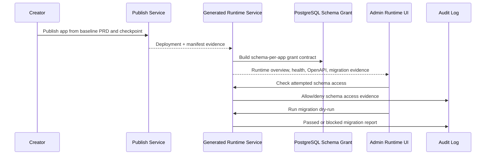

# Sprint 10 Plan - Generated App Runtime Hardening

Version: 0.1
Date: 2026-07-04
Status: Implemented and Accepted
Sprint dates: 2026-09-14 to 2026-09-18
Source roadmap: `docs/planning/production-sprint-roadmap.md`

## 1. Sprint Goal

ยกระดับ publish output จาก MVP registry ให้เป็น production runtime contract สำหรับ generated apps: แอปที่ publish แล้วต้องมี artifact layout, container identity, schema-per-app isolation, health/readiness/log/metrics, OpenAPI contract และ migration dry-run evidence ที่ตรวจสอบได้ผ่าน Admin API และ Admin UI

## 2. Source Alignment

| Roadmap Focus | Backlog Mapping | Sprint 10 Scope |
| --- | --- | --- |
| Separate app container | P4-DEP-001, FR-RUN-001, TC-RUN-001 | Runtime overview exposes container name, image tag, route and status per published app |
| Schema-per-app DB user | P4-DB-001, FR-DATA-004, TC-RUN-005 | Runtime service reports schema grant and denies cross-schema access attempts |
| Health/readiness/log/metrics | P4-DEP-002, FR-RUN-001, TC-RUN-007, TC-RUN-008 | Admin API exposes health, readiness, structured log sample and runtime metrics |
| OpenAPI and migration contract | P4-GEN-001, P4-MIG-001, TC-RUN-006, TC-RUN-009, TC-RUN-010 | Runtime overview links OpenAPI spec and migration dry-run report to deployment |

## 3. Planning Assumptions

| Assumption | Value |
| --- | --- |
| Depends on | Sprint 9 accepted auth/policy hardening baseline |
| Runtime depth | Deterministic production blueprint contract; real container orchestration is deferred to installer/deployment automation |
| Isolation model | Separate app container plus shared PostgreSQL schema-per-app |
| Auth | Generated apps remain behind Platform Auth SDK and do not integrate directly with enterprise IdP |
| UI surface | Admin Runtime Hardening dashboard using `@evcp/ui` primitives and design-system tokens |

## 4. Sprint Backlog

| Priority | Item | Owner Role | Deliverable |
| --- | --- | --- | --- |
| P0 | Generated runtime service | Platform Engineer | `GeneratedAppRuntimeService` with overview, schema check and migration dry-run APIs |
| P0 | Admin runtime API routes | Platform Engineer | `/admin/runtime/projects/:projectId` route family |
| P0 | Runtime persistence model | Platform Engineer | Prisma models, migration and seed for runtime evidence |
| P0 | Monitoring integration | Platform Engineer | Monitoring app health reads runtime evidence |
| P0 | Admin Runtime Hardening UI | UX/UI Designer / Frontend Engineer | Container, schema, health, logs, metrics, OpenAPI and migration panels |
| P0 | Tests | QA Engineer | Unit, integration and E2E/API/UI tests plus full regression gate |
| P0 | Docs and traceability | Technical Writer | ADR update, UI spec, delivery note, acceptance gate, changelog |

## 5. Architecture Flow

## 6. Test Plan

| Area | Check | Evidence |
| --- | --- | --- |
| Runtime overview | Artifact root, required paths, container identity, endpoints and schema isolation | Unit, E2E/API |
| Schema isolation | Assigned schema allowed and cross-schema access denied | Unit, E2E/API |
| Migration dry-run | Destructive changes require Developer Reviewer and Data Owner | Unit, E2E/API |
| Health/readiness | Health, readiness, log sample and metrics are exposed | Unit, E2E/API |
| OpenAPI | Version and generated API paths are linked to deployment | Unit, E2E/API |
| DB | Runtime models, migration SQL and seed evidence exist | Integration, Prisma migrate/seed, DB counts |
| UI | Admin Runtime Hardening dashboard exposes required sections | E2E/UI, screenshot |

## 7. Definition of Done

- [x] Runtime overview is available through service and Admin API.
- [x] Runtime contract includes artifact layout, container identity and endpoints.
- [x] Schema isolation allows only the assigned app schema and denies cross-schema attempts.
- [x] Health/readiness/log/metrics evidence is exposed.
- [x] OpenAPI contract is linked to generated app deployment.
- [x] Migration dry-run blocks destructive changes without approval.
- [x] Prisma schema, migration and seed include runtime evidence records.
- [x] Admin UI shows generated runtime hardening sections using shared design-system components.
- [x] Full `pnpm verify:sprint10` gate passes.
- [x] Prisma migrate/seed and DB count evidence are captured.
- [x] Screenshot and console evidence are captured.
- [x] Product Owner acceptance gate is signed off before PR is ready to merge.

## 8. Demo Script

1. Creator publishes Leave Management from baseline PRD and frontend checkpoint.
2. Admin opens Generated App Runtime Hardening.
3. Admin reviews artifact root, required paths, container name, image tag and runtime endpoints.
4. Admin checks that `app_user_leave_management` can access only `app_leave_management`.
5. Admin reviews `/health`, `/ready`, metrics and structured log sample.
6. Admin opens OpenAPI contract and sees generated paths.
7. Admin runs migration dry-run and sees destructive migration blocked without approvals.
