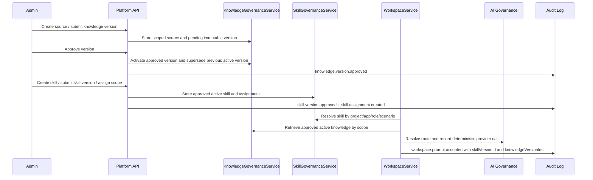

# Sprint 11 Plan - Knowledge and Skill Governance

Version: 0.1
Date: 2026-07-04
Status: Implemented, verification in progress
Sprint dates: 2026-09-21 to 2026-09-25
Source roadmap: `docs/planning/production-sprint-roadmap.md`

## 1. Sprint Goal

ทำให้ AI workflows มี governed context ที่ตรวจสอบย้อนหลังได้: Admin ต้องจัดการ Knowledge Library, immutable knowledge versions, approval/indexing, Skill Library, skill versions และ role/scenario/scope assignments ได้ และ Creator workspace prompt ต้องบันทึกว่าใช้ knowledge version และ skill version ใด

## 2. Source Alignment

| Roadmap Focus | Backlog Mapping | Sprint 11 Scope |
| --- | --- | --- |
| Knowledge library | P2-KNW-001, FR-KNW-001, TC-KNW-001 | Supported source metadata, owner, scope, upload and index status |
| Knowledge retrieval | P2-KNW-002, FR-KNW-002 to FR-KNW-005, TC-KNW-002 to TC-KNW-005 | Immutable versioning, approval activation, scoped retrieval and retrieval logs |
| Skill governance | P2-SKL-001, FR-SKL-001 to FR-SKL-005, TC-SKL-001 to TC-SKL-005 | Skill lifecycle, version contracts, approval, assignment and disabled exclusion |
| Workspace metadata | US-AI-001 | Prompt result stores selected knowledge and skill evidence |

## 3. Planning Assumptions

| Assumption | Value |
| --- | --- |
| Depends on | Sprint 10 accepted generated runtime hardening baseline |
| Indexing depth | Deterministic metadata/chunk indexing skeleton; external vector search deferred |
| Storage depth | Source content stored as metadata and excerpts for Sprint 11; object storage integration remains production extension |
| Access model | Admin manages sources/skills; Creator can retrieve/resolve through allowed project context |
| UI surface | Admin Knowledge and Skill Governance dashboard using `@evcp/ui` primitives |

## 4. Sprint Backlog

| Priority | Item | Owner Role | Deliverable |
| --- | --- | --- | --- |
| P0 | Knowledge governance service | Platform Engineer | Source/version/approval/retrieval lifecycle |
| P0 | Skill governance service | Platform Engineer | Skill/version/approval/assignment/disable lifecycle |
| P0 | Workspace integration | Platform Engineer | Prompt result includes `knowledgeRetrieval`, `skillSelection`, task metadata and audit |
| P0 | Admin API routes | Platform Engineer | `/admin/knowledge/*` and `/admin/skills/*` route families |
| P0 | Persistence contract | Platform Engineer | Prisma models, migration and seed records |
| P0 | Admin UI | UX/UI Designer / Frontend Engineer | Knowledge and Skill Governance dashboard |
| P0 | Tests | QA Engineer | Unit, integration and E2E/API/UI tests plus full regression gate |
| P0 | Docs and traceability | Technical Writer | Plan, UI spec, test plan, RTM, delivery note, acceptance gate and changelog |

## 5. Architecture Flow

## 6. Test Plan

| Area | Check | Evidence |
| --- | --- | --- |
| Knowledge source/version | Create source, submit version, approve active version | Unit, API |
| Knowledge retrieval | Approved active scoped knowledge returned; pending/denied excluded | Unit, API |
| Skill lifecycle | Create skill, submit version, approve, assign, disable | Unit, API |
| Skill resolution | Correct version selected by agent role, scenario and project/app scope | Unit, API |
| Workspace context | Prompt returns selected knowledge and skill metadata | Unit, E2E/API |
| DB | Models, migration SQL and seed evidence exist | Integration, Prisma validate/generate/migrate/seed, DB counts |
| UI | Admin Knowledge and Skill Governance dashboard exposes required sections | E2E/UI, screenshot |

## 7. Definition of Done

- [x] Knowledge sources support owner, supported source type, scope, upload and index status.
- [x] Knowledge versions are immutable, approval-gated and safely supersede previous active versions.
- [x] Retrieval filters approved active knowledge by actor, project, app, department, agent role and scenario.
- [x] Skill library supports draft, active and disabled states.
- [x] Skill versions store instruction, input/output schema, required knowledge and allowed tools.
- [x] Skill assignment resolves approved active version by role, scenario and scope.
- [x] Disabled skills and pending versions are excluded by resolver.
- [x] Workspace prompt returns knowledge and skill metadata.
- [x] Prisma schema, migration and seed include Sprint 11 records.
- [x] Admin UI renders Knowledge and Skill Governance dashboard.
- [x] Full `pnpm verify:sprint11` gate passes.
- [x] Prisma migrate/seed and DB count evidence are captured.
- [x] Screenshot and console evidence are captured.
- [x] Product Owner acceptance gate is signed off before Principal review.

## 8. Demo Script

1. Admin opens Knowledge and Skill Governance.
2. Admin reviews Knowledge Source Library, Version Approval and Scoped Retrieval evidence.
3. Admin reviews Skill Library, Skill Versioning and Skill Assignment evidence.
4. Admin creates/approves source and skill through API.
5. Creator submits workspace prompt and sees task metadata include knowledge/skill version IDs.
6. Admin checks audit/retrieval log evidence for the prompt.
