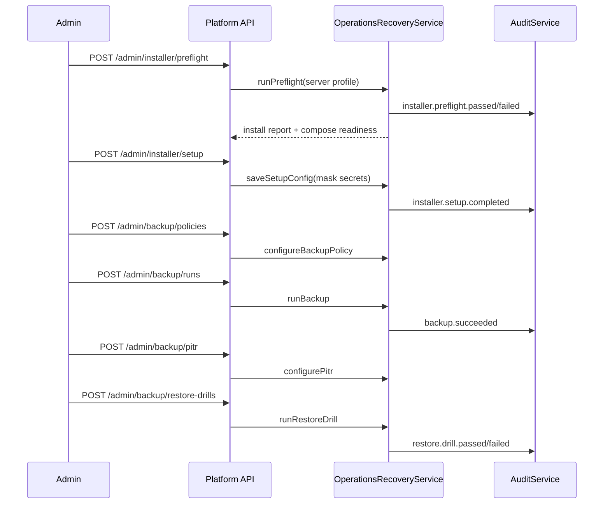

# Sprint 12 Plan - Installer, Backup, Restore

## Goal

Make private-server deployment installable and recoverable with deterministic installer reports, setup configuration evidence, encrypted backup metadata, PostgreSQL PITR readiness and restore drill reports.

## Source Alignment

| Area | Source | Sprint 12 Outcome |
| --- | --- | --- |
| CLI installer / preflight | FR-INST-001, FR-INST-004, TC-INST-001, TC-INST-004 | Admin can run preflight and receive pass/fail install report |
| Local Web Setup Wizard | FR-INST-002, TC-INST-002 | Setup config stores domain, database, storage, auth, AI, guardrail, backup and first admin safely |
| Docker Compose readiness | FR-INST-003, TC-INST-003 | Required services are represented in readiness evidence |
| Backup schedule and storage | FR-BCK-001, OPS-010, TC-BCK-001, TC-BCK-004 | Backup policy supports MinIO/S3-compatible target, retention, schedule and encryption key reference |
| PostgreSQL PITR | FR-BCK-002, OPS-002, TC-BCK-002 | PITR config records WAL retention, base backup, target timestamp and RPO/RTO |
| Restore drill | FR-BCK-003, OPS-003, TC-BCK-003 | Restore drill pass/fail report records validation checks and critical failure audit |

## Scope

| Priority | Item | Owner | Acceptance |
| --- | --- | --- | --- |
| P0 | Operations recovery service | Platform Engineer | Preflight, setup, backup, PITR and restore drill lifecycle methods |
| P0 | Admin API routes | Platform Engineer | `/admin/installer/*` and `/admin/backup/*` routes use shared envelope and admin-only access |
| P0 | Prisma persistence contract | Platform Engineer | Installer, setup, backup, PITR and restore drill models/migration/seed |
| P0 | Admin UI | Frontend Engineer / Designer | Operations Recovery dashboard using `@evcp/ui` primitives |
| P0 | Tests | QA / Engineer | Unit, integration and E2E coverage plus `verify:sprint12` |
| P1 | CLI wrapper | Platform Engineer | Small deterministic preflight/report script if needed after service/API contract |

## Flow

## Test Plan

| Area | Cases | Level |
| --- | --- | --- |
| Installer | pass/fail preflight, actionable failures, admin-only denial | Unit, E2E/API |
| Setup | config capture, secret redaction, audit evidence | Unit, E2E/API |
| Backup | policy, run metadata, encrypted artifact, MinIO/S3-compatible contract | Unit, E2E/API |
| PITR | WAL retention, base backup link, RPO/RTO | Unit, E2E/API |
| Restore drill | pass/fail validation, failed checks, critical audit | Unit, E2E/API |
| Persistence | schema, migration, seed records | Integration |
| UI | required Admin dashboard sections and responsive operations pattern | E2E/UI |

## Definition of Done

- [x] Operations service and Admin API cover installer, setup, backup, PITR and restore drill metadata.
- [x] Admin-only access enforced for operations routes.
- [x] Prisma migration and seed records exist.
- [x] Admin UI renders Installer, Backup and Restore dashboard.
- [x] Unit, integration and E2E Sprint 12 tests pass.
- [x] Full `pnpm verify:sprint12` passes.
- [x] Screenshot, DB count and Product Owner acceptance evidence are captured.
- [ ] Principal review evidence is posted on the PR.
