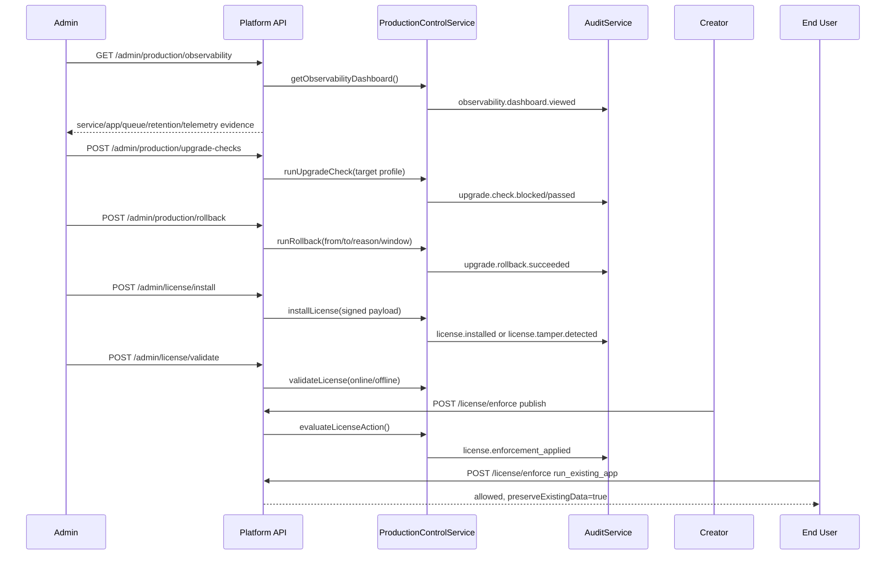
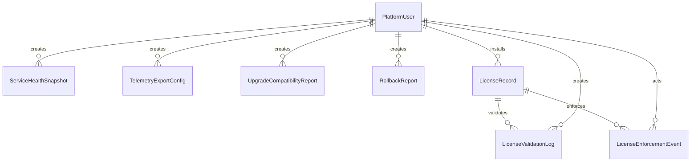

# Sprint 13 Plan - Observability and License

## Goal

Make the production private-server deployment observable and commercially governable with Admin health evidence, telemetry export configuration, upgrade/rollback safety reports, signed license validation and license enforcement that blocks privileged new actions without deleting existing apps or data.

## Source Alignment

| Area | Source | Sprint 13 Outcome |
| --- | --- | --- |
| Health/log/audit dashboard | FR-OBS-001, OPS-007 | Admin can inspect core service health, generated app health, queue backpressure and retention state |
| Observability export | FR-OBS-002, OPS-008 | OTLP-compatible telemetry export config is represented and seeded |
| Upgrade safety | FR-INST-005, OPS-005 | Upgrade compatibility checks block unsafe target versions when backup, service health, disk or license checks fail |
| Rollback report | OPS-006 | Rollback command/report metadata records from/to versions, reason, status and rollback window |
| License module | FR-LIC-001, FR-LIC-002 | Signed license payload metadata validates edition, seats, app limit, AI entitlement, warning/grace windows and offline cache |
| License enforcement | FR-LIC-003 | Publish, AI generation, new app, invite and activation actions are blocked by license policy while existing app usage remains allowed |

## Scope

| Priority | Item | Owner | Acceptance |
| --- | --- | --- | --- |
| P0 | Production control service | Platform Engineer | Observability dashboard, upgrade check, rollback, license install/validate/enforce methods |
| P0 | Admin/API routes | Platform Engineer | `/admin/production/*`, `/admin/license/*` and `/license/enforce` use shared envelope and role checks |
| P0 | Prisma persistence contract | Platform Engineer | Health, telemetry, upgrade, rollback, license, validation and enforcement models/migration/seed |
| P0 | Admin UI | Frontend Engineer / Designer | Observability and License dashboard using `@evcp/ui` primitives and mobile enforcement list |
| P0 | Tests | QA / Engineer | Unit, integration and E2E coverage plus `verify:sprint13` |
| P1 | External export runtime | Platform Engineer | Actual OTLP shipper integration can follow after receiver/environment decisions |

## Flow

## Data Model

## Test Plan

| Area | Cases | Level |
| --- | --- | --- |
| Observability | service health, generated app health, queues, retention, telemetry export, admin-only denial | Unit, E2E/API |
| Upgrade | safe/unsafe compatibility checks, blocking reasons, audit | Unit, E2E/API |
| Rollback | required reason, from/to version, rollback window and audit | Unit, E2E/API |
| License validation | signed payload, tamper detection, warning/grace/expired status, offline cache | Unit, E2E/API |
| License enforcement | action blocks, seat/app/AI limits, expired beyond grace, existing app continuity | Unit, E2E/API |
| Persistence | schema, migration and seed records | Integration |
| UI | required Admin dashboard sections and responsive enforcement pattern | E2E/UI |

## Definition of Done

- [x] Production service and Admin/API routes cover observability, upgrade, rollback and license workflows.
- [x] Admin-only access is enforced for production and license admin routes.
- [x] Prisma migration and seed records exist for Sprint 13.
- [x] Admin UI renders Observability and License dashboard.
- [x] Focused unit, integration and E2E Sprint 13 tests pass.
- [x] Full `pnpm verify:sprint13` passes.
- [x] Screenshot, DB count and Product Owner acceptance evidence are captured.
- [ ] Principal review evidence is posted on the PR.
