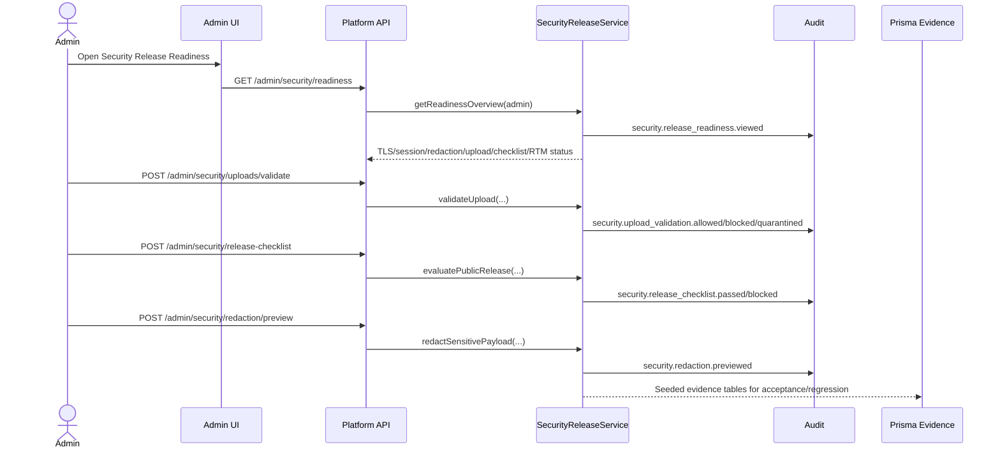

# Sprint 14 Plan - Security Release Readiness

Branch: `codex/sprint-14-security-release-readiness`

## Goal

Make the private-server platform release-ready for public or external app exposure by adding security readiness evidence across TLS, session policy, secret redaction, upload validation, release checklist, sensitive log redaction and RTM regression.

## Requirement Mapping

| Area | Source | Sprint 14 Outcome |
| --- | --- | --- |
| TLS/session/secrets | `SEC-001` to `SEC-006`, `P6-SEC-001` | Admin can inspect TLS enforcement, local setup HTTP exception, secure session policy and secret redaction evidence |
| Upload validation | `SEC-009`, `P6-SEC-002` | Unsupported, oversize and unsafe scan states are blocked or quarantined before ingestion |
| Public/external checklist | `SEC-010`, `P6-SEC-002` | Publish exposure blocks until auth, permission, domain, TLS, data classification and audit checks pass |
| Sensitive logs | `SEC-011` | Prompt, ticket and request payload values are redacted before response/audit evidence |
| RTM regression | RTM P0 | Unit, integration and E2E coverage records security release evidence |

## Scope

| Priority | Work Item | Owner | Acceptance |
| --- | --- | --- | --- |
| P0 | Security release service | Platform Engineer | Readiness, upload, release and redaction decisions are deterministic and audited |
| P0 | Admin-only API routes | Platform Engineer | `/admin/security/*` routes deny non-admin and return shared API envelopes |
| P0 | Prisma persistence contract | Platform Engineer | Security readiness report, check, upload scan, release checklist and redaction evidence tables exist with seed data |
| P0 | Admin UI | UX/UI + Engineer | `Security Release Readiness` dashboard shows all required gates and mobile checklist list |
| P0 | Tests | QA + Engineer | Focused unit, integration, E2E and `pnpm verify:sprint14` pass |

## Flow

## Acceptance Checklist

- [x] Security release service covers readiness, upload validation, release checklist and redaction preview.
- [x] Admin-only routes deny Creator access.
- [x] Upload validation blocks unsupported MIME and oversize files, quarantines pending scan state and allows safe PDF.
- [x] Public release blocks when TLS or data classification checks fail; external release can pass when all controls pass.
- [x] Redaction evidence never returns raw API keys, passwords, card numbers or national IDs.
- [x] Prisma migration and seed records exist for Sprint 14 evidence.
- [x] Admin UI exposes TLS Enforcement, Session Policy, Secret Redaction, Upload Validation, Public / External Checklist, Sensitive Log Redaction and RTM Regression.
- [x] Focused unit, integration and E2E Sprint 14 tests pass.
