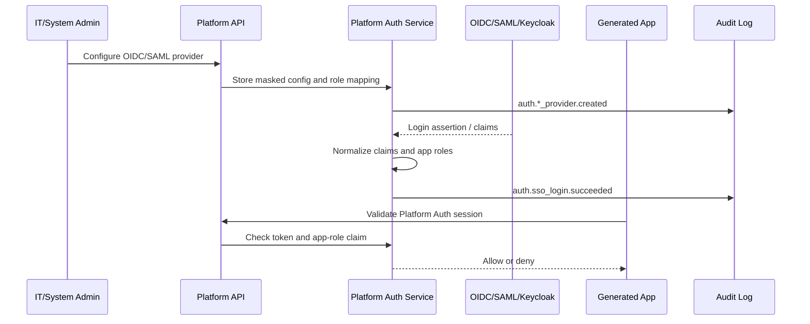

# Sprint 9 Plan - Auth SSO and Policy Hardening

Version: 0.1
Date: 2026-07-04
Status: Implemented and Accepted
Sprint dates: 2026-09-07 to 2026-09-11
Source roadmap: `docs/planning/production-sprint-roadmap.md`

## 1. Sprint Goal

ยกระดับ MVP auth mock ให้เป็น production-ready auth and policy foundation โดย Admin สามารถกำหนด OIDC/SAML provider, เห็น Keycloak default broker contract, ใช้ local break-glass admin แบบ audit ได้ และมี policy templates สำหรับ data classification ที่จะใช้กับ publish/external exposure ใน sprint ถัดไป

## 2. Source Alignment

| Roadmap Focus | Backlog Mapping | Sprint 9 Scope |
| --- | --- | --- |
| OIDC provider config | P1-AUTH-003, FR-AUTH-001, TC-AUTH-001 | Admin configures OIDC provider, secret is masked/fingerprinted, group mapping creates platform roles |
| SAML provider config | P1-AUTH-004, FR-AUTH-002, TC-AUTH-002 | Admin configures SAML provider, certificate is fingerprinted, role mapping is normalized |
| Break-glass admin hardening | P1-AUTH-005, FR-AUTH-003, SEC-007, TC-AUTH-003 | Break-glass requires reason, TTL is 15 minutes, critical audit event is emitted |
| Keycloak default broker | P1-AUTH-002, FR-AUTH-004, TC-AUTH-004 | Default realm/client/group mapping contract is documented and exposed by API |
| Direct IdP constraints | ADR-005, FR-AUTH-005, TC-AUTH-005 | Direct IdP is allowed only through Platform Auth boundary with Security Admin review |
| Generated app Platform Auth | P1-AUTH-001, P4-GEN-003, FR-AUTH-006, TC-AUTH-006 | Generated app session validation denies invalid tokens and enforces app-role claims |
| Policy templates | P1-POL-001, FR-DATA-002, ADR-004 | Public/Internal/Confidential/Restricted templates expose reviewers, checks and exposure defaults |

## 3. Planning Assumptions

| Assumption | Value |
| --- | --- |
| Depends on | Sprint 8 accepted MVP baseline |
| Runtime depth | Production blueprint contract and deterministic service behavior; real IdP network callbacks are deferred to integration hardening |
| Keycloak | Bundled default identity broker contract is defined, not fully provisioned by installer until Sprint 12 |
| Direct IdP | Advanced mode, not default; must preserve Platform Auth session and claims contract |
| Generated apps | No password store and no direct enterprise IdP integration |
| UI surface | Admin Console production readiness panel using `@evcp/ui` primitives and design-system tokens |

## 4. Sprint Backlog

| Priority | Item | Owner Role | Deliverable |
| --- | --- | --- | --- |
| P0 | Platform Auth session and claims contract | Platform Engineer | Service types, API response contract, generated app validation |
| P0 | OIDC provider flow | Platform Engineer | Create/list provider API, masked secret, fingerprint, audit |
| P0 | SAML provider flow | Platform Engineer | Create/list provider API, certificate fingerprint, audit |
| P0 | Keycloak default broker contract | Architect / Platform Engineer | Realm, client, redirect URI and group mapping defaults |
| P0 | Break-glass admin | Security Engineer | Reason-required login, 15-minute TTL, critical audit event |
| P0 | Policy template skeleton | Platform Engineer | Classification templates with required reviewers/checks |
| P0 | Admin Auth/SSO readiness UI | UX/UI Designer / Frontend Engineer | Provider registry, mapping, session evidence, break-glass, policy template panels |
| P0 | Prisma schema, migration and seed | Platform Engineer | Auth providers, sessions, break-glass sessions, policy templates |
| P0 | Unit, integration and E2E/API/UI tests | QA Engineer | Sprint 9 automated coverage and screenshot evidence |
| P0 | Docs and traceability | Technical Writer | ADR update, UI spec, delivery note, acceptance gate, changelog |

## 5. Architecture Flow

## 6. Test Plan

| Area | Check | Evidence |
| --- | --- | --- |
| OIDC | Provider creation masks secret, fingerprints value and maps groups | Unit, E2E/API |
| SAML | Provider creation fingerprints certificate and does not expose raw certificate | Unit, E2E/API |
| Keycloak | Default realm/client/group mapping contract is returned | Unit, E2E/API |
| Direct IdP | Constraints require Platform Auth boundary and security review | Unit, E2E/API, ADR |
| Login/session | Simulated SSO creates normalized Platform Auth claims | Unit, E2E/API |
| Generated app auth | Invalid token is denied; required app role is enforced | Unit, E2E/API |
| Break-glass | Missing reason is rejected; valid session emits critical audit | Unit, E2E/API |
| Policy templates | Classification templates return expected reviewers/checks | Unit, Integration, E2E/API |
| UI | Admin Auth/SSO panel renders with provider, mapping, session, break-glass and policy sections | E2E/UI, screenshot |
| DB | Migration and seed create auth/policy records | Integration, Prisma migrate/seed, DB counts |

## 7. Definition of Done

- [x] OIDC provider config API works without returning client secret.
- [x] SAML provider config API works without returning raw certificate.
- [x] Keycloak default broker contract is visible and documented.
- [x] Direct IdP constraints are documented in ADR-005 and exposed by API.
- [x] Break-glass admin requires reason, uses 15-minute TTL and creates critical audit evidence.
- [x] Generated app session validation enforces Platform Auth token and app-role claims.
- [x] Policy templates exist for Public, Internal, Confidential and Restricted.
- [x] Prisma schema, migration and seed data are verified.
- [x] Admin UI shows Auth/SSO production readiness using design-system patterns.
- [x] Unit, integration and E2E/API/UI tests pass through `pnpm verify:sprint9`.
- [x] Screenshot and console evidence are captured.
- [x] Product Owner acceptance gate is signed off before PR is ready to merge.

## 8. Demo Script

1. Admin opens Auth / SSO Production Readiness.
2. Admin reviews Keycloak default realm/client/group mapping.
3. Admin configures OIDC provider and sees masked secret evidence.
4. Admin configures SAML provider and sees certificate fingerprint evidence.
5. Admin simulates SSO login and inspects normalized Platform Auth claims.
6. Generated app validation allows a valid app role and denies invalid/missing session.
7. Admin triggers break-glass with reason and ticket reference.
8. Admin reviews Public/Internal/Confidential/Restricted policy templates.
