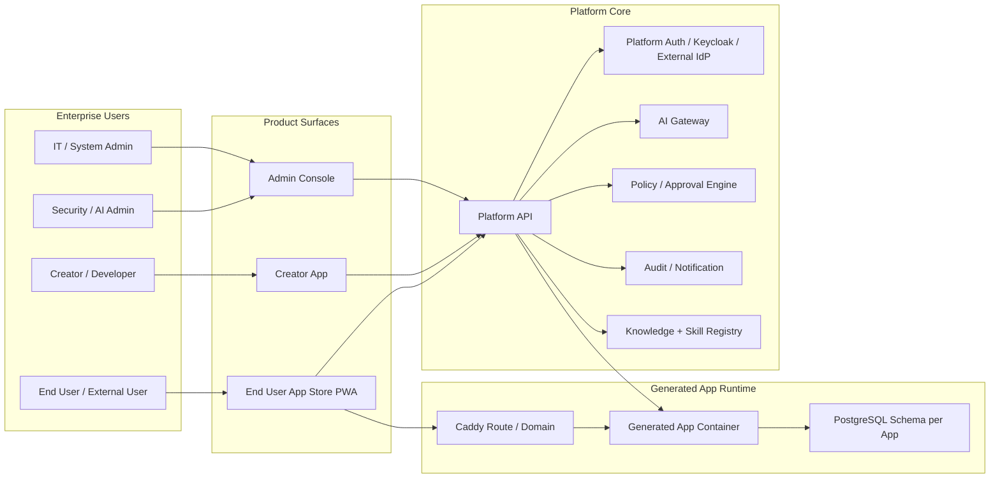
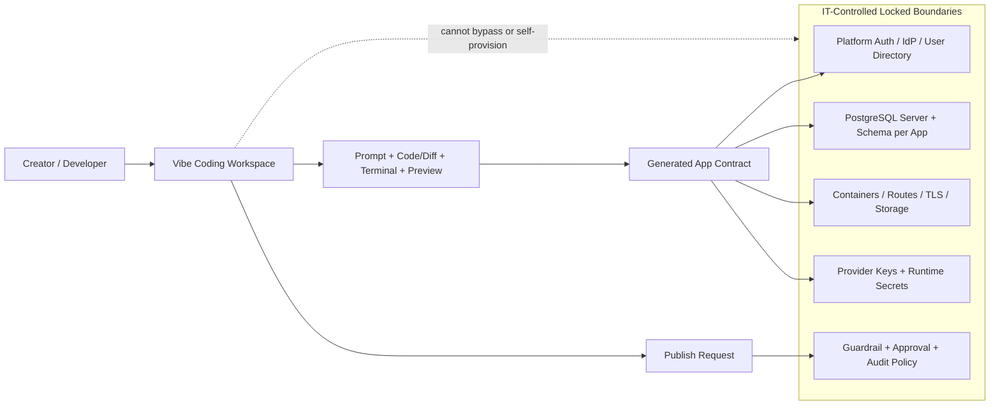
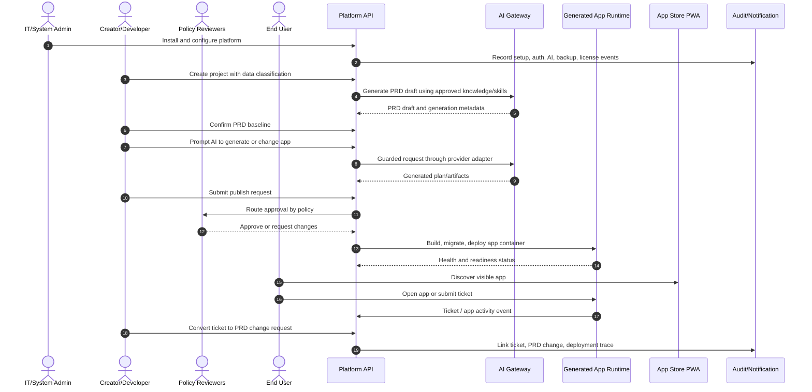
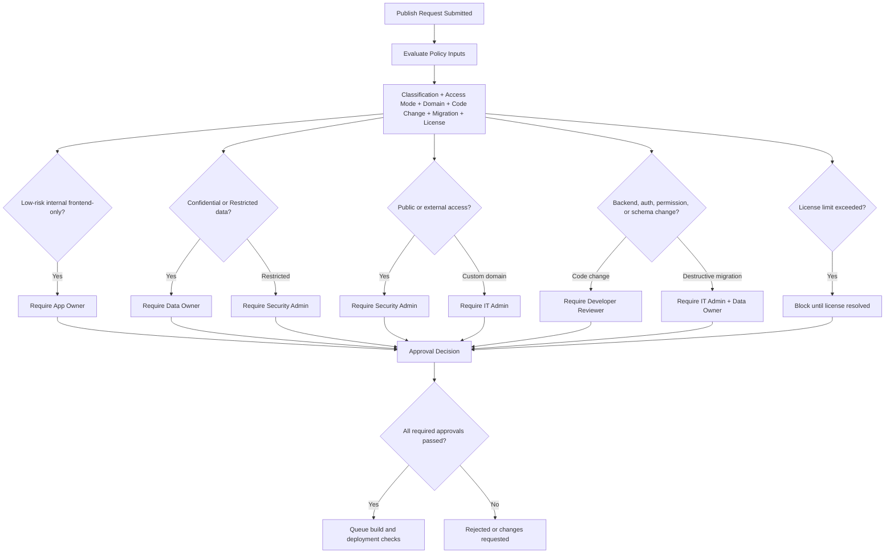
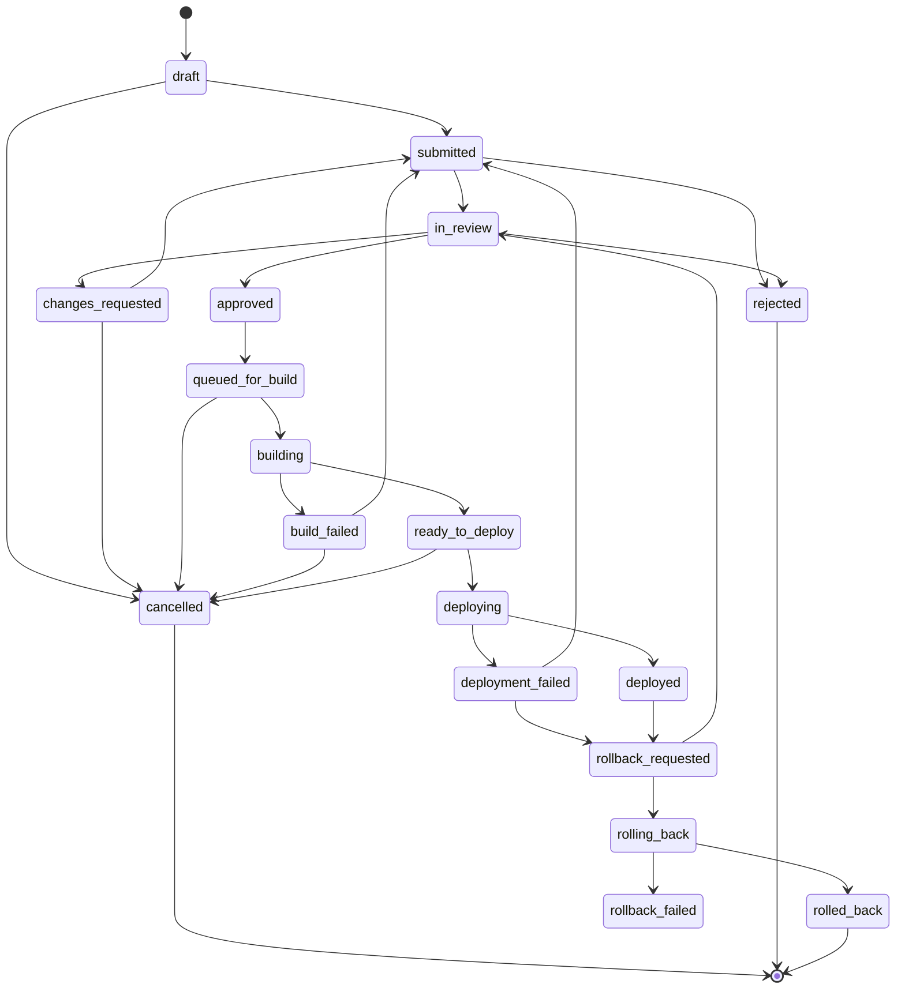
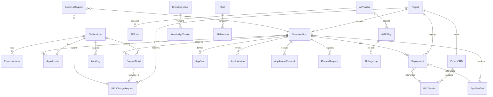
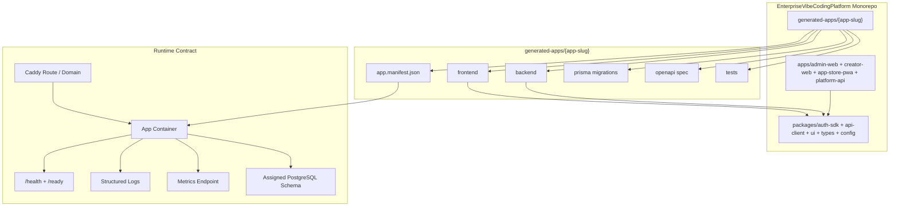
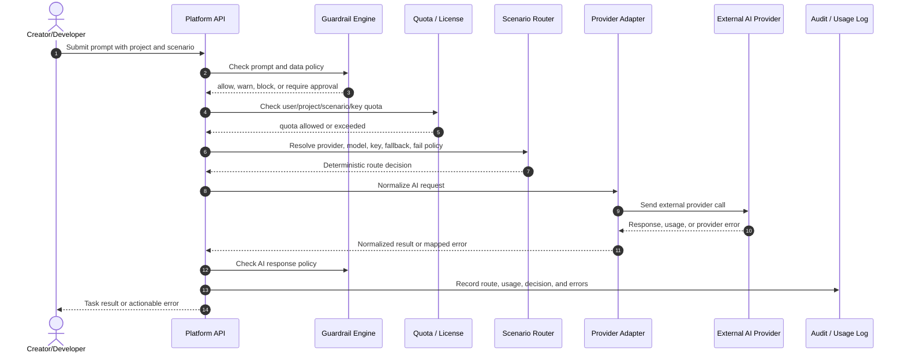

# Enterprise Vibe Coding Platform - Production Blueprint Requirements

Version: 0.3
Date: 2026-07-05  
Status: Validated Requirements Baseline Draft
Language: Thai primary with English technical terms  
Scope: Production Blueprint for Single Enterprise / Private Server

## 1. Purpose

เอกสารนี้กำหนด requirements ระดับ Production Blueprint สำหรับ Enterprise Vibe Coding Platform ซึ่งเป็น private AI application builder สำหรับองค์กร ให้ Business Creator สร้าง internal web application ด้วย AI ได้ โดย IT/System Admin ยังคงควบคุม identity, access, security, AI provider, guardrail, data policy, deployment, monitoring, audit และ lifecycle ของ generated apps ได้จากส่วนกลาง

เอกสารนี้ใช้เป็น baseline ก่อนเริ่ม development และก่อนแตกเป็น implementation backlog, architecture design, test plan และ release plan

## 2. Baseline Decisions

| Area | Decision |
| --- | --- |
| Requirement level | Production Blueprint |
| Deployment model | Single Enterprise / Private Server |
| Network model | Online Private Server |
| AI model support | External AI providers only |
| AI Gateway architecture | Provider Adapter Architecture, เพิ่ม provider ภายหลังได้ |
| Auth / SSO | OIDC + SAML + Local break-glass admin |
| Identity broker | รองรับทั้ง bundled Keycloak และ external IdP/direct integration |
| Generated app runtime | Separate app container ต่อ generated app |
| Generated app data isolation | Shared PostgreSQL database, schema per app |
| Source code model | Monorepo เดียว รวม platform และ generated apps |
| Production orchestration | Docker Compose v1, migration-ready สำหรับ Kubernetes ภายหลัง |
| Publish governance | Policy-based approval |
| Data classification | Public / Internal / Confidential / Restricted |
| Audit retention | Admin configurable, default 1 year |
| Backup / DR | Configurable schedule + PostgreSQL PITR + restore drill + retention policy |
| Object storage | Bundled MinIO + optional external S3-compatible storage |
| Observability | Architecture รองรับ metrics/logs/traces/alerts, v1 UI เริ่มจาก health/log/audit |
| Generated app stack | Production v1 ล็อก stack เดียว, เปิดทาง multi-stack plugin ภายหลัง |
| Code editing | Business Creator ใช้ prompt/config, Developer role ใช้ code editor ภายใต้ governance |
| Review roles | Policy-based: App Owner, IT Admin, Security Admin, Developer Reviewer, Data Owner |
| Knowledge Management | Library + indexing + permission-filtered retrieval + versioning + approval |
| Skill Management | Library + versioning + assignment + approval workflow |
| App Store visibility | Membership, role/access, group-restricted, organization-wide, pending invite/request |
| Ticket SLA | ไม่อยู่ใน production v1 |
| Notifications | Architecture multi-channel, v1 ใช้ in-app + email |
| Installer / Upgrade | CLI installer + Local Web Setup Wizard + preflight/report/backup-before-upgrade/rollback |
| Domain / TLS | Path-based default + TLS + internal/custom domains + public domain approval |
| External users | รองรับ external users + public access policy + approval |
| Licensing | Full license module |
| Success metrics | Balanced scorecard |

## 3. Problem Statement

องค์กรต้องการสร้าง internal applications ได้เร็วขึ้นโดยไม่ทำให้ IT backlog เพิ่มขึ้น แต่การเปิดให้ Business User สร้าง app เองมีความเสี่ยงด้าน security, identity, data access, AI key exposure, compliance, deployment และ operational ownership หากไม่มี platform กลางที่บังคับมาตรฐานเดียวกัน

Enterprise Vibe Coding Platform ต้องแก้ปัญหานี้ด้วย private AI software factory ที่ให้ Creator สร้าง app ผ่าน browser ได้ ขณะที่ทุก app ถูกผูกกับ central auth, app-level role, PRD lifecycle, approval policy, audit, guardrail, deployment traceability และ internal app store

## 4. Goals

G1. ลดเวลาในการสร้าง internal application โดยให้ Creator สามารถสร้าง PRD, preview, invite user และ publish app ผ่าน web workflow ได้ครบถ้วน  
G2. ลด IT backlog โดยให้ Business Unit สร้างและดูแล app ภายใต้ policy ที่ IT กำหนดได้เอง  
G3. บังคับ governance กลางสำหรับ identity, app access, AI provider/key, guardrail, data classification, audit และ deployment  
G4. ทำให้ generated apps ใช้งานจริงบน private server ได้ โดยแยก runtime container ต่อ app และแยก database schema ต่อ app  
G5. สร้าง feedback loop จาก End User ticket กลับไปเป็น PRD change request และ app change ได้อย่าง traceable  
G6. ทำให้ production operation ครบถ้วนพอสำหรับ private server ได้แก่ install, backup, restore, upgrade, rollback, monitoring, audit และ license control

## 5. Non-Goals for Production v1

NG1. ไม่รองรับ multi-tenant SaaS deployment ใน v1 เพราะ baseline คือ one enterprise per private deployment  
NG2. ไม่บังคับรองรับ Local LLM / Ollama / vLLM ใน v1 เพราะ baseline คือ external AI providers only  
NG3. ไม่รองรับ Kubernetes เป็น production runtime หลักใน v1 แต่ architecture ต้องไม่ปิดทาง migration ภายหลัง  
NG4. ไม่รองรับ multiple generated app stacks ใน v1 แต่ template/skill architecture ต้องเปิดทาง future plugin  
NG5. ไม่ต้องมี ticket SLA, business-hour calendar หรือ auto-escalation ใน v1  
NG6. ไม่ต้องมี third-party marketplace สำหรับ skills/templates/plugins ใน v1  
NG7. Creator ไม่สามารถใช้ raw SQL editor หรือ bypass auth/permission guard ได้

## 6. Personas

### 6.1 IT/System Admin

ผู้ดูแล platform, private server, installer, domain, SSO, backup, upgrade, monitoring, license, AI provider, guardrail และ global governance

### 6.2 Security Admin

ผู้กำหนด security policy, guardrail, restricted data approval, public/external exposure approval และ security audit

### 6.3 AI Admin

ผู้จัดการ AI providers, models, API keys, scenario routing, quota, fallback, AI usage logs, knowledge และ skill assignments

### 6.4 App Owner

เจ้าของ business app มีสิทธิ์ approve access, role, low-risk publish และดูแล feedback ของ app

### 6.5 Creator / Business User

ผู้สร้าง app ผ่าน prompt/config workflow, PRD, live preview, database view, invite, publish request และ ticket-to-PRD flow

### 6.6 Developer

ผู้มีสิทธิ์แก้ generated app code ใน web code editor หรือ governed workspace ภายใต้ project/app scope, review, build/test gate และ audit

### 6.7 Data Owner

ผู้อนุมัติการใช้งาน Confidential/Restricted data, retention, export, access และ data-related publish policy

### 6.8 End User

พนักงานหรือ external user ที่เข้า App Store เพื่อเปิด app, request access, submit ticket และ track ticket status

## 7. Product Surfaces

### 7.1 IT/System Admin Software

ต้องเป็น Web Admin Console พร้อม installer/setup experience สำหรับจัดการ platform กลาง ได้แก่ system health, services, users/groups, auth/SSO, AI providers/API keys, scenario routing, quotas, guardrails, knowledge, skills, domains, deployments, backup/restore, upgrade, license, monitoring และ audit logs

### 7.2 Creator App

ต้องเป็น web desktop application สำหรับสร้างและดูแล app ผ่าน AI ได้แก่ project picker, create project, prompt builder, live preview, PRD lifecycle, database view, frontend version restore, code editor สำหรับ Developer role, app users/roles, publish request, token usage และ ticket inbox

ส่วน vibe coding ต้องให้ประสบการณ์ใกล้เคียง browser-based full-stack AI coding workspace แบบ Bolt-like ได้แก่ prompt, file tree/code view, diff, terminal/build/test logs, live preview, snapshot/restore และ publish handoff อยู่ใน workspace เดียว แต่ต้องต่างจาก consumer/self-serve coding tool ตรงที่ infrastructure, database, user directory, authentication, app roles, secrets, network routes และ deployment policy ถูก provision และ lock โดยระบบที่ IT ควบคุม ไม่ใช่สิ่งที่ Creator เลือกหรือ bypass เอง

### 7.3 End User App Store PWA

ต้องเป็น Progressive Web App สำหรับ End User ใช้ค้นหาและเปิด app ตามสิทธิ์, request access, view app detail, submit ticket, track ticket status, receive notification และติดตั้งเป็น PWA ได้

### 7.4 Product Surface and Runtime Overview



## 8. Functional Requirements

### 8.1 Installation, Setup, Upgrade

| ID | Requirement | Priority | Acceptance Criteria |
| --- | --- | --- | --- |
| FR-INST-001 | ระบบต้องมี CLI installer สำหรับ private server | P0 | Admin run installer ได้, installer ตรวจ prerequisites และสร้าง install report |
| FR-INST-002 | ระบบต้องมี Local Web Setup Wizard | P0 | Admin ตั้ง domain, database, storage, auth, AI gateway, guardrail, backup และ first admin ได้ |
| FR-INST-003 | ระบบต้อง deploy production v1 ด้วย Docker Compose | P0 | Compose stack start services หลักได้: platform API, web apps, PostgreSQL, Keycloak, MinIO, Redis, Caddy |
| FR-INST-004 | ระบบต้องมี preflight check | P0 | ตรวจ CPU, RAM, disk, OS, Docker, Compose, ports, DNS, TLS readiness และ network |
| FR-INST-005 | ระบบต้องมี upgrade/rollback command | P0 | Upgrade ต้อง backup-before-upgrade, health check หลัง upgrade และ rollback ได้เมื่อ upgrade fail |
| FR-INST-006 | Architecture ต้อง migration-ready สำหรับ Kubernetes | P1 | Business logic ไม่ hardcode Compose-only container names หรือ local paths ที่ย้ายไม่ได้ |

### 8.2 Authentication and Identity

| ID | Requirement | Priority | Acceptance Criteria |
| --- | --- | --- | --- |
| FR-AUTH-001 | ระบบต้องรองรับ OIDC SSO | P0 | Admin configure OIDC provider ได้, user login ผ่าน IdP ได้, role/group mapping ทำงาน |
| FR-AUTH-002 | ระบบต้องรองรับ SAML SSO | P0 | Admin configure SAML metadata/cert ได้, user login ผ่าน SAML IdP ได้ |
| FR-AUTH-003 | ระบบต้องมี Local break-glass admin | P0 | Admin fallback login ได้เมื่อ SSO unavailable และ event ถูก audit |
| FR-AUTH-004 | ระบบต้องรองรับ bundled Keycloak | P0 | Installer deploy Keycloak และ platform ใช้เป็น identity broker ได้ |
| FR-AUTH-005 | ระบบต้องรองรับ external IdP/direct integration | P1 | Admin เลือกต่อ external OIDC/SAML IdP ได้โดยไม่บังคับใช้ bundled Keycloak |
| FR-AUTH-006 | Generated apps ต้องใช้ Platform Auth | P0 | Generated app ห้ามสร้าง password store แยก และต้อง validate session/token ผ่าน platform auth |

### 8.3 Role and Access Control

| ID | Requirement | Priority | Acceptance Criteria |
| --- | --- | --- | --- |
| FR-ACCESS-001 | ระบบต้องมี platform roles | P0 | รองรับ Platform Admin, AI Admin, Security Admin, Developer, Creator, Viewer |
| FR-ACCESS-002 | ระบบต้องมี project roles | P0 | รองรับ Project Owner, Editor, Reviewer, Viewer |
| FR-ACCESS-003 | ระบบต้องมี app-level roles ต่อ app | P0 | App Owner/Creator สร้าง app roles เช่น Employee, Manager, HR Admin ได้ |
| FR-ACCESS-004 | App Store visibility ต้อง permission-based | P0 | User เห็นเฉพาะ app ที่เข้าตาม membership, group, organization-wide, pending invite/request |
| FR-ACCESS-005 | Creator ต้องไม่เห็น global AI key หรือ system config | P0 | Creator route/API access ไป admin config ต้องถูก block และ audit permission denied |
| FR-ACCESS-006 | External users ต้องอยู่ภายใต้ app-level policy | P0 | External invite/public access ต้องผ่าน approval และ audit |

### 8.4 AI Provider and AI Gateway

| ID | Requirement | Priority | Acceptance Criteria |
| --- | --- | --- | --- |
| FR-AI-001 | AI Gateway ต้องใช้ Provider Adapter Architecture | P0 | Provider adapter เพิ่มใหม่ได้โดยไม่แก้ core routing contract |
| FR-AI-002 | Production v1 ต้องรองรับ external AI providers | P0 | Admin เพิ่ม provider, base URL, model, API key และ status ได้ |
| FR-AI-003 | API key ต้องมี usage mode, scenario, quota, fallback | P0 | Admin route Requirement Analysis, Coding, Review, Documentation ไป key/model ต่างกันได้ |
| FR-AI-004 | Creator ต้องไม่เห็น API key secret | P0 | UI/API ไม่ส่ง key material ให้ non-admin role |
| FR-AI-005 | ระบบต้อง log AI usage | P0 | เก็บ user, project, scenario, model, tokens, cost estimate, latency, status |
| FR-AI-006 | External-only v1 ต้องไม่ require local model | P0 | Install และ AI workflow ใช้งานได้โดยไม่มี local LLM component |

### 8.5 Guardrail and AI Policy

| ID | Requirement | Priority | Acceptance Criteria |
| --- | --- | --- | --- |
| FR-GRD-001 | ระบบต้องรองรับ rule-based guardrail | P0 | Admin สร้าง banned keyword, regex, PII/secret pattern rule ได้ |
| FR-GRD-002 | ระบบต้องรองรับ AI policy guardrail | P0 | Admin กำหนด disallowed behavior เช่น bypass auth, dump database, export sensitive data ได้ |
| FR-GRD-003 | Guardrail actions ต้อง configurable | P0 | รองรับ allow, warn, block, require approval, notify/escalate |
| FR-GRD-004 | Prompt ต้องผ่าน guardrail ก่อนเรียก AI provider | P0 | Blocked prompt ไม่ถูกส่งไป external provider และมี event log |
| FR-GRD-005 | Guardrail events ต้อง audit ได้ | P0 | Admin filter events ตาม user, project, severity, action, date ได้ |

### 8.6 Data Classification and Governance

| ID | Requirement | Priority | Acceptance Criteria |
| --- | --- | --- | --- |
| FR-DATA-001 | Project/app ต้องมี data classification | P0 | Creator/App Owner เลือก Public, Internal, Confidential, Restricted ได้ |
| FR-DATA-002 | Data classification ต้อง drive approval policy | P0 | Confidential/Restricted publish, external access, public domain, export ต้องขอ approval ตาม policy |
| FR-DATA-003 | Data Owner role ต้องใช้กับ data-sensitive workflow | P0 | Confidential/Restricted data access/export/publish สามารถ require Data Owner approval ได้ |
| FR-DATA-004 | Generated app data ต้องแยก schema per app | P0 | App A database user/connection ไม่สามารถอ่าน schema ของ App B ได้ |
| FR-DATA-005 | Platform metadata ต้องอยู่ใน schema กลาง | P0 | Platform users, projects, apps, audit, AI config อยู่ใน platform schema |

### 8.7 Project and PRD Lifecycle

| ID | Requirement | Priority | Acceptance Criteria |
| --- | --- | --- | --- |
| FR-PRD-001 | ทุก project ต้องมี PRD | P0 | Create project แล้วระบบสร้าง PRD draft และต้อง confirm baseline ก่อน serious generation/publish |
| FR-PRD-002 | PRD ต้องมี versioning | P0 | ระบบเก็บ v0.1 draft, v1.0 baseline, minor/major updates และ change summary |
| FR-PRD-003 | Requirement/behavior change ต้องสร้าง PRD change request | P0 | Prompt หรือ ticket ที่เปลี่ยน requirement สร้าง change request พร้อม affected sections |
| FR-PRD-004 | Deployment ต้อง trace ไป PRD version | P0 | Deployment record มี prdVersionId, frontend checkpoint, manifest version, git commit/image tag |
| FR-PRD-005 | Ticket ต้อง convert เป็น PRD change request ได้ | P0 | Creator เลือก ticket แล้วระบบสร้าง PRD change proposal ให้ review/approve |

### 8.8 Creator Workspace and Generated App Development

| ID | Requirement | Priority | Acceptance Criteria |
| --- | --- | --- | --- |
| FR-CRE-001 | Creator ต้องสร้าง project ผ่าน browser ได้ | P0 | Create project wizard เก็บ app name, business problem, app type, intended users, data sensitivity |
| FR-CRE-002 | Creator ต้อง prompt AI และเห็น task progress | P0 | Workspace แสดง steps เช่น load PRD, retrieve knowledge, update PRD, generate frontend/backend, run checks |
| FR-CRE-003 | Creator ต้องเห็น live preview | P0 | Preview refresh ได้และรองรับ desktop/tablet/mobile preview |
| FR-CRE-004 | Creator ต้องเห็น database view แบบ business-friendly | P0 | Schema/table/relationship/sample records/migration history ดูได้โดยไม่มี raw SQL |
| FR-CRE-005 | Frontend restore ต้องกระทบเฉพาะ frontend | P0 | Restore ไม่เปลี่ยน backend, database, auth, app roles, membership, domain, PRD baseline เว้นแต่ confirm |
| FR-CRE-006 | Developer role ต้องใช้ code editor ได้ภายใต้ governance | P0 | Code edit ถูกจำกัด project scope, audit, review/build/test gate และห้าม bypass auth/permission |
| FR-CRE-007 | Generated app stack v1 ต้องเป็นมาตรฐานเดียว | P0 | React + Vite + TypeScript, NestJS + Prisma, PostgreSQL schema per app, Platform Auth SDK |
| FR-CRE-008 | Vibe coding workspace ต้องรองรับ Bolt-like full-stack coding loop ใน browser | P0 | Workspace แสดง prompt thread, project files/code view, AI diff, terminal/build/test logs, live preview, snapshot/restore และ publish handoff โดยไม่ต้องติดตั้ง local dev environment |
| FR-CRE-009 | AI-generated code ต้องถูก constrain ด้วย platform context ที่ IT provision ให้ | P0 | Generation context มี app manifest, Platform Auth SDK, app roles, DB schema contract, storage/route refs, policy และ secret references; artifact validation block code ที่สร้าง auth store, user DB, secret handling หรือ infrastructure เอง |
| FR-CRE-010 | Infrastructure, database, user directory และ authentication ของ generated app ต้องเป็น IT-owned boundaries | P0 | Creator/Developer ไม่สามารถสร้างหรือเปลี่ยน global infra, database server, platform user directory, auth provider, network route หรือ secret material จาก workspace; ขอเปลี่ยนต้องผ่าน policy/admin workflow |

#### 8.8.1 Enterprise Vibe Coding Boundary



### 8.9 Generated App Runtime, Deployment, Domain

| ID | Requirement | Priority | Acceptance Criteria |
| --- | --- | --- | --- |
| FR-RUN-001 | Published generated app ต้อง run เป็น separate container | P0 | แต่ละ app มี container/process, health, logs, route และ deployment record แยก |
| FR-RUN-002 | Routing default ต้องรองรับ path-based routing | P0 | `/admin`, `/creator`, `/store`, `/apps/{slug}`, `/preview/{projectSlug}` ใช้งานได้ |
| FR-RUN-003 | Reverse proxy ต้องจัดการ TLS ได้ | P0 | Caddy หรือ equivalent จัดการ TLS config และ route registration ได้ |
| FR-RUN-004 | ระบบต้องรองรับ internal/custom domain per app | P0 | App Owner ขอ domain ได้และ Admin approve/reject ได้ |
| FR-RUN-005 | Public/custom domain ต้องมี approval workflow | P0 | Domain request มี DNS/TLS/security checks และ audit log |
| FR-RUN-006 | Publish ต้อง policy-based approval | P0 | Approval path เปลี่ยนตาม data classification, external/public access, schema migration, security risk |

### 8.10 App Store and External Users

| ID | Requirement | Priority | Acceptance Criteria |
| --- | --- | --- | --- |
| FR-STORE-001 | End User App Store ต้องเป็น PWA | P0 | มี manifest, app shell caching, offline fallback และ responsive mobile-first UI |
| FR-STORE-002 | User ต้องเห็น My Apps และ Available Apps ตาม permission | P0 | Membership apps, organization-wide apps, group-restricted apps, pending invites/requests แสดงถูกต้อง |
| FR-STORE-003 | User ต้อง request access ได้ | P0 | Request มี reason, requested role, status tracking และ route ไป App Owner/Creator |
| FR-STORE-004 | User ต้อง open app ที่มีสิทธิ์ได้ | P0 | App launch ถูก audit และ permission guard บังคับใช้ |
| FR-STORE-005 | External users ต้องใช้ app ได้ตาม policy | P0 | External invite/public access flow ทำงานและถูก audit |

### 8.11 Support Ticket and Feedback Loop

| ID | Requirement | Priority | Acceptance Criteria |
| --- | --- | --- | --- |
| FR-TKT-001 | End User ต้อง submit ticket ได้ | P0 | Ticket มี type, title, description, priority, screenshot optional, device/browser info |
| FR-TKT-002 | Ticket ต้อง route ไป Creator/App Owner | P0 | Bug/Feedback/Feature ไป Creator/App Owner, Security Concern ไป Security Admin + App Owner |
| FR-TKT-003 | Ticket ต้องมี status timeline | P0 | Status logs, comments, attachments และ assignee ถูกเก็บ |
| FR-TKT-004 | End User ต้อง track ticket status ได้ | P0 | User เห็น ticket ของตนเองและ status ล่าสุด |
| FR-TKT-005 | Creator ต้อง convert ticket เป็น PRD change request ได้ | P0 | Ticket linked กับ project_prd_change_request และ audit event ถูกสร้าง |
| FR-TKT-006 | SLA/auto-escalation ไม่อยู่ใน v1 | P2 | ระบบไม่ต้องมี SLA timers, business hours หรือ auto-escalation |

### 8.12 Knowledge Management

| ID | Requirement | Priority | Acceptance Criteria |
| --- | --- | --- | --- |
| FR-KNW-001 | ระบบต้องมี Knowledge Library | P0 | Admin/authorized user upload/manage PDF, Markdown, Text, Word, Excel, OpenAPI JSON ได้ |
| FR-KNW-002 | Knowledge ต้องมี scope และ permission | P0 | Scope รองรับ global, department, project, app, agent และ retrieval ต้อง filter ตาม permission |
| FR-KNW-003 | Knowledge ต้อง indexing สำหรับ AI retrieval | P0 | AI Agent retrieve relevant knowledge ตาม user/project/scenario ได้ |
| FR-KNW-004 | Knowledge ต้องมี versioning | P0 | Update knowledge แล้วเก็บ version, changelog, owner, approval status |
| FR-KNW-005 | Knowledge update ต้องมี approval workflow | P0 | Publish knowledge version ต้องผ่าน approval ตาม policy และ audit |

### 8.13 Agent Skill Management

| ID | Requirement | Priority | Acceptance Criteria |
| --- | --- | --- | --- |
| FR-SKL-001 | ระบบต้องมี Skill Library | P0 | Admin เพิ่ม/แก้/disable skill ได้ |
| FR-SKL-002 | Skill ต้องมี versioning | P0 | Skill version มี instruction, input/output schema, required knowledge, allowed tools |
| FR-SKL-003 | Skill ต้อง assign ตาม agent role/scenario/scope ได้ | P0 | Requirement Analyst, Database Designer, Frontend Developer, Security Reviewer ฯลฯ ใช้ skill ตาม scenario |
| FR-SKL-004 | Skill update ต้องมี approval workflow | P0 | New/changed skill ต้อง review/approve ก่อน active |
| FR-SKL-005 | Skill changes ต้อง audit | P0 | Add/update/approve/assign/disable มี audit log |

### 8.14 Notification

| ID | Requirement | Priority | Acceptance Criteria |
| --- | --- | --- | --- |
| FR-NOTI-001 | Notification architecture ต้องรองรับหลาย channel | P1 | Contract รองรับ in-app, email, webhook, Slack/Teams, push ภายหลัง |
| FR-NOTI-002 | Production v1 ต้องรองรับ in-app notification | P0 | User เห็น invite, access request, approval, ticket, deployment, guardrail status ใน app |
| FR-NOTI-003 | Production v1 ต้องรองรับ email notification | P0 | Email ส่งสำหรับ invite, approval request, ticket update, guardrail block, backup/restore, license warning |

### 8.15 Audit, Monitoring, Backup, License

| ID | Requirement | Priority | Acceptance Criteria |
| --- | --- | --- | --- |
| FR-AUD-001 | ระบบต้อง audit security-sensitive events | P0 | Login/logout, failed login, role change, AI key change, guardrail, publish, deployment, restore, ticket, PRD change ถูก log |
| FR-AUD-002 | Audit retention ต้อง configurable | P0 | Default 1 year และ Admin ปรับ retention ได้ |
| FR-OBS-001 | Admin Console ต้องมี health dashboard | P0 | แสดง status ของ PostgreSQL, Keycloak, MinIO, Redis, AI Gateway, Caddy, queues, generated app containers |
| FR-OBS-002 | Architecture ต้องรองรับ metrics/logs/traces/alerts | P1 | Export ไป external observability stack ได้ |
| FR-BCK-001 | Backup schedule ต้อง configurable | P0 | Admin ตั้ง schedule, target storage, retention, encryption ได้ |
| FR-BCK-002 | PostgreSQL ต้องรองรับ PITR | P0 | Restore ไปยัง point-in-time ได้ตาม retention policy |
| FR-BCK-003 | ระบบต้องมี restore drill/verification | P0 | Admin run restore validation ได้และได้ report |
| FR-LIC-001 | ระบบต้องมี full license module | P0 | License key/signed file, edition, seats, app limit, AI usage entitlement, expiry, grace period |
| FR-LIC-002 | License ต้องรองรับ online validation และ offline fallback | P0 | Private server ใช้งานต่อได้ตาม grace/offline policy เมื่อ validation endpoint unavailable |
| FR-LIC-003 | License violation ต้องไม่ทำให้ข้อมูลสูญหาย | P0 | ระบบจำกัด create/publish/AI usage ตาม policy แต่ไม่ delete data |

## 9. Non-Functional Requirements

| ID | Category | Requirement | Target |
| --- | --- | --- | --- |
| NFR-PERF-001 | Performance | Platform page load | < 3 seconds สำหรับ normal network |
| NFR-PERF-002 | Performance | Creator workspace initial load | < 5 seconds |
| NFR-PERF-003 | Performance | App Store search | < 1 second สำหรับ typical pilot dataset |
| NFR-PERF-004 | Performance | Ticket submission | < 2 seconds excluding attachment upload |
| NFR-AVL-001 | Availability | Pilot uptime target | 99.0% |
| NFR-AVL-002 | Availability | Production uptime target | 99.5% |
| NFR-SEC-001 | Security | Secrets handling | API keys/secrets encrypted at rest and never sent to unauthorized clients |
| NFR-SEC-002 | Security | Auth boundary | Backend permission guard mandatory; frontend guard is UX only |
| NFR-SEC-003 | Security | AI data protection | Blocked/sensitive prompts must not be sent to unauthorized external provider |
| NFR-OPS-001 | Operability | Installability | Fresh private server install must produce health-checked running system |
| NFR-OPS-002 | Operability | Backup verification | Restore drill must generate pass/fail report |
| NFR-MAINT-001 | Maintainability | Standard stack | Generated app stack v1 must stay standardized for supportability |
| NFR-MAINT-002 | Maintainability | Traceability | Every generated app deployment links PRD version, manifest, code version, DB migration, deployment record |

## 10. User Stories

### IT/System Admin

US-ADM-001: As an IT/System Admin, I want to install the platform on a private server so that my organization can run its own AI application builder.  
US-ADM-002: As an IT/System Admin, I want to configure OIDC/SAML and a break-glass admin account so that users authenticate through enterprise identity while emergency access remains possible.  
US-ADM-003: As an IT/System Admin, I want to approve domain and production publish requests based on policy so that risky deployments do not bypass governance.  
US-ADM-004: As an IT/System Admin, I want backup, restore, upgrade, rollback, health, license, and audit dashboards so that I can operate the platform in production.

### AI Admin / Security Admin

US-AI-001: As an AI Admin, I want to manage provider adapters, models, API keys, quotas, scenario routing, and fallback so that AI usage is controlled centrally.  
US-SEC-001: As a Security Admin, I want guardrails to block unsafe prompts before external AI calls so that sensitive data and security controls are protected.  
US-SEC-002: As a Security Admin, I want audit logs for AI, access, domain, publish, and guardrail events so that incidents can be investigated.

### Creator / Developer / App Owner

US-CRE-001: As a Creator, I want to create a project and generate a PRD draft so that the app has a source of truth before generation.  
US-CRE-002: As a Creator, I want to prompt AI, inspect code/diff/logs and preview the app live in a Bolt-like browser workspace so that I can iterate without local installation while IT-owned auth, data and infrastructure boundaries remain enforced.  
US-CRE-003: As a Creator, I want to invite users and assign app roles so that my app can be used by the right people.  
US-DEV-001: As a Developer, I want to edit generated app code under project scope so that edge cases can be handled without bypassing platform auth, database, infrastructure, secret or publish governance.  
US-OWN-001: As an App Owner, I want to approve access and low-risk publish requests so that business apps can move forward without making IT approve everything.

### End User

US-END-001: As an End User, I want to see apps I can access in a PWA app store so that I can find internal tools easily.  
US-END-002: As an End User, I want to request access to available apps so that I can get permission without contacting IT manually.  
US-END-003: As an End User, I want to submit bug/feedback tickets and track status so that app owners can improve the app.  
US-END-004: As an External User, I want to access approved apps through controlled public/external access so that I can collaborate with the organization securely.

## 11. End-to-End Production Flow

1. IT Admin installs platform on private server using CLI installer and Local Web Setup Wizard.
2. Admin configures domain/TLS, storage, PostgreSQL, Keycloak or external IdP, AI providers, guardrail, backup, license, and first admin.
3. Creator creates a project and selects data classification.
4. AI generates PRD draft using approved skills and permission-filtered knowledge.
5. Creator confirms PRD baseline.
6. Creator prompts AI to generate app.
7. System checks guardrail, uses provider adapter routing, logs AI usage, and updates preview.
8. Developer may edit code under governed scope if needed.
9. Creator/App Owner invites users and defines app roles.
10. Creator submits publish request.
11. Policy engine determines reviewers based on classification, domain, public/external access, schema changes, and security risk.
12. Approved app builds and deploys as a separate container with schema per app.
13. End User sees app in App Store based on visibility rules.
14. End User opens app or submits ticket.
15. Creator converts ticket into PRD change request.
16. Approved change updates PRD, app version, deployment traceability, and audit log.



## 12. Traceability Matrix

| Goal | Related Requirements | Validation |
| --- | --- | --- |
| G1 Productivity | FR-CRE-001 to FR-CRE-010, FR-PRD-001 to FR-PRD-005 | Creator can create PRD, prompt, inspect code/diff/logs, preview, invite, publish request |
| G2 Reduce IT backlog | FR-ACCESS-003, FR-RUN-006, FR-TKT-005 | App Owner approves low-risk work; tickets convert to PRD changes |
| G3 Governance | FR-AUTH, FR-ACCESS, FR-AI, FR-GRD, FR-DATA, FR-AUD | Security/admin policy tests and audit review |
| G4 Production app runtime | FR-RUN-001 to FR-RUN-006, FR-DATA-004 | Generated app deploys as separate container with schema isolation |
| G5 Feedback loop | FR-TKT-001 to FR-TKT-005, FR-PRD-003, FR-PRD-005 | End User ticket becomes PRD change request |
| G6 Operations | FR-INST, FR-BCK, FR-OBS, FR-LIC | Install/upgrade/rollback/backup/restore/license acceptance tests |

## 13. Success Metrics

### Productivity

- Median time from project creation to first working preview
- Median time from PRD baseline to first internal publish
- Number of internal apps published per month
- Reduction in IT internal app backlog over 1 quarter

### Governance and Security

- Percentage of generated apps using Platform Auth and app-level roles
- Percentage of publish events with complete PRD/deployment traceability
- Number of blocked guardrail events reviewed
- Number of unauthorized access attempts blocked and audited

### Operational Reliability

- Install success rate on supported private server environments
- Backup job success rate
- Restore drill success rate
- Upgrade success and rollback success rate
- Platform uptime

### Adoption

- Active Creators per month
- Active End Users per month
- App Store app open rate
- Percentage of invited users who accept and use apps

### Feedback Loop

- Tickets submitted per app
- Percentage of tickets converted to PRD change requests
- Time from ticket submission to approved PRD change
- Percentage of resolved tickets linked to deployment/change record

## 14. Open Questions

| ID | Question | Owner | Blocking? |
| --- | --- | --- | --- |
| OQ-001 | Which external AI providers are mandatory for production v1 besides OpenAI-compatible and Azure OpenAI? | Product / Engineering | No |
| OQ-002 | What exact license enforcement policy applies when seat/app/AI entitlement is exceeded? | Product / Legal | Yes before license implementation |
| OQ-003 | What email provider should production v1 support by default: SMTP only or provider adapters? | Engineering / IT | No |
| OQ-004 | What minimum private server hardware profile is officially supported? | Engineering / Ops | Yes before installer release |
| OQ-005 | What compliance policy templates should be bundled for Public/Internal/Confidential/Restricted? | Security / Product | Yes before policy engine release |
| OQ-006 | Should direct external IdP integration bypass Keycloak or always route through a broker abstraction? | Architecture | Yes before auth implementation |
| OQ-007 | What code editor capability is allowed for Developer role: browser editor only, repo branch workflow, or both? | Product / Engineering / Security | No |

## 15. Validation Checklist

- [ ] Requirements distinguish Production v1, P1, and future considerations.
- [ ] Every P0 requirement has observable acceptance criteria.
- [ ] Creator cannot access Admin-only AI key, SSO, backup, infrastructure, or guardrail config.
- [ ] Generated apps cannot bypass Platform Auth or Permission Guard.
- [ ] Publish policy accounts for data classification, public/external access, domain, schema migration, and security risk.
- [ ] Audit events cover authentication, access, AI, guardrail, PRD, ticket, deployment, restore, backup, license, and domain changes.
- [ ] Backup and restore are testable, not only configurable.
- [ ] App Store visibility is permission-based.
- [ ] Ticket-to-PRD flow is traceable.
- [ ] Non-goals explicitly exclude multi-tenant SaaS, Local LLM requirement, Kubernetes v1, SLA, and multi-stack v1.

## 16. Implementation-Grade Requirement Addendum

ส่วนนี้เติมรายละเอียดที่ต้องใช้ก่อนแตก architecture, backlog, test cases และ implementation tasks จริง โดยยังคงยึด baseline decisions ใน section 2

### 16.1 Permission Matrix

#### 16.1.1 Platform-Level Permissions

| Action / Resource | Platform Admin | AI Admin | Security Admin | Developer | Creator | App Owner | Data Owner | End User |
| --- | --- | --- | --- | --- | --- | --- | --- | --- |
| View system health | Allow | Allow | Allow | Deny | Deny | Deny | Deny | Deny |
| Configure installer/setup | Allow | Deny | Deny | Deny | Deny | Deny | Deny | Deny |
| Configure backup/restore | Allow | Deny | Deny | Deny | Deny | Deny | Deny | Deny |
| Run restore drill | Allow | Deny | Deny | Deny | Deny | Deny | Deny | Deny |
| Configure OIDC/SAML | Allow | Deny | Allow read-only | Deny | Deny | Deny | Deny | Deny |
| Manage platform users/groups | Allow | Deny | Allow read-only | Deny | Deny | Deny | Deny | Deny |
| Manage AI providers/models/API keys | Allow | Allow | Allow read-only | Deny | Deny | Deny | Deny | Deny |
| View API key secret after save | Deny | Deny | Deny | Deny | Deny | Deny | Deny | Deny |
| Rotate/revoke AI key | Allow | Allow | Allow if security incident | Deny | Deny | Deny | Deny | Deny |
| Configure guardrail policy | Allow | Allow for AI policy | Allow | Deny | Deny | Deny | Allow read-only for data policies | Deny |
| View audit logs | Allow | Allow scoped AI logs | Allow | Allow own project events | Allow own project events | Allow own app events | Allow data-scope events | Allow own events |
| Configure license | Allow | Deny | Deny | Deny | Deny | Deny | Deny | Deny |
| Configure global domains | Allow | Deny | Allow security review | Deny | Deny | Deny | Deny | Deny |

#### 16.1.2 Project and App Permissions

| Action / Resource | Project Owner | Project Editor | Project Reviewer | Project Viewer | Developer | App Owner | End User | External User |
| --- | --- | --- | --- | --- | --- | --- | --- | --- |
| View project | Allow | Allow | Allow | Allow | Allow if assigned | Allow if linked app | Deny | Deny |
| Create project | Allow if Creator | Allow if Creator | Deny | Deny | Allow if Creator/Developer | Deny | Deny | Deny |
| Edit project settings | Allow | Allow limited | Deny | Deny | Allow technical settings if assigned | Allow app settings | Deny | Deny |
| Generate PRD draft | Allow | Allow | Deny | Deny | Allow | Deny | Deny | Deny |
| Confirm PRD baseline | Allow | Deny unless delegated | Allow approve/reject | Deny | Deny unless delegated | Allow if App Owner | Deny | Deny |
| Create PRD change request | Allow | Allow | Allow comment | Deny | Allow | Allow from ticket | Deny | Deny |
| Prompt AI | Allow | Allow | Deny | Deny | Allow | Deny | Deny | Deny |
| View live preview | Allow | Allow | Allow | Allow | Allow | Allow | Deny | Deny |
| View database schema/table | Allow | Allow | Allow read-only | Allow read-only | Allow | Allow read-only | Deny | Deny |
| Run raw SQL | Deny | Deny | Deny | Deny | Deny by default | Deny | Deny | Deny |
| Edit generated code | Deny unless Developer | Deny unless Developer | Deny | Deny | Allow if assigned | Deny unless Developer | Deny | Deny |
| Restore frontend version | Allow | Allow if delegated | Review only | Deny | Allow if assigned | Allow if delegated | Deny | Deny |
| Manage app roles | Allow if App Owner | Deny | Deny | Deny | Deny | Allow | Deny | Deny |
| Invite internal user | Allow if App Owner | Deny | Deny | Deny | Deny | Allow | Deny | Deny |
| Invite external user | Requires policy approval | Deny | Deny | Deny | Deny | Requires policy approval | Deny | Deny |
| Submit publish request | Allow | Allow if delegated | Deny | Deny | Allow if assigned | Allow | Deny | Deny |
| Approve publish request | Policy-based | Deny | Allow review | Deny | Developer review only | Policy-based | Deny | Deny |
| Open published app | If member | If member | If member | If member | If member | If member | Allow if member/visible | Allow if approved |
| Submit ticket | Allow if app user | Allow if app user | Allow if app user | Allow if app user | Allow if app user | Allow if app user | Allow | Allow if approved |

#### 16.1.3 Permission Enforcement Rules

- Backend permission guard is mandatory for every protected API route; frontend guards are only UX hints.
- All deny decisions for protected resources must be auditable when the attempted action is security-sensitive.
- A user may hold multiple roles; effective permission is the union of allows minus explicit policy blocks.
- Data classification policy can override role permissions. Example: App Owner cannot approve Restricted external access without Security Admin and Data Owner.
- Break-glass admin permissions are logged with elevated severity and require a reason field.

### 16.2 Policy-Based Approval Rules

#### 16.2.1 Publish Approval Decision Table

| Condition | Required Reviewers | Minimum Outcome |
| --- | --- | --- |
| Internal app, Internal data, frontend-only change, no public domain | App Owner | App Owner approval |
| Internal app, Confidential data | App Owner + Data Owner | Both approve |
| Restricted data | App Owner + Data Owner + Security Admin | All approve |
| Public or external access enabled | App Owner + Security Admin | Both approve |
| Public/custom domain requested | IT Admin + Security Admin | Both approve after DNS/TLS/security checks |
| Backend code change | Developer Reviewer + App Owner | Code review passes and App Owner approves |
| Auth/permission code change | Developer Reviewer + Security Admin | Security review passes |
| Database schema additive migration | Developer Reviewer + App Owner | Migration dry-run passes |
| Database destructive migration | Developer Reviewer + IT Admin + Data Owner | Backup verified, migration dry-run passes, all approve |
| AI skill/knowledge dependency changed since last publish | App Owner + relevant Skill/Knowledge approver | Dependency version approved |
| License limit exceeded | Platform Admin | Publish blocked until license state resolves |



#### 16.2.2 Approval Status Lifecycle

| Status | Meaning | Allowed Transitions |
| --- | --- | --- |
| draft | Request is being prepared | submitted, cancelled |
| submitted | Request awaits policy evaluation | in_review, rejected |
| in_review | One or more reviewers must decide | changes_requested, approved, rejected |
| changes_requested | Requester must revise and resubmit | submitted, cancelled |
| approved | All required reviewers approved | queued_for_build, cancelled |
| rejected | Request cannot proceed without new request | none |
| queued_for_build | Build/deployment job waiting | building, cancelled |
| building | Build/checks are running | build_failed, ready_to_deploy |
| build_failed | Build/checks failed | submitted, cancelled |
| ready_to_deploy | Deployment can start | deploying, cancelled |
| deploying | Deployment job running | deployed, deployment_failed |
| deployed | Production deployment completed | rollback_requested |
| deployment_failed | Deployment failed | submitted, rollback_requested |
| rollback_requested | Rollback requires policy evaluation if data-impacting | in_review, rolling_back |
| rolling_back | Rollback job running | rolled_back, rollback_failed |



#### 16.2.3 Approval Audit Requirements

- Every approval decision must store reviewer, role, decision, reason/comment, timestamp, policy version, and request snapshot.
- Policy evaluation output must be stored with the request so later policy changes do not rewrite historical decisions.
- Changes requested must identify required fix categories: PRD, code, data, security, deployment, domain, license, or documentation.

### 16.3 Domain Model and Data Dictionary

#### 16.3.1 Core Entities

| Entity | Purpose | Owner | Key Status Values | Retention |
| --- | --- | --- | --- | --- |
| PlatformUser | Central user identity mapped from local/SSO | Platform Admin | active, inactive, invited, suspended | Account lifetime + audit retention |
| PlatformGroup | Group from local/SSO mapping | Platform Admin | active, inactive | Account lifetime |
| PlatformRole | Global platform capability role | Platform Admin | active, deprecated | Account lifetime |
| Project | Creator workspace and app source-of-truth boundary | Project Owner | draft, active, published, archived | Project lifetime |
| ProjectMember | User role within a project | Project Owner | active, removed | Project lifetime + audit retention |
| ProjectPRD | PRD container for a project | Project Owner | draft, baseline, active, archived | Project lifetime |
| PRDVersion | Immutable PRD version snapshot | Project Owner | draft, baseline, approved, rejected | Project lifetime |
| PRDChangeRequest | Proposed requirement change from prompt/ticket/manual input | Project Owner | draft, pending, approved, rejected, implemented | Project lifetime |
| GeneratedApp | Published or draft app linked to project | App Owner | draft, published, disabled, archived | App lifetime |
| AppManifest | Versioned app runtime/access/deployment descriptor | Platform | active, superseded | App lifetime |
| AppRole | App-specific role | App Owner | active, disabled | App lifetime |
| AppMember | User membership in app | App Owner | active, suspended, expired | App lifetime + audit retention |
| AppInvitation | Invite to internal/external user or group | App Owner | pending, accepted, expired, revoked | 2 years default |
| AppAccessRequest | Request from End User for app access | App Owner | pending, approved, rejected, cancelled | 2 years default |
| Deployment | Build/deploy record for app version | IT Admin | pending, running, success, failed, rolled_back | App lifetime |
| DomainRequest | Request for internal/custom/public app domain | IT Admin | pending, approved, rejected, active, disabled, failed | App lifetime |
| SupportTicket | End User feedback/bug/access/feature request | App Owner | open, in_review, planned, in_progress, resolved, closed, rejected | App lifetime or configured retention |
| ApprovalRequest | Governance approval workflow record | Policy Engine | draft, submitted, in_review, approved, rejected, cancelled | Audit retention minimum |
| AuditLog | Immutable security/operation event | Platform Admin | recorded | Configurable, default 1 year |
| KnowledgeItem | Knowledge source container | Knowledge Owner | draft, active, deprecated, archived | Configurable |
| KnowledgeVersion | Immutable indexed knowledge version | Knowledge Owner | pending, approved, rejected, active, superseded | Configurable |
| Skill | Agent skill container | AI Admin | draft, active, disabled, deprecated | Configurable |
| SkillVersion | Immutable skill instruction/schema version | AI Admin | pending, approved, rejected, active, superseded | Configurable |
| AIProvider | External provider configuration | AI Admin | active, disabled, error | Platform lifetime |
| AIModel | Model exposed by provider | AI Admin | active, disabled, deprecated | Platform lifetime |
| AIAPIKey | Encrypted provider credential metadata | AI Admin | active, disabled, revoked, expired | Platform lifetime + audit |
| AIUsageLog | AI request usage record | AI Admin | success, failed, blocked | Configurable |
| License | Installed license state | Platform Admin | active, warning, grace, expired, suspended | License lifetime + audit |
| Notification | In-app/email notification record | Platform | unread, read, archived | Configurable |

#### 16.3.2 Required Relationships

- PlatformUser has many ProjectMembers, AppMembers, AppInvitations, SupportTickets, AuditLogs.
- Project has one current ProjectPRD and many PRDVersions, PRDChangeRequests, Deployments, FrontendCheckpoints, GeneratedApps.
- GeneratedApp belongs to one Project and has many AppRoles, AppMembers, AppInvitations, AppAccessRequests, DomainRequests, Deployments, SupportTickets.
- Deployment must reference GeneratedApp, Project, PRDVersion, AppManifest version, frontend checkpoint, git commit or artifact reference, database migration version.
- ApprovalRequest must reference a target resource type and id, policy version, required reviewer roles, and final decision.
- KnowledgeVersion and SkillVersion used by an AI task must be referenced by AI task/audit metadata.



#### 16.3.3 Required Status Enum Constraints

- No destructive action may delete immutable history entities: PRDVersion, Deployment, AuditLog, ApprovalRequest decision snapshots, AIUsageLog.
- Archived Project/App must be read-only except restore operations by authorized role.
- Disabled App must not be launchable from App Store but its data and audit remain retained.
- Revoked/expired AIAPIKey must never be selected by routing.

### 16.4 Generated App Contract

#### 16.4.1 Monorepo Layout Contract

Every generated app must have a deterministic boundary:

```text
generated-apps/{app-slug}/
  app.manifest.json
  package.json
  frontend/
  backend/
  prisma/
  openapi/
  tests/
  README.md
```

The platform packages remain outside generated app folders:

```text
apps/admin-web/
apps/creator-web/
apps/app-store-pwa/
apps/platform-api/
packages/auth-sdk/
packages/api-client/
packages/ui/
packages/types/
packages/config/
```



#### 16.4.2 App Manifest Required Fields

| Field | Requirement |
| --- | --- |
| appId | Stable unique id generated by platform |
| projectId | Source project id |
| slug | Unique route-safe slug |
| name | Human-readable app name |
| ownerUserId | App owner |
| creatorUserId | Original creator |
| dataClassification | Public, Internal, Confidential, Restricted |
| accessMode | private, organization, group_restricted, public, external_shared |
| roles | App-level roles |
| permissions | App-level permission keys |
| auth.provider | Must be `platform` for v1 generated apps |
| auth.ssoRequired | Boolean policy result |
| domain.internalPath | Default route under `/apps/{slug}` |
| domain.customDomains | Approved custom domains |
| prd.currentVersionId | Current PRD version |
| frontend.currentCheckpointId | Current frontend checkpoint |
| backend.apiBasePath | App API base path |
| database.schemaName | PostgreSQL schema assigned to app |
| deployment.currentDeploymentId | Current deployment |
| generatedStack | React/Vite/TypeScript + NestJS/Prisma |
| manifestVersion | Incrementing manifest version |

#### 16.4.3 Container Runtime Contract

| Interface | Requirement |
| --- | --- |
| Health endpoint | Every app container exposes `/health` returning status, appId, version, dependencies |
| Readiness endpoint | Every app container exposes `/ready` and returns ready only after migrations/config loaded |
| Metrics endpoint | Every app exposes metrics in platform-compatible format when enabled |
| Logs | Logs must be structured JSON with appId, deploymentId, requestId, severity |
| Environment variables | Secrets injected by platform; app must not persist secrets in code |
| Auth | App validates platform session/token using Platform Auth SDK |
| Permissions | App enforces app permission keys server-side |
| Database | App connects only to assigned schema with least-privilege DB user |
| OpenAPI | Backend must publish OpenAPI spec for generated APIs |
| Migrations | Migrations must be versioned, dry-runnable, and linked to deployment |

#### 16.4.4 Generated Artifact Requirements

- Frontend pages, backend APIs, Prisma schema, migrations, app manifest, role/permission matrix, OpenAPI spec, README, tests, deployment config, and PRD link must be generated or maintained for every app.
- Generated code must not create independent user/password tables.
- Generated code must not call external AI providers directly; AI calls go through platform AI Gateway.
- Generated app tests must include auth required, permission denied, happy path, and at least one app-specific workflow test.

### 16.5 API and Event Contract Requirements

#### 16.5.1 API Response Contract

All platform APIs must use a consistent response envelope:

```json
{
  "success": true,
  "data": {},
  "message": "OK",
  "meta": {}
}
```

Error response:

```json
{
  "success": false,
  "error": {
    "code": "PERMISSION_DENIED",
    "message": "You do not have permission",
    "details": {}
  }
}
```

#### 16.5.2 API Groups Required for v1

| API Group | Required Scope |
| --- | --- |
| Auth | session, current user, logout, role/permission claims |
| Admin System | health, services, installer report, backup, restore, upgrade, license |
| Admin AI | providers, models, API keys, scenario routes, quotas, usage logs |
| Admin Guardrail | rules, AI policies, test prompt, events |
| Admin Identity | users, groups, platform roles, group mapping |
| Admin Domain | platform domains, app domain requests, DNS/TLS checks |
| Knowledge | items, versions, approvals, indexing, search |
| Skills | skills, versions, approvals, assignments, test |
| Creator Projects | project CRUD, members, settings, archive/restore |
| Creator PRD | PRD generate, versions, change requests, approvals, export |
| Creator AI Workspace | prompt, task progress, preview, refresh, token usage |
| Creator Database | schema, tables, records, relationships, migrations |
| Creator Frontend Versions | checkpoints, compare, restore |
| Creator App Users | roles, members, invitations, access requests |
| Creator Publish | publish requests, approval status, deployments, rollback |
| Store Apps | visible apps, app detail, open app, favorites |
| Store Access | request access, status tracking |
| Store Tickets | tickets, comments, attachments, status |
| Notifications | list, mark read, delivery preferences |
| Audit | query audit logs with role-based filters |

#### 16.5.3 Event Taxonomy

Events must be named with `domain.action` and include `eventId`, `occurredAt`, `actorUserId`, `resourceType`, `resourceId`, `severity`, `metadata`, and `requestId`.

| Event | Severity Default | Trigger |
| --- | --- | --- |
| auth.login_succeeded | info | User logs in |
| auth.login_failed | warning | Login fails |
| auth.break_glass_used | critical | Local emergency admin login |
| user.role_changed | high | Platform/project/app role changes |
| ai.provider_created | high | AI provider added |
| ai.api_key_created | critical | API key created |
| ai.api_key_rotated | critical | API key rotated |
| ai.request_started | info | Prompt accepted for AI call |
| ai.request_failed | warning | Provider call fails |
| ai.quota_exceeded | warning | Quota blocks request |
| guardrail.prompt_blocked | high | Guardrail blocks prompt |
| guardrail.policy_changed | high | Guardrail rule/policy changes |
| project.created | info | Project created |
| prd.baseline_confirmed | high | PRD baseline confirmed |
| prd.change_requested | info | PRD change request created |
| prd.change_approved | high | PRD change approved |
| app.generated | info | App artifacts generated |
| app.invitation_sent | info | App invite sent |
| app.access_requested | info | Access request submitted |
| app.access_approved | high | Access approved |
| app.published | high | App published |
| app.disabled | high | App disabled |
| deployment.started | info | Deployment starts |
| deployment.succeeded | info | Deployment succeeds |
| deployment.failed | high | Deployment fails |
| deployment.rollback_started | high | Rollback starts |
| domain.requested | info | Domain requested |
| domain.approved | high | Domain approved |
| ticket.created | info | Ticket submitted |
| ticket.status_changed | info | Ticket status updated |
| ticket.converted_to_prd_change | high | Ticket linked to PRD change |
| backup.started | info | Backup starts |
| backup.failed | critical | Backup fails |
| restore.started | critical | Restore starts |
| restore.succeeded | critical | Restore succeeds |
| license.warning | warning | License near limit/expiry |
| license.enforcement_applied | high | License blocks or restricts action |

### 16.6 Security and Privacy Requirements

| ID | Requirement | Priority | Acceptance Criteria |
| --- | --- | --- | --- |
| SEC-001 | All web traffic must use TLS in production | P0 | HTTP routes redirect or are blocked except local setup endpoint when explicitly enabled |
| SEC-002 | Secrets must be encrypted at rest | P0 | AI keys, SSO secrets, SMTP credentials, storage keys, license secrets are encrypted |
| SEC-003 | Secrets must be redacted from logs and UI | P0 | Logs/UI never show full secret; only masked fingerprint or last 4 characters |
| SEC-004 | API keys must support rotation and revoke | P0 | Active key can be rotated without exposing old secret; revoked key cannot be routed |
| SEC-005 | Audit logs must be tamper-evident | P1 | Audit record includes hash chain or equivalent integrity mechanism |
| SEC-006 | Session policy must be configurable | P0 | Admin configures idle timeout, absolute timeout, remember-me policy, forced logout |
| SEC-007 | Break-glass login must require reason | P0 | Local admin fallback requires reason and generates critical audit event |
| SEC-008 | Backup encryption key handling must be defined | P0 | Backup encryption uses configured key source and restore requires authorized access |
| SEC-009 | File uploads must be scanned/validated | P0 | Knowledge/ticket attachments enforce size/type policy and malware scan hook or quarantine workflow |
| SEC-010 | Public/external apps must pass security checklist | P0 | Publish cannot proceed until auth, permissions, domain, TLS, data classification, and audit checks pass |
| SEC-011 | Logs must avoid sensitive data leakage | P0 | Prompt excerpts, ticket text, and request payload logs are redacted according to data classification |
| SEC-012 | Admin actions must require CSRF/session protection | P0 | Browser-based state changes protected with secure session strategy |

### 16.7 AI Gateway Behavior Requirements

| ID | Requirement | Priority | Acceptance Criteria |
| --- | --- | --- | --- |
| AIGW-001 | Provider adapter contract must be stable | P0 | Each adapter implements model list, completion request, streaming optional, usage parsing, error mapping |
| AIGW-002 | Scenario routing must be deterministic | P0 | Same scenario/policy input resolves to logged provider/model/key route |
| AIGW-003 | Fallback must respect fail policy | P0 | fail_closed blocks when all routes fail; fail_open only allowed for explicitly safe scenarios |
| AIGW-004 | Quota must be checked before provider call | P0 | User/project/scenario/key quota exhaustion blocks call before external request |
| AIGW-005 | Token/cost usage must be recorded after call | P0 | Input/output/total tokens and estimated cost are stored when provider returns usage |
| AIGW-006 | Rate limit and timeout must be configurable | P0 | Per provider/key/scenario rate limits and timeouts can be set |
| AIGW-007 | Retry policy must avoid duplicate unsafe actions | P0 | Requirement/planning calls may retry idempotently; action execution requires idempotency key |
| AIGW-008 | Guardrail must run before and after AI call | P0 | Prompt checked before provider; response checked before user/app consumes output |
| AIGW-009 | Provider errors must map to platform errors | P0 | timeout, rate_limited, quota_exceeded, auth_failed, provider_unavailable, policy_blocked are distinguishable |
| AIGW-010 | Sensitive prompt policy must be enforceable | P0 | Confidential/Restricted prompts can require approval or block external model based on policy |



### 16.8 Operational Requirements

| ID | Requirement | Priority | Acceptance Criteria |
| --- | --- | --- | --- |
| OPS-001 | Minimum supported hardware profile must be published | P0 | Installer validates CPU, RAM, disk, OS, Docker, Compose versions against supported profile |
| OPS-002 | RPO/RTO must be defined per deployment | P0 | Default RPO <= 24h for full backup and PITR according to WAL retention; default RTO target documented |
| OPS-003 | Restore drill frequency must be configurable | P0 | Admin can schedule or manually run restore drill and store result report |
| OPS-004 | Log retention must be configurable | P0 | Platform logs, app logs, audit logs, AI usage logs have explicit retention settings |
| OPS-005 | Upgrade compatibility checks must run before upgrade | P0 | Check database migration compatibility, disk space, license validity, backup success, service health |
| OPS-006 | Rollback window must be documented per release | P0 | Upgrade report states whether rollback is supported and until when |
| OPS-007 | Generated app health must be monitored separately | P0 | Admin can see per-app container health, last deployment, route status, error state |
| OPS-008 | Queue/backpressure state must be visible | P1 | Build, AI task, deployment, indexing, notification queues expose depth and failure count |
| OPS-009 | Offline behavior for online private server must be graceful | P0 | If internet/provider unavailable, system preserves data and shows actionable degraded status |
| OPS-010 | Storage abstraction must support MinIO and S3-compatible storage | P0 | Same API supports backup, attachments, screenshots, knowledge files, generated artifacts |

### 16.9 License Enforcement Requirements

| License Condition | User Experience | Enforcement |
| --- | --- | --- |
| License valid | Normal operation | No restrictions |
| Expiry within warning window | Admin warning and notification | No restriction |
| License expired within grace period | Admin warning, creator warning | Existing apps continue; new app creation/publish may be restricted by policy |
| License expired after grace period | Admin critical warning | Existing apps continue read/run; block new publish, AI generation, new external invites unless policy allows |
| Seat limit reached | Admin/Creator warning | Block inviting/activating additional users beyond entitlement |
| App limit reached | Admin/Creator warning | Block new app creation or publish beyond entitlement |
| AI usage entitlement exceeded | Creator/Admin warning | Block or throttle AI calls according to license policy |
| Online validation unavailable | Admin warning | Use signed offline license cache until offline validity window expires |
| License tamper detected | Admin critical warning | Block privileged creation/publish/AI actions, preserve app runtime and data |

License enforcement must never delete projects, apps, generated code, databases, audit logs, tickets, knowledge, skills, or backups.

### 16.10 QA Acceptance Scenario Set

These scenarios are required before a production release candidate can be accepted.

#### 16.10.1 Governance and Permission

- Given a Creator attempts to view AI API key secrets, when the Creator opens Admin AI settings or calls the API, then access is denied and no secret material is returned.
- Given a Developer edits backend permission code, when publish is requested, then Developer Reviewer and Security Admin approval are required.
- Given an App Owner requests external access for a Restricted app, when policy is evaluated, then App Owner, Data Owner, and Security Admin approvals are required.
- Given an End User has no app membership, group access, organization access, invite, or pending request, when opening App Store, then the app is not visible.

#### 16.10.2 AI and Guardrail

- Given a prompt matches a banned keyword rule, when Creator submits prompt, then the prompt is blocked before provider call and `guardrail.prompt_blocked` is logged.
- Given the primary AI provider times out and fallback exists, when scenario policy allows fallback, then fallback provider is used and routing decision is logged.
- Given user quota is exhausted, when Creator submits prompt, then AI call is blocked before external provider request.

#### 16.10.3 Generated App Runtime

- Given a published app is deployed, when health dashboard loads, then the app container health, route, deployment id, PRD version, manifest version, and schema name are visible.
- Given App A database credentials are used, when attempting to access App B schema, then access is denied.
- Given generated app receives a request without valid platform auth, when protected API route is called, then request is denied server-side.

#### 16.10.4 PRD and Feedback Loop

- Given an End User submits a bug ticket, when Creator converts it to PRD change request, then the ticket links to the change request and audit event is recorded.
- Given PRD change is approved, when deployment is created, then deployment references the new PRD version and app manifest version.

#### 16.10.5 Operations

- Given backup schedule is configured, when backup job runs, then backup artifact is encrypted, stored in configured object storage, and result is logged.
- Given restore drill is run, when validation completes, then report shows pass/fail and restored dataset timestamp.
- Given upgrade fails health check, when rollback command is executed, then previous version is restored and audit event records rollback.
- Given license expires beyond grace period, when Creator attempts new publish, then publish is blocked while existing published apps remain accessible.

## 17. Artifact Index and Next Execution Step

The requirement engineering baseline now consists of:

| Artifact | Path |
| --- | --- |
| Requirements baseline | `docs/requirements/production-blueprint-requirements.md` |
| Requirements traceability matrix | `docs/requirements/requirements-traceability-matrix.md` |
| Requirements validation review | `docs/requirements/requirements-validation-review.md` |
| UX/UI requirements | `docs/design/ux-ui-requirements.md` |
| MVP sprint UI design index | `docs/design/mvp-sprint-ui-design-index.md` |
| MVP test strategy | `docs/testing/mvp-test-strategy.md` |
| MVP sprint test plan | `docs/testing/mvp-sprint-test-plan.md` |
| Architecture decision records | `docs/architecture/ADR-001-single-enterprise-private-server-deployment.md` through `docs/architecture/ADR-005-auth-broker-and-external-idp-strategy.md` |
| Production implementation backlog | `docs/planning/production-implementation-backlog.md` |
| MVP-aligned sprint roadmap | `docs/planning/production-sprint-roadmap.md` |
| MVP sprint execution plans | `docs/planning/sprint-0-plan.md` through `docs/planning/sprint-8-plan.md` |

Next execution step: start Sprint 0 implementation from `docs/planning/sprint-0-plan.md`, then keep RTM and validation review updated when delivered behavior changes requirement scope.
