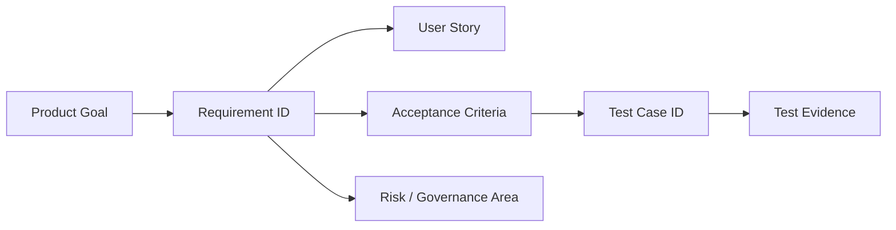

# Enterprise Vibe Coding Platform - Requirements Traceability Matrix

Version: 0.1  
Date: 2026-07-03  
Status: Draft for Requirements Validation  
Source baseline: `docs/requirements/production-blueprint-requirements.md`

## 1. Purpose

เอกสารนี้ map requirements จาก Production Blueprint ไปยัง user stories, acceptance criteria และ test cases เพื่อให้ requirement engineering ปิดรอบก่อนเข้าสู่ architecture design, backlog breakdown และ implementation ได้อย่าง traceable

## 2. Traceability Model

| Trace Level | Format | Example |
| --- | --- | --- |
| Goal | `G#` | `G3 Governance` |
| Requirement | `FR-*`, `SEC-*`, `AIGW-*`, `OPS-*` | `FR-AUTH-001` |
| User Story | `US-*` | `US-ADM-002` |
| Test Case | `TC-AREA-###` | `TC-AUTH-001` |
| Evidence | Test output, screenshot, audit event, API response, deployment report | Health check report |

## 3. Goal Coverage Summary

| Goal | Covered Requirement Groups | Primary Test Suites |
| --- | --- | --- |
| G1 Productivity | FR-PRD, FR-CRE, FR-STORE, FR-TKT | Creator workflow, PRD lifecycle, App Store, ticket flow |
| G2 Reduce IT backlog | FR-ACCESS, FR-RUN, FR-TKT, policy approval | App ownership, low-risk publish, feedback loop |
| G3 Governance | FR-AUTH, FR-ACCESS, FR-AI, FR-GRD, FR-DATA, SEC | Auth, RBAC, AI key, guardrail, data classification, security |
| G4 Production app runtime | FR-RUN, FR-DATA, generated app contract, OPS | Container runtime, schema isolation, deployment |
| G5 Feedback loop | FR-TKT, FR-PRD, notification, audit | Ticket-to-PRD and deployment trace |
| G6 Operations | FR-INST, FR-BCK, FR-OBS, FR-LIC, OPS | Install, backup/restore, upgrade/rollback, license |

## 4. Requirement to Test Matrix

### 4.1 Installation, Setup, and Upgrade

| Requirement | User Story | Acceptance Focus | Test Cases | Priority |
| --- | --- | --- | --- | --- |
| FR-INST-001 | US-ADM-001 | CLI installer runs and creates install report | TC-INST-001 | P0 |
| FR-INST-002 | US-ADM-001 | Local Web Setup Wizard captures platform config | TC-INST-002 | P0 |
| FR-INST-003 | US-ADM-001 | Docker Compose starts required services | TC-INST-003 | P0 |
| FR-INST-004, OPS-001 | US-ADM-001 | Preflight checks supported hardware/software/network | TC-INST-004 | P0 |
| FR-INST-005, OPS-005, OPS-006 | US-ADM-004 | Upgrade backup, health check, rollback | TC-INST-005, TC-INST-006 | P0 |
| FR-INST-006 | US-ADM-001 | Compose v1 does not block future Kubernetes migration | TC-ARCH-001 | P1 |

#### Test Cases

| Test Case | Given | When | Then | Evidence |
| --- | --- | --- | --- | --- |
| TC-INST-001 | A supported private server with Docker installed | Admin runs CLI installer | Installer completes preflight and writes install report | CLI output, install report |
| TC-INST-002 | Installer is running | Admin opens Local Web Setup Wizard | Wizard saves domain, database, storage, auth, AI, guardrail, backup and first admin config | Setup config, audit event |
| TC-INST-003 | Setup config is complete | Admin starts Docker Compose deployment | Platform API, web apps, PostgreSQL, Keycloak, MinIO, Redis and Caddy become healthy | Compose status, health dashboard |
| TC-INST-004 | Server does not meet minimum profile | Admin runs preflight | Installer blocks install with actionable failed checks | Failed preflight report |
| TC-INST-005 | Current deployment is healthy | Admin runs upgrade | System performs backup-before-upgrade and health check after upgrade | Backup artifact, upgrade report |
| TC-INST-006 | Upgrade health check fails | Admin runs rollback | Previous version is restored and rollback is audited | Rollback report, audit event |
| TC-ARCH-001 | Architecture review is performed | Reviewer inspects service configuration | Business logic does not depend on Compose-only names or local paths | Architecture review note |

Sprint 12 implementation evidence:

| Requirement / Test Case | Automated Evidence | Current Status |
| --- | --- | --- |
| FR-INST-001 to FR-INST-004 / TC-INST-001 to TC-INST-004 | `tests/unit/platform-sprint12-installer-backup-services.test.mjs`, `tests/e2e/sprint12-installer-backup-smoke.test.mjs`, `tests/integration/platform-sprint12-installer-backup-schema.test.mjs` | Focused tests passing |
| FR-BCK-001 to FR-BCK-003 / TC-BCK-001 to TC-BCK-004 | `tests/unit/platform-sprint12-installer-backup-services.test.mjs`, `tests/e2e/sprint12-installer-backup-smoke.test.mjs`, `tests/integration/platform-sprint12-installer-backup-schema.test.mjs` | Focused tests passing |

### 4.2 Authentication, Identity, and Access Control

| Requirement | User Story | Acceptance Focus | Test Cases | Priority |
| --- | --- | --- | --- | --- |
| FR-AUTH-001 | US-ADM-002 | OIDC SSO works with role/group mapping | TC-AUTH-001 | P0 |
| FR-AUTH-002 | US-ADM-002 | SAML SSO works with metadata/cert config | TC-AUTH-002 | P0 |
| FR-AUTH-003, SEC-007 | US-ADM-002 | Break-glass admin works and is audited | TC-AUTH-003 | P0 |
| FR-AUTH-004 | US-ADM-002 | Bundled Keycloak is usable as broker | TC-AUTH-004 | P0 |
| FR-AUTH-005 | US-ADM-002 | External IdP/direct integration is supported | TC-AUTH-005 | P1 |
| FR-AUTH-006, SEC-006 | US-END-001 | Generated apps use Platform Auth | TC-AUTH-006 | P0 |
| FR-ACCESS-001 to FR-ACCESS-006 | US-ADM-003, US-CRE-003, US-END-001 | RBAC and app visibility enforce permissions | TC-ACCESS-001 to TC-ACCESS-006 | P0 |

#### Test Cases

| Test Case | Given | When | Then | Evidence |
| --- | --- | --- | --- | --- |
| TC-AUTH-001 | OIDC provider is configured | User logs in via OIDC | Platform creates/links user and applies mapped roles/groups | Sprint 9 unit/E2E API: OIDC provider + simulated login |
| TC-AUTH-002 | SAML provider metadata is configured | User logs in via SAML | Platform creates/links user and applies mapped roles/groups | Sprint 9 unit/E2E API: SAML provider + simulated login |
| TC-AUTH-003 | SSO is unavailable | Break-glass admin logs in with reason | Login succeeds, reason is required, critical audit event is created | Sprint 9 unit/E2E API: `auth.break_glass_used` |
| TC-AUTH-004 | Bundled Keycloak is selected | Setup completes | Platform authenticates through Keycloak broker | Sprint 9 API/UI: Keycloak realm/client/group defaults |
| TC-AUTH-005 | External IdP/direct integration is selected | Admin configures external IdP | Login works without requiring bundled Keycloak as active broker | Sprint 9 ADR/API: direct IdP constraints preserve Platform Auth boundary |
| TC-AUTH-006 | Generated app protected endpoint exists | Request lacks valid platform session/token | Backend denies access server-side | Sprint 9 unit/E2E API: generated app session validation |
| TC-ACCESS-001 | Creator account is active | Creator calls Admin AI key API | Access is denied and no secret material returns | API response, audit event |
| TC-ACCESS-002 | End User has no membership/group/org access/invite/request | User opens App Store | Restricted app is not visible | App Store response |
| TC-ACCESS-003 | End User has pending invite | User opens App Store | App is visible with pending invite state | App Store response |
| TC-ACCESS-004 | App Owner invites external user | Policy requires approval | Invite remains pending until required approval passes | Approval request, audit |
| TC-ACCESS-005 | User has multiple roles with data policy block | User attempts blocked action | Explicit policy block overrides role allow | API response, policy log |
| TC-ACCESS-006 | App role changes | App Owner updates role/member | Permission changes are applied and audited | Member record, audit event |

### 4.3 AI Gateway and Guardrail

| Requirement | User Story | Acceptance Focus | Test Cases | Priority |
| --- | --- | --- | --- | --- |
| FR-AI-001, AIGW-001 | US-AI-001 | Provider adapter contract is stable | TC-AI-001 | P0 |
| FR-AI-002 | US-AI-001 | External provider/model/key management | TC-AI-002 | P0 |
| FR-AI-003, AIGW-002, AIGW-003 | US-AI-001 | Scenario routing, quota, fallback | TC-AI-003, TC-AI-004 | P0 |
| FR-AI-004, SEC-002, SEC-003 | US-SEC-002 | Secrets hidden and encrypted | TC-AI-005 | P0 |
| FR-AI-005, AIGW-005 | US-AI-001 | AI usage log records tokens/cost/status | TC-AI-006 | P0 |
| FR-GRD-001 to FR-GRD-005, AIGW-008, AIGW-010 | US-SEC-001 | Guardrail blocks/warns before and after AI | TC-GRD-001 to TC-GRD-004 | P0 |

#### Test Cases

| Test Case | Given | When | Then | Evidence |
| --- | --- | --- | --- | --- |
| TC-AI-001 | A new provider adapter is implemented | Adapter is registered | Platform can list models, send completion request, parse usage and map errors via common contract | Adapter contract test |
| TC-AI-002 | AI Admin adds external provider and API key | Provider is activated | Provider/model/key appear active without exposing key secret | Admin UI/API response |
| TC-AI-003 | Scenario route has primary and fallback | Primary provider times out | Fallback is used if policy allows and route decision is logged | AI usage log |
| TC-AI-004 | User/project/scenario quota is exhausted | Creator submits prompt | Request is blocked before external provider call | Quota response, no provider log |
| TC-AI-005 | API key is saved | Admin or Creator views key record | Only masked fingerprint is shown; encrypted value is stored server-side | UI/API response, DB inspection |
| TC-AI-006 | AI provider returns usage metadata | Request succeeds | Input/output/total tokens, cost estimate, latency and status are logged | AI usage log |
| TC-GRD-001 | Banned keyword rule is active | Creator submits matching prompt | Prompt is blocked before provider call | Event `guardrail.prompt_blocked` |
| TC-GRD-002 | AI policy disallows dumping database | Creator asks to dump database | Prompt is blocked or requires approval by configured action | Guardrail decision log |
| TC-GRD-003 | AI response includes disallowed content | Provider response returns unsafe output | Response is blocked before user/app consumes it | Guardrail response event |
| TC-GRD-004 | Confidential/Restricted data policy applies | Creator submits sensitive prompt | Policy blocks or routes according to configured external provider policy | Policy evaluation output |

### 4.4 Data Governance, PRD, Creator Workspace

| Requirement | User Story | Acceptance Focus | Test Cases | Priority |
| --- | --- | --- | --- | --- |
| FR-DATA-001 to FR-DATA-005 | US-CRE-001, US-ADM-003 | Data classification drives access, schema and approval | TC-DATA-001 to TC-DATA-004 | P0 |
| FR-PRD-001 to FR-PRD-005 | US-CRE-001, US-END-003 | PRD lifecycle and ticket-to-PRD traceability | TC-PRD-001 to TC-PRD-005 | P0 |
| FR-CRE-001 to FR-CRE-007 | US-CRE-001, US-CRE-002, US-DEV-001 | Creator workspace, preview, database, restore, code governance | TC-CRE-001 to TC-CRE-007 | P0 |

#### Test Cases

| Test Case | Given | When | Then | Evidence |
| --- | --- | --- | --- | --- |
| TC-DATA-001 | Creator creates a project | Creator selects data classification | Project/app stores Public/Internal/Confidential/Restricted classification | Project record |
| TC-DATA-002 | Confidential app requests external access | Publish/access policy evaluates request | Data Owner approval is required | Approval request |
| TC-DATA-003 | Restricted app requests public domain | Policy evaluates request | Data Owner and Security Admin approval are required | Approval request |
| TC-DATA-004 | App A database user is used | Request attempts App B schema access | Database access is denied | DB permission test |
| TC-PRD-001 | Creator creates project | AI generates PRD draft | Project has PRD draft and cannot serious-generate/publish before baseline confirmation | PRD record |
| TC-PRD-002 | Creator confirms PRD draft | Baseline is created | PRD v1.0 baseline is immutable and audited | PRD version, audit |
| TC-PRD-003 | Creator prompt changes requirement | AI analyzes impact | PRD change request is created with affected sections | Change request |
| TC-PRD-004 | Deployment is created | Deployment record is saved | Deployment references PRD version, manifest version, frontend checkpoint and code/artifact ref | Deployment record |
| TC-PRD-005 | Ticket exists | Creator converts ticket to PRD change | Ticket links to PRD change request and audit event is recorded | Ticket and change records |
| TC-CRE-001 | Creator opens Create Project wizard | Required fields are submitted | Project is created with app name, problem, app type, intended users and sensitivity | Project record |
| TC-CRE-002 | Creator submits prompt | AI task runs | Task progress shows PRD/knowledge/skill/generation/check steps | Workspace UI |
| TC-CRE-003 | App preview exists | Creator switches device preview | Desktop/tablet/mobile preview renders and refresh works | UI screenshot |
| TC-CRE-004 | App schema/sample data exists | Creator opens database view | Schema/table/relationships/migrations are visible without raw SQL | Database view screenshot |
| TC-CRE-005 | Frontend checkpoint exists | Creator restores old frontend | Only frontend changes; backend, DB, auth, roles, membership and domain remain unchanged | Diff/audit |
| TC-CRE-006 | Developer edits generated code | Developer submits publish | Code edit is scoped, audited and routed through review/build/test gate | Audit, approval request |
| TC-CRE-007 | Generated app is created | Artifact generation completes | Stack is React/Vite/TypeScript + NestJS/Prisma + Platform Auth SDK | Generated app manifest |

### 4.5 Generated Runtime, Deployment, Domain

| Requirement | User Story | Acceptance Focus | Test Cases | Priority |
| --- | --- | --- | --- | --- |
| FR-RUN-001 | US-ADM-004 | Separate app container per published app | TC-RUN-001 | P0 |
| FR-RUN-002, FR-RUN-003 | US-END-001 | Path routing and TLS reverse proxy | TC-RUN-002 | P0 |
| FR-RUN-004, FR-RUN-005 | US-ADM-003 | Internal/custom/public domain approval | TC-RUN-003, TC-RUN-004 | P0 |
| FR-RUN-006 | US-OWN-001 | Policy-based publish approval | TC-RUN-005 | P0 |
| Generated App Contract | US-DEV-001 | Manifest, health/readiness, logs, metrics, OpenAPI, migrations | TC-RUN-006 to TC-RUN-010 | P0 |

#### Test Cases

| Test Case | Given | When | Then | Evidence |
| --- | --- | --- | --- | --- |
| TC-RUN-001 | Publish is approved | Deployment runs | App is deployed as its own container/process with health/logs/deployment record | Sprint 10 unit/E2E API: runtime overview container status and deployment ID |
| TC-RUN-002 | Platform domain is configured | User opens `/admin`, `/creator`, `/store`, `/apps/{slug}` | Caddy routes traffic with TLS to correct service/app | Route test, TLS check |
| TC-RUN-003 | App Owner requests internal/custom domain | IT Admin approves | Domain becomes active after DNS/TLS checks | Domain request, route status |
| TC-RUN-004 | App requests public domain | Policy evaluates request | IT Admin and Security Admin approvals are required | Approval request |
| TC-RUN-005 | Publish request includes Restricted data and destructive migration | Policy evaluates request | Developer Reviewer, IT Admin and Data Owner are required | Sprint 10 unit/E2E API: migration dry-run blocked without required approvals |
| TC-RUN-006 | Generated app folder exists | Artifact check runs | Required manifest, frontend, backend, prisma, openapi, tests and README exist | Sprint 10 unit/API: `artifactContract.requiredPaths` |
| TC-RUN-007 | App container starts | Health and readiness endpoints are called | `/health` and `/ready` return correct app/dependency status | Sprint 10 E2E API: `/admin/runtime/projects/:projectId/health` |
| TC-RUN-008 | App handles request | Logs are emitted | Structured JSON logs include appId, deploymentId, requestId and severity | Sprint 10 unit/API: `logSample` with appId/deploymentId/requestId |
| TC-RUN-009 | App backend exposes API | OpenAPI spec is requested | Spec exists and matches generated API surface | Sprint 10 E2E API/UI: OpenAPI contract paths |
| TC-RUN-010 | Migration is included in deployment | Dry-run runs | Migration is versioned, dry-runnable and linked to deployment | Sprint 10 unit/E2E API: migration report linked to deployment |

### 4.6 App Store, Tickets, Notifications

| Requirement | User Story | Acceptance Focus | Test Cases | Priority |
| --- | --- | --- | --- | --- |
| FR-STORE-001 | US-END-001 | PWA shell, manifest, offline fallback | TC-STORE-001 | P0 |
| FR-STORE-002 | US-END-001 | Permission-based app visibility | TC-STORE-002 | P0 |
| FR-STORE-003 | US-END-002 | Access request with reason/status routing | TC-STORE-003 | P0 |
| FR-STORE-004 | US-END-001 | Open app with audit and permission guard | TC-STORE-004 | P0 |
| FR-STORE-005 | US-END-004 | External users access approved apps | TC-STORE-005 | P0 |
| FR-TKT-001 to FR-TKT-006 | US-END-003 | Ticket submit, route, timeline, track, convert to PRD | TC-TKT-001 to TC-TKT-005 | P0 |
| FR-NOTI-001 to FR-NOTI-003 | Cross-persona | In-app and email notifications | TC-NOTI-001 to TC-NOTI-003 | P0/P1 |

#### Test Cases

| Test Case | Given | When | Then | Evidence |
| --- | --- | --- | --- | --- |
| TC-STORE-001 | User opens App Store on mobile browser | PWA loads | Manifest, responsive app shell and offline fallback are available | Lighthouse/PWA check |
| TC-STORE-002 | User has membership/group/org/pending access | App Store loads | My Apps and Available Apps reflect visibility policy | API/UI response |
| TC-STORE-003 | User requests access | Request is submitted | Request stores reason, requested role, status and routes to App Owner/Creator | Access request record |
| TC-STORE-004 | User opens authorized app | App launch occurs | Launch is allowed and audited; unauthorized launch is denied | Audit event/API response |
| TC-STORE-005 | External user has approved access | External user opens app | App is visible and openable according to external policy | App Store/app access |
| TC-TKT-001 | User has app access | User submits bug ticket with optional screenshot | Ticket stores type, title, description, priority and device info | Ticket record |
| TC-TKT-002 | Ticket is created | Routing runs | Ticket routes to Creator/App Owner or Security Admin by type | Ticket assignee/routing |
| TC-TKT-003 | Ticket status changes | Creator updates status/comment | Status timeline and comments are stored | Ticket timeline |
| TC-TKT-004 | End User opens ticket status | Ticket belongs to user | Latest status is visible | Ticket status UI |
| TC-TKT-005 | Creator converts ticket | Change request is created | Ticket links to PRD change and audit event | PRD/ticket records |
| TC-NOTI-001 | Invite/access/publish/ticket event occurs | Notification dispatch runs | In-app notification is created | Notification record |
| TC-NOTI-002 | Email channel is configured | Important event occurs | Email notification is sent or failure is logged | Email log |
| TC-NOTI-003 | Future webhook/Slack channel is disabled | Event occurs | v1 still succeeds with in-app/email and records unsupported channel state | Notification log |

### 4.7 Knowledge, Skills, Audit, Backup, Observability, License

| Requirement | User Story | Acceptance Focus | Test Cases | Priority |
| --- | --- | --- | --- | --- |
| FR-KNW-001 to FR-KNW-005 | US-AI-001 | Knowledge upload, scope, indexing, versioning, approval | TC-KNW-001 to TC-KNW-005 | P0 |
| FR-SKL-001 to FR-SKL-005 | US-AI-001 | Skill library, versioning, assignment, approval, audit | TC-SKL-001 to TC-SKL-005 | P0 |
| FR-AUD-001, FR-AUD-002 | US-SEC-002 | Audit events and retention | TC-AUD-001, TC-AUD-002 | P0 |
| FR-OBS-001, FR-OBS-002, OPS-007, OPS-008 | US-ADM-004 | Health/log/audit dashboard and observability export | TC-OBS-001 to TC-OBS-003 | P0/P1 |
| FR-BCK-001 to FR-BCK-003, OPS-002, OPS-003, OPS-010 | US-ADM-004 | Backup schedule, PITR, restore drill, storage abstraction | TC-BCK-001 to TC-BCK-004 | P0 |
| FR-LIC-001 to FR-LIC-003 | US-ADM-004 | License module and enforcement | TC-LIC-001 to TC-LIC-005 | P0 |
| SEC-001 to SEC-012 | US-SEC-001, US-SEC-002 | Security and privacy controls | TC-SEC-001 to TC-SEC-006 | P0/P1 |

#### Test Cases

| Test Case | Given | When | Then | Evidence |
| --- | --- | --- | --- | --- |
| TC-KNW-001 | Authorized user uploads supported file | Knowledge item is saved | Source metadata and owner are stored | Knowledge record |
| TC-KNW-002 | Knowledge has department/project/app scope | AI retrieval runs | Retrieval filters by user/project/scenario permission | Retrieval log |
| TC-KNW-003 | Knowledge is indexed | AI task needs context | Relevant chunks are retrievable | Index/search result |
| TC-KNW-004 | Knowledge is updated | New version is submitted | Version, changelog and approval status are stored | Knowledge version |
| TC-KNW-005 | Knowledge approval is required | Approver approves version | Version becomes active and audit is created | Approval/audit |
| TC-SKL-001 | AI Admin creates skill | Skill is saved | Skill library lists draft skill | Skill record |
| TC-SKL-002 | Skill version is submitted | Version includes instruction/schema/tools | Version is stored and immutable after approval | Skill version |
| TC-SKL-003 | Skill is assigned to scenario | AI task starts | Correct skill version is selected by agent role/scenario/scope | AI task metadata |
| TC-SKL-004 | Skill update requires approval | Approver approves | Skill version becomes active | Approval/audit |
| TC-SKL-005 | Skill is disabled | AI task resolves skills | Disabled skill is not selected | AI task metadata |

Sprint 11 implementation evidence:

| Requirement / Test Case | Automated Evidence | Current Status |
| --- | --- | --- |
| FR-KNW-001 to FR-KNW-005 / TC-KNW-001 to TC-KNW-005 | `tests/unit/platform-sprint11-knowledge-skill-services.test.mjs`, `tests/e2e/sprint11-knowledge-skill-smoke.test.mjs`, `tests/integration/platform-sprint11-knowledge-skill-schema.test.mjs` | Passed in `pnpm verify:sprint11` |
| FR-SKL-001 to FR-SKL-005 / TC-SKL-001 to TC-SKL-005 | `tests/unit/platform-sprint11-knowledge-skill-services.test.mjs`, `tests/e2e/sprint11-knowledge-skill-smoke.test.mjs`, `tests/integration/platform-sprint11-knowledge-skill-schema.test.mjs` | Passed in `pnpm verify:sprint11` |

Sprint 13 implementation evidence:

| Requirement / Test Case | Automated Evidence | Current Status |
| --- | --- | --- |
| FR-OBS-001, FR-OBS-002, OPS-007, OPS-008 / TC-OBS-001 to TC-OBS-003 | `tests/unit/platform-sprint13-observability-license-services.test.mjs`, `tests/e2e/sprint13-observability-license-smoke.test.mjs`, `tests/integration/platform-sprint13-observability-license-schema.test.mjs` | Passed in `pnpm verify:sprint13` |
| FR-INST-005, OPS-005, OPS-006 / TC-INST-005, TC-INST-006 | `tests/unit/platform-sprint13-observability-license-services.test.mjs`, `tests/e2e/sprint13-observability-license-smoke.test.mjs`, `tests/integration/platform-sprint13-observability-license-schema.test.mjs` | Passed in `pnpm verify:sprint13` |
| FR-LIC-001 to FR-LIC-003 / TC-LIC-001 to TC-LIC-005 | `tests/unit/platform-sprint13-observability-license-services.test.mjs`, `tests/e2e/sprint13-observability-license-smoke.test.mjs`, `tests/integration/platform-sprint13-observability-license-schema.test.mjs` | Passed in `pnpm verify:sprint13` |

| TC-AUD-001 | Security-sensitive event occurs | Event is emitted | Audit log stores event with actor, resource, severity, requestId and metadata | Audit log |
| TC-AUD-002 | Audit retention policy is configured | Retention job runs | Logs are retained or archived according to policy | Retention report |
| TC-OBS-001 | Admin opens health dashboard | Services are running/degraded | Dashboard shows PostgreSQL, Keycloak, MinIO, Redis, AI Gateway, Caddy, queues and app containers | UI screenshot |
| TC-OBS-002 | App container fails | Health polling runs | Degraded app health is visible and logged | Health dashboard/audit |
| TC-OBS-003 | Observability export is configured | Metrics/logs/traces emit | External-compatible telemetry is exported | Export receiver/log |
| TC-BCK-001 | Backup schedule is configured | Backup runs | Encrypted artifact is stored in configured object storage | Backup artifact/report |
| TC-BCK-002 | PITR is configured | Restore to point-in-time runs | Database restores to requested point according to WAL retention | Restore report |
| TC-BCK-003 | Restore drill runs | Validation completes | Pass/fail report is generated | Restore drill report |
| TC-BCK-004 | Storage target switches from MinIO to S3-compatible | Backup/upload runs | Same storage abstraction handles artifacts | Storage integration test |
| TC-LIC-001 | Valid license is installed | Admin opens license module | Edition, seats, app limit, AI entitlement, expiry and status are visible | License UI/API |
| TC-LIC-002 | License expires within warning window | Warning job runs | Admin receives warning and operation continues | Notification/license state |
| TC-LIC-003 | License expires after grace period | Creator attempts new publish | Publish/AI/new app actions are blocked by policy while existing apps remain accessible | API response/app access |
| TC-LIC-004 | Seat limit is reached | App Owner invites additional user | Activation/invite is blocked or held according to license policy | API response |
| TC-LIC-005 | Online validation is unavailable | License check runs | Signed offline cache is used until validity window expires | License log |
| TC-SEC-001 | Production route is accessed over HTTP | User requests route | Traffic redirects or blocks except explicitly enabled local setup | HTTP response |
| TC-SEC-002 | Secret-bearing record is logged/displayed | UI/log output is inspected | Secret is masked/redacted | UI/log sample |
| TC-SEC-003 | Admin rotates API key | Rotation completes | Old key is revoked and new key routes without exposing old secret | Key metadata/audit |
| TC-SEC-004 | File upload violates type/size policy | User uploads file | Upload is rejected or quarantined | Upload response |
| TC-SEC-005 | Public/external publish request is submitted | Security checklist runs | Publish blocks until auth, permission, domain, TLS, data and audit checks pass | Checklist report |
| TC-SEC-006 | Sensitive prompt/ticket payload is logged | Log is inspected | Sensitive content is redacted according to data classification | Log sample |

## 5. Coverage Gaps and Blocking Decisions

| Gap | Related Requirements | Owner | Blocks Development? | Notes |
| --- | --- | --- | --- | --- |
| Exact commercial pricing/contract thresholds | FR-LIC, TC-LIC | Product / Legal | Does not block Sprint 13 foundation | Sprint 13 stores thresholds from signed payload/config and seeds deterministic demo limits; commercial values remain Legal/Product-owned |
| Minimum hardware profile | OPS-001, TC-INST-004 | Engineering / Ops | Blocks installer release | Needed before final preflight implementation |
| Direct IdP vs broker routing detail | FR-AUTH-004, FR-AUTH-005 | Architecture | Unblocked in Sprint 9 | ADR-005 accepted: Keycloak default broker, direct IdP optional through Platform Auth boundary |
| Compliance templates for data classification | FR-DATA, SEC, policy approval | Security / Product | Blocks policy defaults | Need default rules per Public/Internal/Confidential/Restricted |
| Developer code workflow detail | FR-CRE-006, TC-CRE-006 | Product / Engineering / Security | Blocks code editor implementation | Need final decision on branch/review mechanics |
| Email provider default | FR-NOTI-003, TC-NOTI-002 | Engineering / IT | Does not block core platform | SMTP-only may be enough for v1 |

## 6. Validation Sign-Off Checklist

| Check | Status | Evidence |
| --- | --- | --- |
| Every P0 requirement has at least one test case | Pass for baseline | Section 4 maps each requirement group to RTM test cases; implementation must instantiate these as automated/manual tests per sprint |
| Every product goal maps to requirement groups and test suites | Pass | Section 3 maps goals to requirement and test groups |
| Governance/security requirements include negative tests | Pass | TC-AUTH-003, TC-ACCESS-003, TC-AI-003, TC-GRD-001, TC-DATA-002, TC-PUB-003, TC-STORE-003, TC-SEC-001 |
| Generated app runtime requirements include deployment and isolation tests | Pass | TC-GEN-001 to TC-GEN-003, TC-DEP-001, TC-DEP-002, TC-DOM-001 |
| Ticket-to-PRD feedback loop has end-to-end traceability | Pass | TC-TKT-001 to TC-TKT-003 and TC-PRD-003 |
| Operational requirements include backup, restore, upgrade, rollback and license tests | Pass | TC-BCK-001 to TC-BCK-003, TC-UPG-001, TC-UPG-002, TC-LIC-001, TC-LIC-002 |
| Blocking gaps are accepted as ADR/backlog inputs before implementation | Pass with residual decisions | Section 5 and `docs/planning/production-implementation-backlog.md` section 14 |

## 7. Current Artifact Status

The ADR set, implementation backlog, MVP-aligned sprint roadmap and Sprint 0-13 plans have been created. Use `docs/requirements/requirements-validation-review.md` for the current completeness review and use sprint plans in `docs/planning/` as implementation execution plans.
