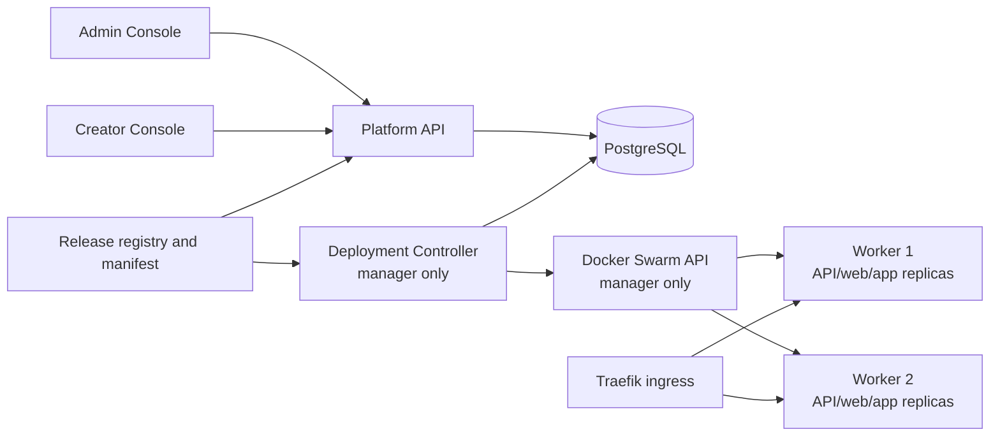
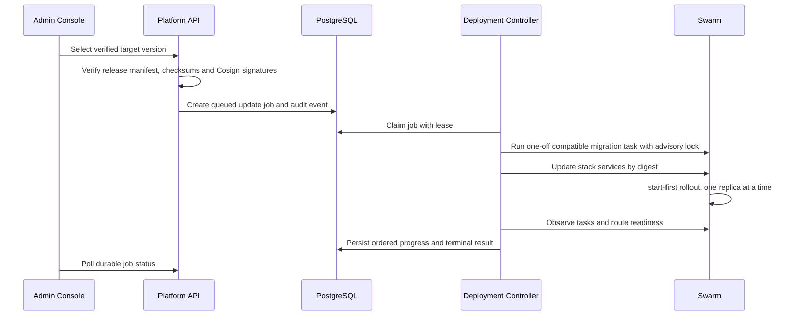
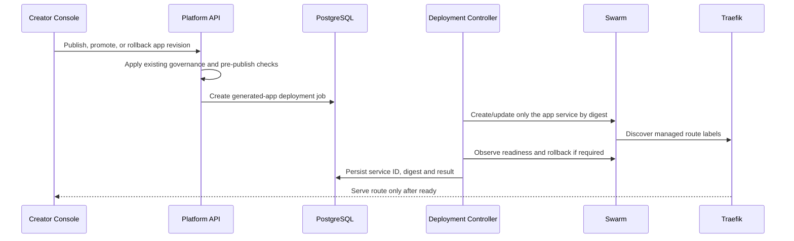

# Docker Swarm Platform and Generated-App Deployment Design

**Date:** 2026-07-11  
**Issue:** #125  
**Status:** Approved for planning

## Goal

Run EVCP production on a one-manager/two-worker Docker Swarm while retaining Docker Compose for local development. An administrator can select a verified EVCP release and update it from the Admin Console; Creator publish/update/rollback deploys each generated application as an independent Swarm service.

## Decisions

- `docker/docker-compose.yml` remains the local-development runtime. It must not require Swarm initialization or a registry.
- Production uses a new `docker/docker-stack.yml`, deployed as the `evcp` stack. Images are manifest-pinned as `repository@sha256:<digest>`; a tag is display metadata only.
- GitHub Release assets and the existing Cosign image signing workflow remain the release authority. A v2 release manifest records immutable image references, asset checksums, migration compatibility and minimum controller version.
- A manager-constrained Deployment Controller is the only component allowed to mutate Docker Swarm. The browser and Platform API never receive a Docker socket path, Docker credentials, arbitrary image coordinates, arbitrary service names, or Docker CLI capability.
- PostgreSQL is the source of truth for platform update jobs, generated-app deployment jobs, ordered job steps, lease ownership, target/previous digest and redacted failure evidence. Controller restarts resume/observe a job rather than creating a second deployment.
- Platform releases and generated-app releases are independent. `docker stack deploy` is reserved for EVCP platform releases. A generated app only creates or updates its own `evcp-app-<app-key>-<environment>` service.
- Production ingress changes from static Caddy routing to Traefik Swarm discovery. Traefik consumes managed service labels and exposes generated apps only after readiness. Compose/Caddy remains available for local development.

## Topology

- The manager runs the controller and stateful services pinned by placement constraint. It remains a control-plane and stateful-data failure domain; this topology does not claim manager HA.
- Stateless platform services run two replicas on workers where resources permit. Traefik runs two worker replicas behind an organisation-provided L4 load balancer/VIP.
- `evcp-public` and `evcp-internal` are encrypted overlay networks. No generated app publishes a host port. Traefik is the only public entrypoint.
- Secrets are Swarm secrets, never labels, environment-file values, job payloads, audit metadata, or UI logs. Non-secret static configuration uses Swarm configs.

## Platform Update Flow

The Admin Update Center lists current and available releases, digest/signature evidence, changelog, migration classification, active-job progress, history and a rollback action. It only submits a selected verified release ID plus an idempotency key. A requested rollback is limited to a retained, verified prior digest and requires an auditable reason.

Platform services use two replicas, `parallelism: 1`, `order: start-first`, `monitor: 60s`, `failure_action: rollback`, `max_failure_ratio: 0`, a restart policy, liveness `/health`, and dependency readiness `/ready`. A job is successful only after Swarm task state and route-level readiness both pass.

Database migration is a one-off manager-pinned task using the target image and a Postgres advisory lock. Migrations must be expand/contract and backward compatible. The normal Platform API startup must not run migration or seed. The controller never auto-reverses a database schema; it rolls application images back while retaining a compatible schema. Destructive migrations require a separate approved maintenance procedure and a verified backup.

## Generated-App Flow

Before deployment, the generated app image is built, scanned, signed, pushed to the configured registry and resolved to a digest. Its Swarm service receives deterministic managed labels, two replicas by default, resource limits, its app/schema-scoped secret reference, `start-first` rolling update and rollback configuration. A failed revision rolls back only that service to its recorded previous healthy digest; platform services and other apps remain unchanged.

Existing project authorization, PRD/policy checks, publish registry and audit history remain mandatory. Deployment records are extended with Swarm service identity, image digest, desired/observed revision, readiness time, rollback predecessor and redacted failure reason. The existing raw-container deployment implementation remains local/development-only until the Swarm adapter is active.

## API and Persistence Contracts

Admin-only endpoints:

- `GET /admin/platform-releases`
- `POST /admin/platform-update-jobs` with `{ targetVersion, idempotencyKey, scheduledAt? }`
- `GET /admin/platform-update-jobs/:jobId`
- `POST /admin/platform-update-jobs/:jobId/rollback` with `{ idempotencyKey, reason }`

Creator publishing changes from a synchronous local-container response to a `202 Accepted` deployment job. Deployment history and app rollback endpoints expose only verified historical revisions for the same app/environment.

New persisted concepts are `PlatformRelease`, `PlatformUpdateJob`, `DeploymentJob` and `DeploymentJobStep`. Jobs have idempotency keys, a controller lease/heartbeat, ordered redacted steps and terminal states: `queued`, `verifying`, `migrating`, `rolling_out`, `verifying_health`, `succeeded`, `failed`, `rolled_back`.

`SwarmControlPort` is intentionally narrow: run a migration task, deploy a verified platform release, create/update a verified app service, inspect managed service/tasks and roll a managed resource back to a verified predecessor. Its Docker adapter may call the Engine Swarm endpoints only for labelled EVCP resources.

## Safety and Recovery

- Fail before mutation if a manifest, checksum, signature, image digest, release origin, compatibility check or migration dry-run is invalid.
- Pull/resolve all platform images before rollout and preserve the prior verified release in the job record.
- Controller leases prevent concurrent/repeated deployment actions. Retried jobs observe or resume from persisted state.
- Logs, errors, audit metadata and API responses are redacted. Docker daemon responses and secrets never reach UI clients.
- Back up PostgreSQL, MinIO artifacts, Keycloak configuration and release evidence before any approved non-compatible maintenance operation.
- Worker replica availability does not protect manager/stateful storage failure. The operations runbook must cover manager restore/rejoin, registry outage, backup restore and a non-production rollback drill.

## Verification

- Unit tests cover manifest/digest/signature gates, admin authorization/idempotency, controller lease recovery, Swarm service spec construction, migration policy, health rollback, app-service isolation and no-secret/no-socket exposure.
- Integration tests parse the stack, release workflow and installer contracts; mock Docker Engine Swarm endpoints; validate Traefik routes and both migration compatibility paths.
- E2E tests run only on disposable manager/worker-capable infrastructure: Admin upgrade success/rollback, Creator independent app publish/update rollback, reconnect-safe progress and browser isolation from Docker APIs.
- Existing local Compose, workspace and publish flows remain regression-tested; standard developer tests do not require a live Swarm.

## Out of Scope

- Three-manager control-plane HA, replicated stateful storage, automatic database schema down-migrations and arbitrary third-party Docker workloads.
- A browser or general-purpose API for Docker/Swarm commands.
- Migrating old standalone generated-app containers in place. Existing apps are republished to signed registry images or retained as historical evidence.
