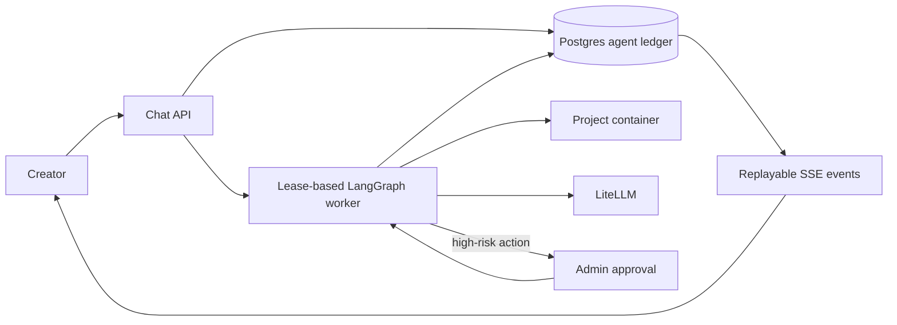

# Durable LangGraph Vibe Coder Design

## Goal

Make Horizon's server-side Vibe Coder durable across Platform API and workspace restarts while preserving the existing chat, artifact streaming, container action execution, commit, and preview experience.

## Scope

The feature adds persistent conversations, messages, agent runs, actions, approval decisions, ordered progress events, and LangGraph checkpoints. The agent remains a code-generating Vibe Coder: it loads project context, streams an LLM response, parses artifacts, executes one server-container action at a time, validates, commits, and reports progress.

The feature does not move execution to the browser, replace the existing artifact protocol, change project-container isolation, or introduce a separate queue service in the first release.

## Architecture

LangGraph is the server-side orchestration layer. A graph thread uses the durable agent-run ID as its `thread_id`. In Prisma mode, `@langchain/langgraph-checkpoint-postgres` checkpoints JSON-serializable graph state after every node. In memory mode, an in-memory checkpointer and repository preserve deterministic tests.

Postgres domain records are the business and audit read model; LangGraph checkpoints are opaque recovery state. The browser only consumes an SSE stream and reconnects using a run ID and event cursor. It never owns execution or authoritative agent state.

## Durable Data Model

- `AgentConversation`: a project-scoped thread with title, creator, and timestamps.
- `AgentMessage`: append-only user, assistant, and system messages associated with a conversation and, when applicable, an agent run.
- `AgentRun`: one invocation of the graph with its LangGraph thread ID, guarded state, graph schema version, worker lease, retry timing, and terminal outcome.
- `AgentAction`: an ordered action ledger with a unique `(agentRunId, actionIndex)` key, input fingerprint, status, attempt count, result/error, and before/after Git SHA.
- `AgentApproval`: immutable request/decision evidence for one pending action fingerprint.
- `AgentRunEvent`: ordered, replayable event ledger containing the existing streaming payloads plus run status, retry, and approval events.

The models relate to `Project` and the initiating/approving `PlatformUser`. They are additive; existing `WorkspaceTask`, migration, checkpoint, and audit models are not repurposed.

## Graph Behaviour

The graph is:

`load_context → generate_artifact → parse_actions → risk_gate → execute_next_action → validate → commit_checkpoint → complete`

`execute_next_action` processes exactly one action per invocation. It loops to itself while parsed actions remain. A retryable failure routes to `retry`; a non-retryable failure routes to `failed`. A high-risk action calls LangGraph `interrupt()`, creates an approval request, and puts the run in `waiting_approval`. Approval resumes the same thread; rejection produces a terminal rejected result without replaying completed actions.

The graph reuses the current message parser, context selector, system prompts, action runner, file readers, migration runner, and container Git committer. It replaces the in-process `runTurn` lifecycle with a durable facade and worker without changing normal file/edit/safe-shell Vibe Coder behaviour.

## State, Recovery, and Idempotency

Run states are `queued`, `running`, `waiting_approval`, `retrying`, `completed`, `failed`, `cancelled`, and `interrupted`. Action states are `pending`, `running`, `succeeded`, `failed`, and `skipped`.

A lease-based worker atomically claims queued or recoverable runs. Each action is claimed transactionally before execution. On recovery, completed actions are skipped. An action recorded as running is reconciled with its action fingerprint and expected Git state; it is retried only when no completion evidence exists. A destructive migration or shell command is never automatically retried unless it has an explicit idempotent completion probe.

Retries have both per-action and per-run limits, exponential backoff, classified retryability, and persisted attempt evidence. A stale lease is recoverable without losing the graph thread.

## Approval Policy

The initial policy requires an `admin` to approve production publish/deploy, destructive or irreversible migrations, secret or credential changes, and policy-matched shell commands. File edits, file creation, non-destructive migration preparation, and safe shell commands remain automatic.

An approval stores the requested action fingerprint, the admin decision, comment, timestamp, and outcome. The approval endpoint verifies project membership, role, pending run status, and fingerprint before resuming a graph, so a stale approval cannot authorize a changed action.

## API and UI Contract

`POST /projects/:projectId/chat` accepts a prompt, agent mode, attachment IDs, optional conversation ID, and optional idempotency key. It creates or returns a single durable run and streams its events. Existing `token`, `action_start`, `action_result`, `commit`, `error`, and `done` event shapes remain supported. New `run_status`, `retrying`, and `approval_required` events include `runId` and monotonic sequence.

`GET /projects/:projectId/conversations/:conversationId` restores messages and the latest run summary. `GET /projects/:projectId/runs/:runId/events?after=<sequence>` replays durable events before tailing live progress. `POST /projects/:projectId/runs/:runId/approval` accepts `approve` or `reject` plus an optional comment and expected pending-action fingerprint.

The Creator Workspace retains the present chat presentation and action cards, restores the selected conversation/latest run on load, reconnects after a dropped SSE stream, and presents approve/reject controls only when the logged-in user has permission.

## Security and Privacy

Secrets must never enter graph state, message records, checkpoint payloads, audit metadata, SSE events, or error logs. The graph stores identifiers, references, summaries, and fingerprints; large action bodies and tool output are permission-scoped records. Existing project membership checks apply to every conversation, run, event, and approval route. All state transitions and approval decisions are audit logged.

## Package and Runtime Requirements

Add compatible, pinned versions of `@langchain/langgraph`, `@langchain/core`, `@langchain/langgraph-checkpoint-postgres`, `zod`, and `pg` to the Platform API package. Use a dedicated generation composition module rather than expanding `app-factory.ts`. LangGraph checkpoint table setup is executed through a controlled migration/setup step and verified during startup in Prisma mode.

The feature flag `EVCP_AGENT_LOOP=legacy|langgraph` defaults to `legacy`. Memory mode uses no external Postgres connection. Prisma mode requires the database checkpointer and durable repositories to initialize successfully before LangGraph mode accepts runs.

## Testing and Rollout

Unit tests cover graph routing, policy classification, action idempotency, retry bounds, event ordering, approval verification, and memory-mode behaviour. Integration tests cover Prisma persistence, restart recovery, SSE replay, authorization, and concurrent worker claims. An end-to-end flow verifies that a Vibe Coder prompt writes a file, validates, commits, refreshes preview, survives a restart, and resumes a pending approved action.

Roll out in memory-mode tests, Prisma staging, then production behind `EVCP_AGENT_LOOP=langgraph`. On rollback, disable LangGraph for new prompts, retain all records/checkpoints, mark in-flight LangGraph runs `interrupted`, and require an explicit retry. The schema migration is additive and is never rolled back by dropping data.
