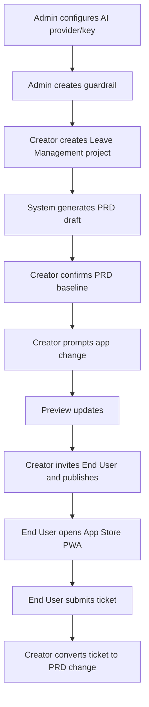
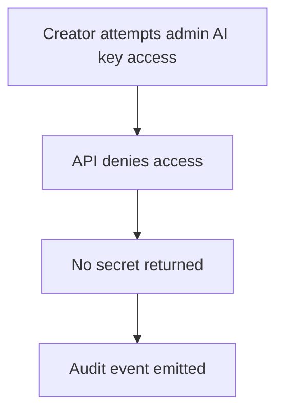
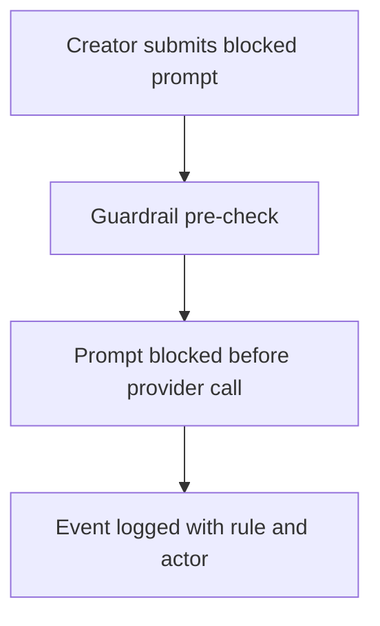
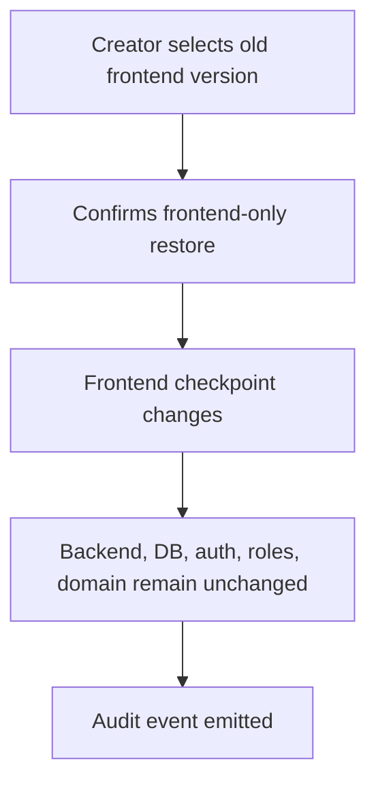

# Enterprise Vibe Coding Platform - MVP Test Strategy

Version: 0.1
Date: 2026-07-03
Status: Ready for MVP implementation
Scope: Sprint 0-8 MVP plus production-extension readiness signals

## 1. Purpose

เอกสารนี้กำหนดแนวทาง testing สำหรับ Enterprise Vibe Coding Platform MVP เพื่อให้ทีมรู้ว่าต้องทดสอบอะไร, ใช้ test level ไหน, เก็บ evidence อะไร และมี quality gate อะไรก่อนถือว่างานแต่ละ sprint ผ่าน

เอกสารนี้ทำงานร่วมกับ:

- `docs/requirements/requirements-traceability-matrix.md`
- `docs/planning/sprint-0-plan.md` through `docs/planning/sprint-8-plan.md`
- `docs/design/sprint-0-ui-spec.md` through `docs/design/sprint-8-ui-spec.md`

## 2. Testing Principles

| Principle | Requirement |
| --- | --- |
| Risk-based testing | Prioritize auth, access control, AI key secrecy, guardrail, publish, data isolation and ticket-to-PRD traceability |
| Test pyramid | Unit tests for logic, integration tests for APIs/data, E2E tests for critical user journeys |
| Evidence-driven acceptance | Every sprint must produce test output, screenshots, API responses, audit events or demo recordings where applicable |
| Negative tests required | Every protected/security-sensitive path must include at least one deny/block/error case |
| Mock-first but contract-safe | MVP may use mock AI/generated apps, but API/manifest/auth contracts must remain stable |
| Regression grows every sprint | Sprint N must keep previous sprint core flow passing |

## 3. Test Levels

| Level | Purpose | Examples | Owner |
| --- | --- | --- | --- |
| Unit | Validate isolated logic and helpers | response envelope, guardrail matcher, routing resolver, quota calculation, permission helper | Engineer |
| Component/UI | Validate reusable UI behavior | Button, Table, Modal, Tabs, AppCard, PromptProgress, TicketForm | Frontend Engineer |
| API Integration | Validate API + database behavior | project create, PRD baseline, provider/key CRUD, ticket create, publish record | Backend/Full-stack |
| Contract | Validate shared interfaces | API response envelope, app manifest, provider adapter, generated app route contract | Platform |
| E2E | Validate user journeys across surfaces | Admin config -> Creator publish -> End User ticket -> Creator PRD change | QA/Engineer |
| Accessibility | Validate keyboard, labels, focus and status indicators | forms, modals, tabs, PWA ticket flow | Frontend/QA |
| Visual/Screenshot | Validate shell/layout states | Admin dashboard, Creator workspace, Store PWA mobile | Frontend/QA |
| Security | Validate deny paths and secret handling | no API key exposure, RBAC deny, guardrail block, app visibility | Security/Engineer |
| Operational | Validate private-server operations | health, backup, restore, upgrade, rollback, license in later sprints | DevOps/Platform |

## 4. MVP Quality Gates

### 4.1 Per Pull Request

- [ ] Linked requirement/backlog/test IDs are referenced.
- [ ] Unit/component tests added for changed logic/UI.
- [ ] Protected API routes include authorization tests.
- [ ] Secret-bearing fields are masked/redacted in UI/API/log tests.
- [ ] Audit event tests added for security-sensitive actions.
- [ ] Build, typecheck, lint and test commands pass.

### 4.2 Per Sprint

- [ ] Sprint plan Definition of Done passes.
- [ ] Sprint UI spec acceptance criteria pass where UI exists.
- [ ] RTM test cases touched by sprint are executed or explicitly marked not applicable for MVP mock scope.
- [ ] Regression smoke test from prior MVP flow passes.
- [ ] Screenshot/API/audit evidence is captured for demo-critical behavior.

### 4.3 MVP Release Candidate After Sprint 8

- [ ] Full MVP E2E demo passes.
- [ ] All Sprint 0-8 P0 acceptance criteria pass.
- [ ] RTM P0 MVP-related test cases pass or have approved exception.
- [ ] Security deny-path tests pass for API keys, RBAC, guardrail and app visibility.
- [ ] UX acceptance evidence exists for Admin, Creator and Store PWA critical screens.
- [ ] Traceability evidence links ticket -> PRD change -> frontend/deployment state.

## 5. Critical Test Journeys

### 5.1 MVP Happy Path

### 5.2 Governance Negative Path

### 5.3 Guardrail Negative Path

### 5.4 Frontend Restore Boundary Path

## 6. Coverage Targets

These are MVP targets, not final production guarantees.

| Area | Target |
| --- | --- |
| Shared packages | Unit tests for exported helpers and components used by apps |
| API response/error contract | 100% contract behavior covered |
| Auth/RBAC guards | Every protected API group has allow and deny tests |
| AI key handling | Save/mask/rotate/deny tests for API and UI |
| Guardrail | Allow, warn, block and event logging tests |
| PRD lifecycle | Create draft, confirm baseline, version, change request tests |
| Creator workspace | Prompt accepted, blocked, task progress and preview update tests |
| Frontend restore | Boundary test proving non-frontend areas unchanged |
| App Store visibility | My Apps/Available Apps permission matrix tests |
| Ticket-to-PRD | E2E or integration test linking ticket to PRD change |
| Accessibility | Basic keyboard/label/focus checks for forms/modals/tabs |

## 7. Test Evidence Model

| Evidence Type | When Required |
| --- | --- |
| Command output | Build/typecheck/lint/unit/integration tests |
| API response | API contract, auth, guardrail, publish, ticket tests |
| DB record/query | Audit, PRD version, ticket, deployment, membership tests |
| Screenshot | UI acceptance, PWA layout, workspace, dashboard |
| Audit event | Login/auth, denied access, AI key change, guardrail, publish, restore, ticket-to-PRD |
| Demo script result | Sprint demo and Sprint 8 MVP acceptance |

## 8. Tooling Recommendation

| Area | Recommended Tooling |
| --- | --- |
| Unit tests | Vitest for shared packages and frontend logic; Jest or Vitest for backend if compatible with NestJS setup |
| Component tests | React Testing Library |
| API integration | Supertest or equivalent NestJS HTTP testing |
| E2E | Playwright |
| Accessibility | axe integration in Playwright/component tests |
| Visual evidence | Playwright screenshots for critical screens |
| Contract validation | JSON schema tests for response envelope and app manifest |

## 9. Known Test Gaps To Close During Implementation

| Gap | When To Close |
| --- | --- |
| Exact CI provider and workflow names | Sprint 0 |
| Exact package manager/test runner command names | Sprint 0 |
| Real external AI provider test strategy vs mocked provider | Sprint 2-4 |
| Test database lifecycle and seed reset approach | Sprint 1 |
| Screenshot baseline storage policy | Sprint 0-2 |
| Production backup/restore drill automation | Production extension Sprint 12 |
| Load/performance targets as executable checks | Production hardening |

